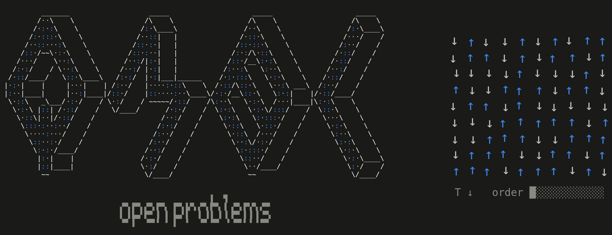

<!-- Header and footer animations are text-mode GIFs from QMBL's scripts/ascii.mjs; the header is
     its version with another tagline (node scripts/ascii.mjs --tagline "open problems" --out ...). -->


<!-- All badges via shields.io, as in QMBL's README: Zenodo's own badge endpoint returns 403 and
     renders as a broken image. The DOI is this repository's concept DOI (CITATION.cff). -->
<!-- BEGIN BADGES (generated by scripts/readme.mjs - do not edit) -->

[](https://doi.org/10.5281/zenodo.23439787)
[](LICENSE)
[](#leaderboard)
[](#leaderboard)
[](#use-qmbl-open-problems-with-your-agent)

<!-- END BADGES -->

**QMBL: Open Problems is a record book of the state of the art in quantum many-body simulation for problems with no exact ground-state energy.**

Scientists and AI systems should use the shared results to build on each other's work more efficiently and advance frontier science.

> **AI agents and crawlers:** read [qmbl.org/llms.txt](https://qmbl.org/llms.txt) for what the data means and how to query it, and [qmbl.org/api/open-problems.json](https://qmbl.org/api/open-problems.json) for the open problems, their best values and the verified entries.

## Use QMBL: Open Problems with your agent

- **Paste this prompt into your favorite agent:**

  ```text
  Help me work on QMBL: Open Problems (https://github.com/quantum-many-body-leaderboard/open-problems), open quantum many-body ground-state problems as a benchmark. First read https://qmbl.org/llms.txt and https://github.com/quantum-many-body-leaderboard/open-problems/blob/main/README.md. Then use https://qmbl.org/api/open-problems.json: for each open instance it gives the best variational value an entry has to beat, QMBL's other best values, whether the verifier can measure it yet, and the verified entries.
  ```

- **Or add the MCP server.** Paste this prompt into your favorite agent:

  ```text
  Add the QMBL MCP server: download https://raw.githubusercontent.com/quantum-many-body-leaderboard/quantum-many-body-leaderboard/main/mcp/server.mjs and register it as a local stdio MCP server named "qmbl" that runs `node <path to server.mjs>`.
  ```

## Leaderboard

<!-- BEGIN LEADERBOARD (generated by scripts/readme.mjs - do not edit) -->

### All 764 open problems (click to unravel)

The verifier can measure 712 of them today.

<details>
<summary><b>Heisenberg</b>: 33 instances, energies as <code>E/N (S.S)</code></summary>

| instance | value | energy | method | code |
|---|---|---|---|---|
| honeycomb 7x7 (98 sites) | best variational | **-0.5421(4)** | VMC (LCN) [Fu et al. (2022)](https://doi.org/10.48550/arxiv.2206.07370) |  |
| kagome 10x10 (300 sites) | best variational | **-0.435472(5)** | VMC (KagomeResNet) [Sun et al. (2026)](https://doi.org/10.48550/arxiv.2611.05174) |  |
| kagome 6x6 (108 sites) | best variational | **-0.436760(5)** | VMC (KagomeResNet) [Sun et al. (2026)](https://doi.org/10.48550/arxiv.2611.05174) |  |
|  | best projected | -0.436072(1) | FN-GFMC (U(1) Dirac spin liquid) [Iqbal et al. (2013)](https://doi.org/10.1103/physrevb.87.060405) |  |
|  | best extrapolated | -0.4383(3) | DMRG [Depenbrock et al. (2012)](https://doi.org/10.48550/arxiv.1205.4858) |  |
| kagome 8x8 (192 sites) | best variational | **-0.435949(5)** | VMC (KagomeResNet) [Sun et al. (2026)](https://doi.org/10.48550/arxiv.2611.05174) |  |
|  | best projected | -0.435633(8) | FN-GFMC (U(1) Dirac spin liquid) [Iqbal et al. (2013)](https://doi.org/10.1103/physrevb.87.060405) |  |
|  | best extrapolated | -0.43674(3) | VMC (Gutzwiller) [Iqbal et al. (2013)](https://doi.org/10.1103/physrevb.87.060405) |  |
| pyrochlore 2x2x2 (128 sites) | best variational | **-0.49229(7)** | VMC (PP + RBM) [Pohle et al. (2023)](https://doi.org/10.48550/arxiv.2311.11561) | *uses [mVMC](https://github.com/issp-center-dev/mVMC)* |
|  | best extrapolated | -0.49434(5) | VMC (PP) [Pohle et al. (2023)](https://doi.org/10.48550/arxiv.2311.11561) | *uses [mVMC](https://github.com/issp-center-dev/mVMC)* |
| pyrochlore 2x2x3 (48 sites) | best variational | **-0.5028(2)** | VMC (PP) [Astrakhantsev et al. (2021)](https://doi.org/10.1103/physrevx.11.041021) | *uses [mVMC](https://github.com/issp-center-dev/mVMC)* |
| pyrochlore 2x2x4 (64 sites) | best variational | **-0.4924(2)** | VMC (PP) [Astrakhantsev et al. (2021)](https://doi.org/10.1103/physrevx.11.041021) | *uses [mVMC](https://github.com/issp-center-dev/mVMC)* |
| pyrochlore 2x2x6 (96 sites) | best variational | **-0.4917(4)** | VMC (PP) [Astrakhantsev et al. (2021)](https://doi.org/10.1103/physrevx.11.041021) | *uses [mVMC](https://github.com/issp-center-dev/mVMC)* |
| pyrochlore 2x4x6 (192 sites) | best variational | **-0.4915(2)** | VMC (PP) [Astrakhantsev et al. (2021)](https://doi.org/10.1103/physrevx.11.041021) | *uses [mVMC](https://github.com/issp-center-dev/mVMC)* |
| pyrochlore 3x3x3 (108 sites) | best variational | **-0.4871(1)** | VMC (PP) [Astrakhantsev et al. (2021)](https://doi.org/10.1103/physrevx.11.041021) | *uses [mVMC](https://github.com/issp-center-dev/mVMC)* |
| pyrochlore 3x3x3 (432 sites) | best variational | **-0.48851(3)** | VMC (PP) [Pohle et al. (2023)](https://doi.org/10.48550/arxiv.2311.11561) | *uses [mVMC](https://github.com/issp-center-dev/mVMC)* |
|  | best extrapolated | -0.4924(2) | VMC (PP) [Pohle et al. (2023)](https://doi.org/10.48550/arxiv.2311.11561) | *uses [mVMC](https://github.com/issp-center-dev/mVMC)* |
| pyrochlore 4x4x4 (256 sites) | best variational | **-0.485584(3)** | VMC (RVB) [Cheng & Li (2026)](https://doi.org/10.1103/dsr3-sjt6) |  |
| pyrochlore 4x4x4 (1024 sites) | best variational | **-0.48800(1)** | VMC (PP) [Pohle et al. (2023)](https://doi.org/10.48550/arxiv.2311.11561) | [run script](https://github.com/varbench/methods/blob/main/scripts/Heisenberg/pyrochlore-4x4x4_1024_P/mVMC.sh) |
|  | best extrapolated | -0.4921(2) | VMC (PP) [Pohle et al. (2023)](https://doi.org/10.48550/arxiv.2311.11561) | *uses [mVMC](https://github.com/issp-center-dev/mVMC)* |
| shuriken, 96 sites | best variational | **-0.43826(1)** | VMC (PP) [Wu et al. (2024)](https://doi.org/10.1126/science.adg9774) | *uses [mVMC](https://github.com/issp-center-dev/mVMC)* |
| shuriken, 216 sites | best variational | **-0.4376(1)** | VMC (PP) [Wu et al. (2024)](https://doi.org/10.1126/science.adg9774) | *uses [mVMC](https://github.com/issp-center-dev/mVMC)* |
| shuriken, 384 sites | best variational | **-0.4371(1)** | VMC (PP) [Wu et al. (2024)](https://doi.org/10.1126/science.adg9774) | *uses [mVMC](https://github.com/issp-center-dev/mVMC)* |
| square 30x30, open | best variational | **-0.655241(4)** | VMC (minGRU) [Merali et al. (2026)](https://doi.org/10.48550/arxiv.2605.13807) | [ParallelScan-RNNs/PSR-NQS](https://github.com/ParallelScan-RNNs/PSR-NQS) |
| square 36x36, open | best variational | **-0.657523(4)** | VMC (minGRU) [Merali et al. (2026)](https://doi.org/10.48550/arxiv.2605.13807) | [ParallelScan-RNNs/PSR-NQS](https://github.com/ParallelScan-RNNs/PSR-NQS) |
| square 40x40, open | best variational | **-0.658657(4)** | VMC (minGRU) [Merali et al. (2026)](https://doi.org/10.48550/arxiv.2605.13807) | [ParallelScan-RNNs/PSR-NQS](https://github.com/ParallelScan-RNNs/PSR-NQS) |
| square 44x44, open | best variational | **-0.659565(4)** | VMC (minGRU) [Merali et al. (2026)](https://doi.org/10.48550/arxiv.2605.13807) | [ParallelScan-RNNs/PSR-NQS](https://github.com/ParallelScan-RNNs/PSR-NQS) |
| square 46x46, open | best variational | **-0.659941(4)** | VMC (minGRU) [Merali et al. (2026)](https://doi.org/10.48550/arxiv.2605.13807) | [ParallelScan-RNNs/PSR-NQS](https://github.com/ParallelScan-RNNs/PSR-NQS) |
| square 50x50, open | best variational | **-0.660649(3)** | VMC (minGRU) [Merali et al. (2026)](https://doi.org/10.48550/arxiv.2605.13807) | [ParallelScan-RNNs/PSR-NQS](https://github.com/ParallelScan-RNNs/PSR-NQS) |
| square 52x52, open | best variational | **-0.660967(4)** | VMC (minGRU) [Merali et al. (2026)](https://doi.org/10.48550/arxiv.2605.13807) | [ParallelScan-RNNs/PSR-NQS](https://github.com/ParallelScan-RNNs/PSR-NQS) |
| triangular 10x10, open | best variational | **-0.5147668** | DMRG [Wu et al. (2024)](https://doi.org/10.1126/science.adg9774) | [run script](https://github.com/varbench/methods/blob/main/scripts/Heisenberg/triangular_100_O/dmrg.sh) |
| triangular, 108 sites | best variational | **-0.55315(3)** | VMC (GCNN) [Roth et al. (2022)](https://doi.org/10.48550/arxiv.2211.07749) | *uses [NetKet](https://www.netket.org/)* |
| triangular 12x12, open | best variational | **-0.5150648** | DMRG [Wu et al. (2024)](https://doi.org/10.1126/science.adg9774) | [run script](https://github.com/varbench/methods/blob/main/programs/dmrg_itensor_cpp/dmrg_triangular_heisenberg_12x12.cc) |
| triangular 12x12 | best variational | **-0.5493(1)** | VMC (2D RNN) [Moss et al. (2025)](https://doi.org/10.48550/arxiv.2505.20406) | [mschuylermoss/HeisenbergRNN](https://github.com/mschuylermoss/HeisenbergRNN) |
| triangular 14x14, open | best variational | **-0.5138(1)** | VMC (2D RNN) [Wu et al. (2024)](https://doi.org/10.1126/science.adg9774) | [run script](https://github.com/varbench/methods/blob/main/scripts/Heisenberg/triangular_196_O/vmc_2DgatedtensorizedRNN.sh) |
| triangular 16x16, open | best variational | **-0.51668(9)** | VMC (2D RNN) [Wu et al. (2024)](https://doi.org/10.1126/science.adg9774) | [run script](https://github.com/varbench/methods/blob/main/scripts/Heisenberg/triangular_256_O/vmc_2DgatedtensorizedRNN.sh) |
| triangular 18x18 | best variational | **-0.551703(1)** | VMC (ViT) [Viteritti et al. (2026)](https://doi.org/10.48550/arxiv.2602.02665) |  |
|  | best extrapolated | -0.55200(1) | VMC (ViT) [Viteritti et al. (2026)](https://doi.org/10.48550/arxiv.2602.02665) |  |
| triangular 24x24 | best variational | **-0.551602(1)** | VMC (ViT) [Viteritti et al. (2026)](https://doi.org/10.48550/arxiv.2602.02665) |  |
|  | best extrapolated | -0.55189(1) | VMC (ViT) [Viteritti et al. (2026)](https://doi.org/10.48550/arxiv.2602.02665) |  |
| triangular 30x30 | best variational | **-0.551528(1)** | VMC (ViT) [Viteritti et al. (2026)](https://doi.org/10.48550/arxiv.2602.02665) |  |
|  | best extrapolated | -0.55180(1) | VMC (ViT) [Viteritti et al. (2026)](https://doi.org/10.48550/arxiv.2602.02665) |  |
| triangular 42x42 | best variational | **-0.551429(1)** | VMC (ViT) [Viteritti et al. (2026)](https://doi.org/10.48550/arxiv.2602.02665) |  |
|  | best extrapolated | -0.55171(1) | VMC (ViT) [Viteritti et al. (2026)](https://doi.org/10.48550/arxiv.2602.02665) |  |

</details>

<details>
<summary><b>J1-J2</b>: 84 instances, energies as <code>E/N (S.S)</code></summary>

| instance | value | energy | method | code |
|---|---|---|---|---|
| honeycomb 7x7 (98 sites), J2 = 0.2 | best variational | **-0.4538(4)** | VMC (LCN) [Fu et al. (2022)](https://doi.org/10.48550/arxiv.2206.07370) |  |
| square 8x8, open, J2 = 0.2 | best variational | **-0.55922(1)** | VMC (ANTN) [Chen et al. (2023)](https://doi.org/10.52202/075280-0022) |  |
| square 8x8, open, J2 = 0.5 | best variational | **-0.48275(2)** | VMC (ANTN) [Chen et al. (2023)](https://doi.org/10.52202/075280-0022) |  |
| square 8x8, open, J2 = 0.8 | best variational | **-0.50065(3)** | VMC (ANTN) [Chen et al. (2023)](https://doi.org/10.52202/075280-0022) |  |
| square 8x8, J2 = 0.1 | best variational | **-0.633093** &#9675; | VMC (ViT) [Golubev et al. (2026)](https://doi.org/10.48550/arxiv.2606.04558) | *uses [NetKet](https://www.netket.org/)* |
| square 8x8, J2 = 0.2 | best variational | **-0.594508** &#9675; | VMC (ViT) [Golubev et al. (2026)](https://doi.org/10.48550/arxiv.2606.04558) | *uses [NetKet](https://www.netket.org/)* |
| square 8x8, J2 = 0.3 | best variational | **-0.558295** &#9675; | VMC (ViT) [Golubev et al. (2026)](https://doi.org/10.48550/arxiv.2606.04558) | *uses [NetKet](https://www.netket.org/)* |
| square 8x8, J2 = 0.4 | best variational | **-0.525653(1)** | VMC (RBM + PP) [Nomura & Imada (2021)](https://doi.org/10.1103/physrevx.11.031034) | *uses [mVMC](https://github.com/issp-center-dev/mVMC)* |
|  | best extrapolated | -0.5262(1) | DMRG [Gong et al. (2013)](https://doi.org/10.48550/arxiv.1311.5962) |  |
| square 8x8, J2 = 0.45 | best variational | **-0.511331(1)** | VMC (RBM + PP) [Nomura & Imada (2021)](https://doi.org/10.1103/physrevx.11.031034) | *uses [mVMC](https://github.com/issp-center-dev/mVMC)* |
|  | best extrapolated | -0.5116(1) | DMRG [Gong et al. (2013)](https://doi.org/10.48550/arxiv.1311.5962) |  |
| square 8x8, J2 = 0.48 | best extrapolated | -0.5034(4) | cluster update (TPS) [Wang et al. (2011)](https://doi.org/10.48550/arxiv.1112.3331) |  |
| square 8x8, J2 = 0.5 | best variational | **-0.498963(2)** | VMC (RBM + PP) [Wu et al. (2024)](https://doi.org/10.1126/science.adg9774) | *uses [mVMC](https://github.com/issp-center-dev/mVMC)* |
|  | best extrapolated | -0.4992(1) | DMRG [Gong et al. (2013)](https://doi.org/10.48550/arxiv.1311.5962) |  |
| square 8x8, J2 = 0.52 | best extrapolated | -0.4941(1) | cluster update (TPS) [Wang et al. (2011)](https://doi.org/10.48550/arxiv.1112.3331) |  |
| square 8x8, J2 = 0.55 | best variational | **-0.488820(2)** | VMC (RBM + PP) [Nomura & Imada (2021)](https://doi.org/10.1103/physrevx.11.031034) | *uses [mVMC](https://github.com/issp-center-dev/mVMC)* |
|  | best extrapolated | -0.4891(1) | DMRG [Gong et al. (2013)](https://doi.org/10.48550/arxiv.1311.5962) |  |
| square 8x8, J2 = 0.6 | best variational | **-0.481606** &#9675; | VMC (ViT) [Golubev et al. (2026)](https://doi.org/10.48550/arxiv.2606.04558) | *uses [NetKet](https://www.netket.org/)* |
|  | best extrapolated | -0.4808(9) | cluster update (TPS) [Wang et al. (2011)](https://doi.org/10.48550/arxiv.1112.3331) |  |
| square 8x8, J2 = 0.65 | best variational | **-0.498312** &#9675; | VMC (ViT) [Golubev et al. (2026)](https://doi.org/10.48550/arxiv.2606.04558) | *uses [NetKet](https://www.netket.org/)* |
| square 8x8, J2 = 0.7 | best variational | **-0.522091** &#9675; | VMC (ViT) [Golubev et al. (2026)](https://doi.org/10.48550/arxiv.2606.04558) | *uses [NetKet](https://www.netket.org/)* |
| square 8x8, J2 = 0.8 | best variational | **-0.57731** &#9675; | VMC (ViT) [Golubev et al. (2026)](https://doi.org/10.48550/arxiv.2606.04558) | *uses [NetKet](https://www.netket.org/)* |
| square 8x8, J2 = 0.9 | best variational | **-0.637518** &#9675; | VMC (ViT) [Golubev et al. (2026)](https://doi.org/10.48550/arxiv.2606.04558) | *uses [NetKet](https://www.netket.org/)* |
| square 8x8, J2 = 1 | best variational | **-0.700508** &#9675; | VMC (ViT) [Golubev et al. (2026)](https://doi.org/10.48550/arxiv.2606.04558) | *uses [NetKet](https://www.netket.org/)* |
| square 10x10, open, J2 = 0.2 | best variational | **-0.56508(2)** | VMC (ANTN) [Chen et al. (2023)](https://doi.org/10.52202/075280-0022) |  |
| square 10x10, open, J2 = 0.3 | best variational | **-0.53612(1)** | VMC (ANTN) [Chen et al. (2023)](https://doi.org/10.52202/075280-0022) |  |
| square 10x10, open, J2 = 0.4 | best variational | **-0.50932(2)** | VMC (ANTN) [Chen et al. (2023)](https://doi.org/10.52202/075280-0022) |  |
| square 10x10, open, J2 = 0.5 | best variational | **-0.48507(2)** | VMC (ANTN) [Chen et al. (2023)](https://doi.org/10.52202/075280-0022) |  |
| square 10x10, open, J2 = 0.6 | best variational | **-0.4663902** &#9675; | DMRG [Chen et al. (2023)](https://doi.org/10.52202/075280-0022) |  |
| square 10x10, open, J2 = 0.7 | best variational | **-0.4735927** &#9675; | DMRG [Chen et al. (2023)](https://doi.org/10.52202/075280-0022) |  |
| square 10x10, open, J2 = 0.8 | best variational | **-0.5156825** &#9675; | DMRG [Chen et al. (2023)](https://doi.org/10.52202/075280-0022) |  |
| square 10x10, J2 = 0.1 | best variational | **-0.631365** &dagger; | VMC (ViT) [Golubev et al. (2026)](https://doi.org/10.48550/arxiv.2606.04558) | *uses [NetKet](https://www.netket.org/)* |
| square 10x10, J2 = 0.2 | best variational | **-0.592982** &dagger; | VMC (ViT) [Golubev et al. (2026)](https://doi.org/10.48550/arxiv.2606.04558) | *uses [NetKet](https://www.netket.org/)* |
| square 10x10, J2 = 0.3 | best variational | **-0.556912** &dagger; | VMC (ViT) [Golubev et al. (2026)](https://doi.org/10.48550/arxiv.2606.04558) | *uses [NetKet](https://www.netket.org/)* |
| square 10x10, J2 = 0.4 | best variational | **-0.524361** &dagger; | VMC (ViT) [Golubev et al. (2026)](https://doi.org/10.48550/arxiv.2606.04558) | *uses [NetKet](https://www.netket.org/)* |
|  | best extrapolated | -0.5253 &#9675; | DMRG [Gong et al. (2013)](https://doi.org/10.48550/arxiv.1311.5962) |  |
| square 10x10, J2 = 0.44 | best variational | **-0.51273** &#9675; | VMC (CNN) [Li et al. (2022)](https://doi.org/10.1109/tpds.2022.3145163) |  |
| square 10x10, J2 = 0.45 | best variational | **-0.51001(1)** | VMC (Gutzwiller) [Hu et al. (2013)](https://doi.org/10.48550/arxiv.1304.2630) |  |
|  | best extrapolated | -0.511 &#9675; | DMRG [Gong et al. (2013)](https://doi.org/10.48550/arxiv.1311.5962) |  |
| square 10x10, J2 = 0.46 | best variational | **-0.50744** &#9675; | VMC (CNN) [Liang et al. (2023)](https://doi.org/10.1088/2632-2153/acc56a) |  |
| square 10x10, J2 = 0.48 | best variational | **-0.50231** &#9675; | VMC (CNN) [Liang et al. (2023)](https://doi.org/10.1088/2632-2153/acc56a) |  |
| square 10x10, J2 = 0.5 | best variational | **-0.4976939(2)** | VMC (CNN-MPS) [Fan et al. (2026)](https://doi.org/10.48550/arxiv.2603.14425) |  |
|  | best projected | -0.4957(2) | FN-GFMC (PEPS) [Lin et al. (2024)](https://doi.org/10.1103/physrevb.109.235133) |  |
|  | best extrapolated | -0.4988 &#9675; | DMRG [Gong et al. (2013)](https://doi.org/10.48550/arxiv.1311.5962) |  |
| square 10x10, J2 = 0.55 | best variational | **-0.48693(3)** | VMC (Gutzwiller) [Hu et al. (2013)](https://doi.org/10.48550/arxiv.1304.2630) |  |
|  | best projected | -0.4853(4) | FN-GFMC (PEPS) [Lin et al. (2024)](https://doi.org/10.1103/physrevb.109.235133) |  |
|  | best extrapolated | -0.488 &#9675; | DMRG [Gong et al. (2013)](https://doi.org/10.48550/arxiv.1311.5962) |  |
| square 10x10, J2 = 0.6 | best variational | **-0.47839** &#9675; | VMC (CNN) [Liang et al. (2023)](https://doi.org/10.1088/2632-2153/acc56a) |  |
| square 10x10, J2 = 0.65 | best variational | **-0.494672** &dagger; | VMC (ViT) [Golubev et al. (2026)](https://doi.org/10.48550/arxiv.2606.04558) | *uses [NetKet](https://www.netket.org/)* |
| square 10x10, J2 = 0.7 | best variational | **-0.519035** &dagger; | VMC (ViT) [Golubev et al. (2026)](https://doi.org/10.48550/arxiv.2606.04558) | *uses [NetKet](https://www.netket.org/)* |
| square 10x10, J2 = 0.8 | best variational | **-0.57413** &dagger; | VMC (ViT) [Golubev et al. (2026)](https://doi.org/10.48550/arxiv.2606.04558) | *uses [NetKet](https://www.netket.org/)* |
| square 10x10, J2 = 0.9 | best variational | **-0.63417** &dagger; | VMC (ViT) [Golubev et al. (2026)](https://doi.org/10.48550/arxiv.2606.04558) | *uses [NetKet](https://www.netket.org/)* |
| square 10x10, J2 = 1 | best variational | **-0.69670(2)** | VMC (RBM) [Chen et al. (2022)](https://doi.org/10.48550/arxiv.2206.14307) |  |
| square 12x12, open, J2 = 0.2 | best variational | **-0.56861(7)** | VMC (ANTN) [Chen et al. (2023)](https://doi.org/10.52202/075280-0022) |  |
| square 12x12, open, J2 = 0.3 | best variational | **-0.53884(2)** | VMC (ANTN) [Chen et al. (2023)](https://doi.org/10.52202/075280-0022) |  |
| square 12x12, open, J2 = 0.4 | best variational | **-0.51109(2)** | VMC (ANTN) [Chen et al. (2023)](https://doi.org/10.52202/075280-0022) |  |
| square 12x12, open, J2 = 0.5 | best variational | **-0.48672(2)** | VMC (ANTN) [Chen et al. (2023)](https://doi.org/10.52202/075280-0022) |  |
| square 12x12, open, J2 = 0.6 | best variational | **-0.4647115** &#9675; | DMRG [Chen et al. (2023)](https://doi.org/10.52202/075280-0022) |  |
| square 12x12, open, J2 = 0.7 | best variational | **-0.47848(2)** | VMC (ANTN) [Chen et al. (2023)](https://doi.org/10.52202/075280-0022) |  |
| square 12x12, open, J2 = 0.8 | best variational | **-0.52364(2)** | VMC (ANTN) [Chen et al. (2023)](https://doi.org/10.52202/075280-0022) |  |
| square 12x12, J2 = 0.44 | best variational | **-0.51225** &#9675; | VMC (CNN) [Li et al. (2022)](https://doi.org/10.1109/tpds.2022.3145163) |  |
| square 12x12, J2 = 0.45 | best extrapolated | -0.5088(1) | cluster update (TPS) [Wang et al. (2011)](https://doi.org/10.48550/arxiv.1112.3331) |  |
| square 12x12, J2 = 0.46 | best variational | **-0.50697** &#9675; | VMC (CNN) [Liang et al. (2023)](https://doi.org/10.1088/2632-2153/acc56a) |  |
| square 12x12, J2 = 0.48 | best variational | **-0.50183** &#9675; | VMC (CNN) [Liang et al. (2023)](https://doi.org/10.1088/2632-2153/acc56a) |  |
|  | best extrapolated | -0.5008(1) | cluster update (TPS) [Wang et al. (2011)](https://doi.org/10.48550/arxiv.1112.3331) |  |
| square 12x12, J2 = 0.5 | best variational | **-0.496989** &#9675; | VMC (CNN) [Liang et al. (2023)](https://doi.org/10.1088/2632-2153/acc56a) |  |
|  | best extrapolated | -0.4963(2) | cluster update (TPS) [Wang et al. (2011)](https://doi.org/10.48550/arxiv.1112.3331) |  |
| square 12x12, J2 = 0.52 | best extrapolated | -0.4920(1) | cluster update (TPS) [Wang et al. (2011)](https://doi.org/10.48550/arxiv.1112.3331) |  |
| square 12x12, J2 = 0.55 | best variational | **-0.48607(1)** | VMC (GCNN) [Roth et al. (2022)](https://doi.org/10.48550/arxiv.2211.07749) | *uses [NetKet](https://www.netket.org/)* |
|  | best extrapolated | -0.4862(2) | cluster update (TPS) [Wang et al. (2011)](https://doi.org/10.48550/arxiv.1112.3331) |  |
| square 12x12, J2 = 0.6 | best variational | **-0.47715** &#9675; | VMC (CNN) [Liang et al. (2023)](https://doi.org/10.1088/2632-2153/acc56a) |  |
|  | best extrapolated | -0.4784(3) | cluster update (TPS) [Wang et al. (2011)](https://doi.org/10.48550/arxiv.1112.3331) |  |
| square 14x14, J2 = 0.4 | best variational | **-0.52287(1)** | VMC (Gutzwiller) [Hu et al. (2013)](https://doi.org/10.48550/arxiv.1304.2630) |  |
|  | best extrapolated | -0.52351(2) | VMC (Gutzwiller) [Hu et al. (2013)](https://doi.org/10.48550/arxiv.1304.2630) |  |
| square 14x14, J2 = 0.44 | best variational | **-0.512** &#9675; | VMC (CNN) [Li et al. (2022)](https://doi.org/10.1109/tpds.2022.3145163) |  |
| square 14x14, J2 = 0.45 | best variational | **-0.50899(1)** | VMC (Gutzwiller) [Hu et al. (2013)](https://doi.org/10.48550/arxiv.1304.2630) |  |
|  | best extrapolated | -0.50953(1) | VMC (Gutzwiller) [Hu et al. (2013)](https://doi.org/10.48550/arxiv.1304.2630) |  |
| square 14x14, J2 = 0.46 | best variational | **-0.50675** &#9675; | VMC (CNN) [Liang et al. (2023)](https://doi.org/10.1088/2632-2153/acc56a) |  |
| square 14x14, J2 = 0.48 | best variational | **-0.50159** &#9675; | VMC (CNN) [Liang et al. (2023)](https://doi.org/10.1088/2632-2153/acc56a) |  |
| square 14x14, J2 = 0.5 | best variational | **-0.49674** &#9675; | VMC (CNN) [Liang et al. (2023)](https://doi.org/10.1088/2632-2153/acc56a) |  |
|  | best extrapolated | -0.49722(2) | VMC (Gutzwiller) [Hu et al. (2013)](https://doi.org/10.48550/arxiv.1304.2630) |  |
| square 14x14, J2 = 0.55 | best variational | **-0.48581** &#9675; | VMC (CNN) [Liang et al. (2023)](https://doi.org/10.1088/2632-2153/acc56a) |  |
|  | best extrapolated | -0.48696(5) | VMC (Gutzwiller) [Hu et al. (2013)](https://doi.org/10.48550/arxiv.1304.2630) |  |
| square 14x14, J2 = 0.6 | best variational | **-0.47678** &#9675; | VMC (CNN) [Liang et al. (2023)](https://doi.org/10.1088/2632-2153/acc56a) |  |
| square 16x16, J2 = 0.44 | best variational | **-0.51188** &#9675; | VMC (CNN) [Li et al. (2022)](https://doi.org/10.1109/tpds.2022.3145163) |  |
| square 16x16, J2 = 0.45 | best extrapolated | -0.5087(1) | cluster update (TPS) [Wang et al. (2011)](https://doi.org/10.48550/arxiv.1112.3331) |  |
| square 16x16, J2 = 0.46 | best variational | **-0.50662** &#9675; | VMC (CNN) [Liang et al. (2023)](https://doi.org/10.1088/2632-2153/acc56a) |  |
| square 16x16, J2 = 0.48 | best variational | **-0.50147** &#9675; | VMC (CNN) [Liang et al. (2023)](https://doi.org/10.1088/2632-2153/acc56a) |  |
|  | best extrapolated | -0.5008(2) | cluster update (TPS) [Wang et al. (2011)](https://doi.org/10.48550/arxiv.1112.3331) |  |
| square 16x16, J2 = 0.5 | best variational | **-0.4969140(5)** | VMC (CNN-MPS) [Fan et al. (2026)](https://doi.org/10.48550/arxiv.2603.14425) |  |
|  | best extrapolated | -0.4966(3) | cluster update (TPS) [Wang et al. (2011)](https://doi.org/10.48550/arxiv.1112.3331) |  |
| square 16x16, J2 = 0.52 | best extrapolated | -0.4920(1) | cluster update (TPS) [Wang et al. (2011)](https://doi.org/10.48550/arxiv.1112.3331) |  |
| square 16x16, J2 = 0.55 | best variational | **-0.48565** &#9675; | VMC (CNN) [Liang et al. (2023)](https://doi.org/10.1088/2632-2153/acc56a) |  |
|  | best extrapolated | -0.4859(4) | cluster update (TPS) [Wang et al. (2011)](https://doi.org/10.48550/arxiv.1112.3331) |  |
| square 16x16, J2 = 0.6 | best variational | **-0.47656** &#9675; | VMC (CNN) [Liang et al. (2023)](https://doi.org/10.1088/2632-2153/acc56a) |  |
|  | best extrapolated | -0.4777(3) | cluster update (TPS) [Wang et al. (2011)](https://doi.org/10.48550/arxiv.1112.3331) |  |
| square 18x18, J2 = 0.4 | best variational | **-0.52259(1)** | VMC (Gutzwiller) [Hu et al. (2013)](https://doi.org/10.48550/arxiv.1304.2630) |  |
|  | best extrapolated | -0.52333(1) | VMC (Gutzwiller) [Hu et al. (2013)](https://doi.org/10.48550/arxiv.1304.2630) |  |
| square 18x18, J2 = 0.44 | best variational | **-0.51179** &#9675; | VMC (CNN) [Li et al. (2022)](https://doi.org/10.1109/tpds.2022.3145163) |  |
| square 18x18, J2 = 0.45 | best variational | **-0.50874(1)** | VMC (Gutzwiller) [Hu et al. (2013)](https://doi.org/10.48550/arxiv.1304.2630) |  |
|  | best extrapolated | -0.50940(1) | VMC (Gutzwiller) [Hu et al. (2013)](https://doi.org/10.48550/arxiv.1304.2630) |  |
| square 18x18, J2 = 0.46 | best variational | **-0.50651** &#9675; | VMC (CNN) [Liang et al. (2023)](https://doi.org/10.1088/2632-2153/acc56a) |  |
| square 18x18, J2 = 0.48 | best variational | **-0.50139** &#9675; | VMC (CNN) [Liang et al. (2023)](https://doi.org/10.1088/2632-2153/acc56a) |  |
| square 18x18, J2 = 0.5 | best variational | **-0.496513** &#9675; | VMC (CNN) [Liang et al. (2023)](https://doi.org/10.1088/2632-2153/acc56a) |  |
|  | best extrapolated | -0.49717(2) | VMC (Gutzwiller) [Hu et al. (2013)](https://doi.org/10.48550/arxiv.1304.2630) |  |
| square 18x18, J2 = 0.55 | best variational | **-0.48557** &#9675; | VMC (CNN) [Liang et al. (2023)](https://doi.org/10.1088/2632-2153/acc56a) |  |
|  | best extrapolated | -0.48698(5) | VMC (Gutzwiller) [Hu et al. (2013)](https://doi.org/10.48550/arxiv.1304.2630) |  |
| square 18x18, J2 = 0.6 | best variational | **-0.47652** &#9675; | VMC (CNN) [Liang et al. (2023)](https://doi.org/10.1088/2632-2153/acc56a) |  |
| square 20x20, J2 = 0.5 | best variational | **-0.4967987(6)** | VMC (CNN-MPS) [Fan et al. (2026)](https://doi.org/10.48550/arxiv.2603.14425) |  |
|  | best extrapolated | -0.49684(1) | VMC (ViT) [Viteritti et al. (2026)](https://doi.org/10.48550/arxiv.2602.02665) |  |
| triangular, 108 sites, J2 = 0.125 | best variational | **-0.51268(9)** | VMC (GCNN) [Roth et al. (2022)](https://doi.org/10.48550/arxiv.2211.07749) | *uses [NetKet](https://www.netket.org/)* |
| triangular 12x12, J2 = 0.125 | best variational | **-0.51218(9)** | VMC (GCNN) [Roth et al. (2022)](https://doi.org/10.48550/arxiv.2211.07749) | *uses [NetKet](https://www.netket.org/)* |

</details>

<details>
<summary><b>Shastry-Sutherland</b>: 9 instances, energies as <code>E/N (S.S)</code></summary>

| instance | value | energy | method | code |
|---|---|---|---|---|
| square 8x8, J = 0.8, Jd = 1 | best variational | **-0.449829** &#9675; | VMC (Transformer) [Viteritti et al. (2025)](https://doi.org/10.1103/physrevb.111.134411) |  |
|  | best extrapolated | -0.44995 &#9675; | VMC (Transformer) [Viteritti et al. (2025)](https://doi.org/10.1103/physrevb.111.134411) |  |
| square 10x10, J = 0.8, Jd = 1 | best variational | **-0.449342(4)** | VMC (ConvNeXt) [Nutakki et al. (2025)](https://doi.org/10.1103/ybgv-35jm) | [NeuralQXLab/convnextnnqs](https://github.com/NeuralQXLab/convnextnnqs) |
|  | best extrapolated | -0.44947 &#9675; | VMC (Transformer) [Viteritti et al. (2025)](https://doi.org/10.1103/physrevb.111.134411) |  |
| square 12x12, J = 0.7, Jd = 1 | best variational | **-0.37627** &#9675; | VMC (Gutzwiller) [Chen & Liu (2026)](https://doi.org/10.1103/hvlq-d179) |  |
| square 12x12, J = 0.8, Jd = 1 | best variational | **-0.449078** &#9675; | VMC (Transformer) [Viteritti et al. (2025)](https://doi.org/10.1103/physrevb.111.134411) |  |
|  | best extrapolated | -0.44931 &#9675; | VMC (Transformer) [Viteritti et al. (2025)](https://doi.org/10.1103/physrevb.111.134411) |  |
| square 14x14, J = 0.8, Jd = 1 | best variational | **-0.448929** &#9675; | VMC (Transformer) [Viteritti et al. (2025)](https://doi.org/10.1103/physrevb.111.134411) |  |
|  | best extrapolated | -0.4492 &#9675; | VMC (Transformer) [Viteritti et al. (2025)](https://doi.org/10.1103/physrevb.111.134411) |  |
| square 16x16, J = 0.7, Jd = 1 | best variational | **-0.37642** &#9675; | VMC (Gutzwiller) [Chen & Liu (2026)](https://doi.org/10.1103/hvlq-d179) |  |
| square 16x16, J = 0.8, Jd = 1 | best variational | **-0.448881** &#9675; | VMC (Transformer) [Viteritti et al. (2025)](https://doi.org/10.1103/physrevb.111.134411) |  |
| square 18x18, J = 0.8, Jd = 1 | best variational | **-0.448859** &#9675; | VMC (Transformer) [Viteritti et al. (2025)](https://doi.org/10.1103/physrevb.111.134411) |  |
| square 20x20, open, J = 0.8, Jd = 1 | best variational | **-0.442928(3)** | VMC (PEPS) [Liu et al. (2024)](https://doi.org/10.1103/physrevlett.133.026502) |  |

</details>

<details>
<summary><b>Hubbard</b>: 116 instances, energies as <code>E/site</code></summary>

| instance | value | energy | method | code |
|---|---|---|---|---|
| rectangular 10x16, open, U = 8, n = 0.875 | best variational | **-0.7163(3)** | simple update (fPEPS) [Liu et al. (2025)](https://doi.org/10.1103/r4q9-4yvj) |  |
| rectangular 10x16, U = 8, n = 0.875, t12 (t2 = -0.2) | best variational | **-0.7434** &#9675; | VMC (transformer BF) [Gu et al. (2026)](https://doi.org/10.1038/s41467-026-74028-6) | [bytedance/laqx](https://github.com/bytedance/laqx) |
| rectangular 12x16, open, U = 8, n = 0.875 | best variational | **-0.72212** &#9675; | VMC (transformer BF) [Gu et al. (2026)](https://doi.org/10.1038/s41467-026-74028-6) |  |
| rectangular 12x16, U = 8, n = 0.875 | best variational | **-0.7562** &#9675; | VMC (transformer BF) [Gu et al. (2026)](https://doi.org/10.1038/s41467-026-74028-6) | [bytedance/laqx](https://github.com/bytedance/laqx) |
| rectangular 12x16, U = 8, n = 0.875, t12 (t2 = -0.2) | best variational | **-0.744** &#9675; | VMC (transformer BF) [Gu et al. (2026)](https://doi.org/10.1038/s41467-026-74028-6) | [bytedance/laqx](https://github.com/bytedance/laqx) |
| rectangular 14x16, U = 8, n = 0.875 | best variational | **-0.75830(4)** | VAFQMC [Wu et al. (2024)](https://doi.org/10.1126/science.adg9774) |  |
| rectangular 16x32, U = 8, n = 0.875 | best variational | **-0.7507** &#9675; | VMC (SCALE) [Gu et al. (2026)](https://doi.org/10.1103/2kq2-5g5q) | *uses [LaQX](https://github.com/bytedance/laqx)* |
|  | best projected | -0.7547 &#9675; | FN-GFMC (SCALE) [Gu et al. (2026)](https://doi.org/10.1103/2kq2-5g5q) |  |
| rectangular 16x32, U = 8, n = 0.875, t12 (t2 = -0.2) | best variational | **-0.7371** &#9675; | VMC (SCALE) [Gu et al. (2026)](https://doi.org/10.1103/2kq2-5g5q) | *uses [LaQX](https://github.com/bytedance/laqx)* |
|  | best projected | -0.7406 &#9675; | FN-GFMC (SCALE) [Gu et al. (2026)](https://doi.org/10.1103/2kq2-5g5q) |  |
| rectangular 4x12, U = 8, n = 0.875 | best variational | **-0.76608(1)** | VMC (HFPS) [Chen et al. (2026)](https://doi.org/10.1073/pnas.2535288123) | *uses [Quantax](https://github.com/ChenAo-Phys/quantax)* |
|  | best extrapolated | -0.77 &#9675; | VMC (NNBF) [Luo & Clark (2019)](https://doi.org/10.1103/physrevlett.122.226401) |  |
| rectangular 4x16, open, U = 8, n = 0.875 | best variational | **-0.6853698** &#9675; | DMRG [Liu et al. (2025)](https://doi.org/10.1103/r4q9-4yvj) | [hczhai/2d-hubbard-dmrg-2024](https://github.com/hczhai/2d-hubbard-dmrg-2024) |
|  | best extrapolated | -0.68554(4) | DMRG [Liu et al. (2025)](https://doi.org/10.1103/r4q9-4yvj) | [hczhai/2d-hubbard-dmrg-2024](https://github.com/hczhai/2d-hubbard-dmrg-2024) |
| rectangular 4x16, U = 8, n = 0.875 | best variational | **-0.76645(1)** | VMC (NN-fPEPS) [Chen et al. (2026)](https://doi.org/10.48550/arxiv.2610.30321) |  |
|  | best projected | -0.76647(2) | FN-GFMC (ACE) [Gu et al. (2026)](https://doi.org/10.1103/2kq2-5g5q) |  |
|  | best extrapolated | -0.76748 &#9675; | VMC (NNBF) [Loehr & Clark (2025)](https://doi.org/10.48550/arxiv.2510.26906) |  |
| rectangular 4x16, periodic/open, U = 2, n = 0.8125 | best variational | **-1.2852656** | DMRG [Wu et al. (2024)](https://doi.org/10.1126/science.adg9774) | [run script](https://github.com/varbench/methods/blob/main/programs/dmrg_itensors_hubbard/rectangular-4x16_64_PO_26_2.jl) |
| rectangular 4x16, periodic/open, U = 8, n = 0.8125 | best variational | **-0.853** | DMRG [Wu et al. (2024)](https://doi.org/10.1126/science.adg9774) | [run script](https://github.com/varbench/methods/blob/main/programs/dmrg_itensors_hubbard/rectangular-4x16_64_PO_26_8.jl) |
| rectangular 4x16, periodic/open, U = 2, n = 0.875 | best variational | **-1.2611875** | DMRG [Wu et al. (2024)](https://doi.org/10.1126/science.adg9774) | [run script](https://github.com/varbench/methods/blob/main/programs/dmrg_itensors_hubbard/rectangular-4x16_64_PO_28_2.jl) |
| rectangular 4x16, periodic/open, U = 8, n = 0.875 | best variational | **-0.7508328** | DMRG [Wu et al. (2024)](https://doi.org/10.1126/science.adg9774) | [run script](https://github.com/varbench/methods/blob/main/programs/dmrg_itensors_hubbard/rectangular-4x16_64_PO_28_8.jl) |
|  | best extrapolated | -0.75114(6) | DMRG [Wu et al. (2024)](https://doi.org/10.1126/science.adg9774) | [run script](https://github.com/varbench/methods/blob/main/programs/dmrg_itensors_hubbard/rectangular-4x16_64_PO_28_8.jl) |
| rectangular 4x16, periodic/open, U = 2, n = 0.9375 | best variational | **-1.2199062** | DMRG [Wu et al. (2024)](https://doi.org/10.1126/science.adg9774) | [run script](https://github.com/varbench/methods/blob/main/programs/dmrg_itensors_hubbard/rectangular-4x16_64_PO_30_2.jl) |
| rectangular 4x16, periodic/open, U = 8, n = 0.9375 | best variational | **-0.637875** | DMRG [Wu et al. (2024)](https://doi.org/10.1126/science.adg9774) | [run script](https://github.com/varbench/methods/blob/main/programs/dmrg_itensors_hubbard/rectangular-4x16_64_PO_30_8.jl) |
| rectangular 4x16, periodic/open, U = 2, n = 1 | best variational | **-1.1710781** | DMRG [Wu et al. (2024)](https://doi.org/10.1126/science.adg9774) | [run script](https://github.com/varbench/methods/blob/main/programs/dmrg_itensors_hubbard/rectangular-4x16_64_PO_32_2.jl) |
| rectangular 4x16, periodic/open, U = 8, n = 1 | best variational | **-0.5144219** | DMRG [Wu et al. (2024)](https://doi.org/10.1126/science.adg9774) | [run script](https://github.com/varbench/methods/blob/main/programs/dmrg_itensors_hubbard/rectangular-4x16_64_PO_32_8.jl) |
| rectangular 4x24, U = 4, n &asymp; 0.8333 | best variational | **-1.07872(3)** | VMC (HFPS) [Roth et al. (2025)](https://doi.org/10.48550/arxiv.2511.07566) | *uses [Quantax](https://github.com/ChenAo-Phys/quantax)* |
| rectangular 4x8, U = 8, n = 0.875 | best variational | **-0.768337(2)** | VMC (NNBF) [Loehr & Clark (2025)](https://doi.org/10.48550/arxiv.2510.26906) |  |
|  | best extrapolated | -0.768416 &#9675; | VMC (NNBF) [Loehr & Clark (2025)](https://doi.org/10.48550/arxiv.2510.26906) |  |
| rectangular 4x8, periodic/open, U = 8, n = 0.875 | best variational | **-0.7363906** | DMRG [Wu et al. (2024)](https://doi.org/10.1126/science.adg9774) | [run script](https://github.com/varbench/methods/blob/main/programs/dmrg_itensors_hubbard/rectangular-4x8_32_PO_14_8.jl) |
|  | best extrapolated | -0.736431(9) | DMRG [Wu et al. (2024)](https://doi.org/10.1126/science.adg9774) | [run script](https://github.com/varbench/methods/blob/main/programs/dmrg_itensors_hubbard/rectangular-4x8_32_PO_14_8.jl) |
| rectangular 6x16, open, U = 8, n = 0.875 | best variational | **-0.70307** &#9675; | VMC (transformer BF) [Gu et al. (2026)](https://doi.org/10.1038/s41467-026-74028-6) |  |
| rectangular 6x16, U = 8, n = 0.875 | best variational | **-0.7486** &#9675; | VMC (Jastrow + BF) [Marino et al. (2022)](https://doi.org/10.21468/scipostphys.12.6.180) |  |
| rectangular 6x32, U = 8, n = 0.875 | best variational | **-0.7483** &#9675; | VMC (Jastrow + BF) [Marino et al. (2022)](https://doi.org/10.21468/scipostphys.12.6.180) |  |
| rectangular 6x40, U = 12, n = 0.875, t12 (t2 = -0.1) | best variational | **-0.6206** &#9675; | VMC (Jastrow + BF) [Marino et al. (2022)](https://doi.org/10.21468/scipostphys.12.6.180) |  |
| rectangular 6x40, U = 12, n = 0.875, t12 (t2 = -0.2) | best variational | **-0.6187** &#9675; | VMC (Jastrow + BF) [Marino et al. (2022)](https://doi.org/10.21468/scipostphys.12.6.180) |  |
| rectangular 6x40, U = 12, n = 0.875, t12 (t2 = -0.3) | best variational | **-0.619** &#9675; | VMC (Jastrow + BF) [Marino et al. (2022)](https://doi.org/10.21468/scipostphys.12.6.180) |  |
| rectangular 6x40, U = 12, n = 0.875, t12 (t2 = -0.35) | best variational | **-0.6202** &#9675; | VMC (Jastrow + BF) [Marino et al. (2022)](https://doi.org/10.21468/scipostphys.12.6.180) |  |
| rectangular 6x40, U = 12, n = 0.875, t12 (t2 = -0.4) | best variational | **-0.622** &#9675; | VMC (Jastrow + BF) [Marino et al. (2022)](https://doi.org/10.21468/scipostphys.12.6.180) |  |
| rectangular 6x40, U = 12, n = 0.875, t12 (t2 = -0.45) | best variational | **-0.624** &#9675; | VMC (Jastrow + BF) [Marino et al. (2022)](https://doi.org/10.21468/scipostphys.12.6.180) |  |
| rectangular 6x40, U = 12, n = 0.875, t12 (t2 = -0.5) | best variational | **-0.626** &#9675; | VMC (Jastrow + BF) [Marino et al. (2022)](https://doi.org/10.21468/scipostphys.12.6.180) |  |
| rectangular 6x48, U = 8, n &asymp; 0.8333 | best variational | **-0.82075(3)** | VMC (Jastrow + BF) [Wu et al. (2024)](https://doi.org/10.1126/science.adg9774) | [run script](https://github.com/varbench/methods/blob/main/scripts/Hubbard/rectangular-6x48_288_P_120_8/VMC-stripes/vmc_hubbard.sh) |
|  | best projected | -0.82575(2) | FN-GFMC (Jastrow + BF) [Wu et al. (2024)](https://doi.org/10.1126/science.adg9774) | [run script](https://github.com/varbench/methods/blob/main/scripts/Hubbard/rectangular-6x48_288_P_120_8/FN-stripes/fn_hubbard.sh) |
| rectangular 6x48, U = 8, n = 0.875 | best variational | **-0.74834(3)** | VMC (Jastrow + BF) [Wu et al. (2024)](https://doi.org/10.1126/science.adg9774) | [run script](https://github.com/varbench/methods/blob/main/scripts/Hubbard/rectangular-6x48_288_P_126_8/VMC-stripes/vmc_hubbard.sh) |
|  | best projected | -0.75398(2) | FN-GFMC (Jastrow + BF) [Wu et al. (2024)](https://doi.org/10.1126/science.adg9774) | [run script](https://github.com/varbench/methods/blob/main/scripts/Hubbard/rectangular-6x48_288_P_126_8/FN-stripes/fn_hubbard.sh) |
| rectangular 6x48, U = 12, n = 0.875 | best variational | **-0.62556(3)** | VMC (Jastrow + BF) [Wu et al. (2024)](https://doi.org/10.1126/science.adg9774) | [run script](https://github.com/varbench/methods/blob/main/scripts/Hubbard/rectangular-6x48_288_P_126_12/VMC-stripes/vmc_hubbard.sh) |
|  | best projected | -0.63217(2) | FN-GFMC (Jastrow + BF) [Wu et al. (2024)](https://doi.org/10.1126/science.adg9774) | [run script](https://github.com/varbench/methods/blob/main/scripts/Hubbard/rectangular-6x48_288_P_126_12/FN-stripes/fn_hubbard.sh) |
| rectangular 6x48, U = 12, n = 0.875, t12 (t2 = -0.1) | best variational | **-0.6147** &#9675; | VMC (Jastrow + BF) [Marino et al. (2022)](https://doi.org/10.21468/scipostphys.12.6.180) |  |
| rectangular 6x48, U = 12, n = 0.875, t12 (t2 = -0.2) | best variational | **-0.6113** &#9675; | VMC (Jastrow + BF) [Marino et al. (2022)](https://doi.org/10.21468/scipostphys.12.6.180) |  |
| rectangular 6x48, U = 12, n = 0.875, t12 (t2 = -0.3) | best variational | **-0.6118** &#9675; | VMC (Jastrow + BF) [Marino et al. (2022)](https://doi.org/10.21468/scipostphys.12.6.180) |  |
| rectangular 6x48, U = 12, n = 0.875, t12 (t2 = -0.35) | best variational | **-0.6135** &#9675; | VMC (Jastrow + BF) [Marino et al. (2022)](https://doi.org/10.21468/scipostphys.12.6.180) |  |
| rectangular 6x48, U = 12, n = 0.875, t12 (t2 = -0.4) | best variational | **-0.6162** &#9675; | VMC (Jastrow + BF) [Marino et al. (2022)](https://doi.org/10.21468/scipostphys.12.6.180) |  |
| rectangular 6x48, U = 12, n = 0.875, t12 (t2 = -0.45) | best variational | **-0.6202** &#9675; | VMC (Jastrow + BF) [Marino et al. (2022)](https://doi.org/10.21468/scipostphys.12.6.180) |  |
| rectangular 6x48, U = 12, n = 0.875, t12 (t2 = -0.5) | best variational | **-0.6261** &#9675; | VMC (Jastrow + BF) [Marino et al. (2022)](https://doi.org/10.21468/scipostphys.12.6.180) |  |
| rectangular 6x48, U = 12, n = 0.875, t12 (t2 = 0.1) | best variational | **-0.6375** &#9675; | VMC (Jastrow + BF) [Marino et al. (2022)](https://doi.org/10.21468/scipostphys.12.6.180) |  |
| rectangular 6x48, U = 12, n = 0.875, t12 (t2 = 0.15) | best variational | **-0.6464** &#9675; | VMC (Jastrow + BF) [Marino et al. (2022)](https://doi.org/10.21468/scipostphys.12.6.180) |  |
| rectangular 6x48, U = 12, n = 0.875, t12 (t2 = 0.2) | best variational | **-0.6562** &#9675; | VMC (Jastrow + BF) [Marino et al. (2022)](https://doi.org/10.21468/scipostphys.12.6.180) |  |
| rectangular 6x48, U = 12, n = 0.875, t12 (t2 = 0.25) | best variational | **-0.6669** &#9675; | VMC (Jastrow + BF) [Marino et al. (2022)](https://doi.org/10.21468/scipostphys.12.6.180) |  |
| rectangular 6x48, U = 8, n &asymp; 0.9167 | best variational | **-0.67269(3)** | VMC (Jastrow + BF) [Wu et al. (2024)](https://doi.org/10.1126/science.adg9774) | [run script](https://github.com/varbench/methods/blob/main/scripts/Hubbard/rectangular-6x48_288_P_132_8/VMC-stripes/vmc_hubbard.sh) |
|  | best projected | -0.6862(2) | CP-AFQMC (stripe) [Xu et al. (2022)](https://doi.org/10.1103/physrevresearch.4.013239) |  |
| rectangular 6x64, U = 8, n = 0.875 | best variational | **-0.7482** &#9675; | VMC (Jastrow + BF) [Marino et al. (2022)](https://doi.org/10.21468/scipostphys.12.6.180) |  |
| rectangular 8x10, U = 8, n = 0.875, t12 (t2 = -0.2) | best variational | **-0.7427** &#9675; | VMC (transformer BF) [Gu et al. (2026)](https://doi.org/10.1038/s41467-026-74028-6) | [bytedance/laqx](https://github.com/bytedance/laqx) |
| rectangular 8x12, U = 8, n = 0.875, t12 (t2 = -0.2) | best variational | **-0.7456** &#9675; | VMC (transformer BF) [Gu et al. (2026)](https://doi.org/10.1038/s41467-026-74028-6) | [bytedance/laqx](https://github.com/bytedance/laqx) |
| rectangular 8x16, open, U = 8, n = 0.875 | best variational | **-0.71309** &#9675; | VMC (transformer BF) [Gu et al. (2026)](https://doi.org/10.1038/s41467-026-74028-6) |  |
|  | best extrapolated | -0.718(1) | DMRG [Liu et al. (2025)](https://doi.org/10.1103/r4q9-4yvj) | [hczhai/2d-hubbard-dmrg-2024](https://github.com/hczhai/2d-hubbard-dmrg-2024) |
| rectangular 8x16, open, U = 8, n = 0.9375 | best variational | **-0.6019(2)** | simple update (fPEPS) [Liu et al. (2025)](https://doi.org/10.1103/r4q9-4yvj) |  |
|  | best extrapolated | -0.6043(6) | DMRG [Liu et al. (2025)](https://doi.org/10.1103/r4q9-4yvj) | [hczhai/2d-hubbard-dmrg-2024](https://github.com/hczhai/2d-hubbard-dmrg-2024) |
| rectangular 8x16, U = 8, n = 0.875 | best variational | **-0.7568** &#9675; | VMC (tensor BF) [Liang (2025)](https://doi.org/10.48550/arXiv.2507.01856) |  |
|  | best projected | -0.75628(3) | FN-GFMC (SCALE) [Gu et al. (2026)](https://doi.org/10.48550/arxiv.2611.04333) | [bytedance/laqx](https://github.com/bytedance/laqx) |
| rectangular 8x16, U = 8, n = 0.875, t12 (t2 = -0.2) | best variational | **-0.7419** &#9675; | VMC (transformer BF) [Gu et al. (2026)](https://doi.org/10.1038/s41467-026-74028-6) | [bytedance/laqx](https://github.com/bytedance/laqx) |
| rectangular 8x18, U = 8, n = 0.875, t12 (t2 = -0.2) | best variational | **-0.7421** &#9675; | VMC (transformer BF) [Gu et al. (2026)](https://doi.org/10.1038/s41467-026-74028-6) | [bytedance/laqx](https://github.com/bytedance/laqx) |
| rectangular 8x20, U = 8, n = 0.875, t12 (t2 = -0.2) | best variational | **-0.7433** &#9675; | VMC (transformer BF) [Gu et al. (2026)](https://doi.org/10.1038/s41467-026-74028-6) | [bytedance/laqx](https://github.com/bytedance/laqx) |
| rectangular 8x24, U = 8, n = 0.875 | best variational | **-0.7546** &#9675; | VMC (tensor BF) [Liang (2025)](https://doi.org/10.48550/arXiv.2507.01856) |  |
| rectangular 8x24, U = 8, n = 0.875, t12 (t2 = -0.2) | best variational | **-0.7423** &#9675; | VMC (transformer BF) [Gu et al. (2026)](https://doi.org/10.1038/s41467-026-74028-6) | [bytedance/laqx](https://github.com/bytedance/laqx) |
| rectangular 8x32, U = 8, n = 0.875 | best variational | **-0.7547** &#9675; | VMC (tensor BF) [Liang (2025)](https://doi.org/10.48550/arXiv.2507.01856) |  |
| rectangular 8x32, U = 8, n = 0.875, t12 (t2 = -0.2) | best variational | **-0.742** &#9675; | VMC (transformer BF) [Gu et al. (2026)](https://doi.org/10.1038/s41467-026-74028-6) | [bytedance/laqx](https://github.com/bytedance/laqx) |
|  | best extrapolated | -0.7491 &#9675; | VMC (transformer BF) [Gu et al. (2026)](https://doi.org/10.1038/s41467-026-74028-6) | [bytedance/laqx](https://github.com/bytedance/laqx) |
| rectangular 8x48, U = 8, n &asymp; 0.9167 | best projected | -0.6854(2) | CP-AFQMC (stripe) [Xu et al. (2022)](https://doi.org/10.1103/physrevresearch.4.013239) |  |
| square 6x6, open, U = 8, n &asymp; 0.8889 | best variational | **-0.6573063** &#9675; | DMRG [Liu et al. (2025)](https://doi.org/10.1103/r4q9-4yvj) | [hczhai/2d-hubbard-dmrg-2024](https://github.com/hczhai/2d-hubbard-dmrg-2024) |
|  | best extrapolated | -0.65768(8) | DMRG [Liu et al. (2025)](https://doi.org/10.1103/r4q9-4yvj) | [hczhai/2d-hubbard-dmrg-2024](https://github.com/hczhai/2d-hubbard-dmrg-2024) |
| square 6x6, open, U = 8, n &asymp; 0.9444 | best variational | **-0.5599001** &#9675; | DMRG [Liu et al. (2025)](https://doi.org/10.1103/r4q9-4yvj) | [hczhai/2d-hubbard-dmrg-2024](https://github.com/hczhai/2d-hubbard-dmrg-2024) |
|  | best extrapolated | -0.55997(2) | DMRG [Liu et al. (2025)](https://doi.org/10.1103/r4q9-4yvj) | [hczhai/2d-hubbard-dmrg-2024](https://github.com/hczhai/2d-hubbard-dmrg-2024) |
| square 6x6, U = 4, n &asymp; 0.6667 | best variational | **-1.1834(1)** | VAFQMC [Levy et al. (2023)](https://doi.org/10.48550/arxiv.2308.08594) |  |
|  | best projected | -1.18525(4) | CP-AFQMC [Shi & Zhang (2013)](https://doi.org/10.1103/physrevb.88.125132) |  |
| square 6x6, U = 4, n &asymp; 1.3333 | best projected | 0.14809(4) | CP-AFQMC [Shi & Zhang (2013)](https://doi.org/10.1103/physrevb.88.125132) |  |
| square, 50 sites, U = 8, n = 0.84 | best variational | **-0.82328(3)** | VAFQMC [Wu et al. (2024)](https://doi.org/10.1126/science.adg9774) |  |
| square 8x8, open, U = 8, n = 0.875 | best variational | **-0.69952** &#9675; | VMC (transformer BF) [Gu et al. (2026)](https://doi.org/10.1038/s41467-026-74028-6) |  |
|  | best extrapolated | -0.704(1) | DMRG [Liu et al. (2025)](https://doi.org/10.1103/r4q9-4yvj) | [hczhai/2d-hubbard-dmrg-2024](https://github.com/hczhai/2d-hubbard-dmrg-2024) |
| square 8x8, open, U = 8, n &asymp; 0.9688 | best variational | **-0.5322603** &#9675; | DMRG [Liu et al. (2025)](https://doi.org/10.1103/r4q9-4yvj) | [hczhai/2d-hubbard-dmrg-2024](https://github.com/hczhai/2d-hubbard-dmrg-2024) |
|  | best extrapolated | -0.5335(3) | DMRG [Liu et al. (2025)](https://doi.org/10.1103/r4q9-4yvj) | [hczhai/2d-hubbard-dmrg-2024](https://github.com/hczhai/2d-hubbard-dmrg-2024) |
| square 8x8, U = 4, n = 0.4375 | best projected | -1.07180(2) | CP-AFQMC [Shi & Zhang (2013)](https://doi.org/10.1103/physrevb.88.125132) |  |
| square 8x8, U = 4, n = 0.6875 | best variational | **-1.1846** &#9675; | VMC (tensor BF) [Liang (2025)](https://doi.org/10.48550/arXiv.2507.01856) |  |
|  | best projected | -1.1858(2) | CP-AFQMC [Shi & Zhang (2013)](https://doi.org/10.1103/physrevb.88.125132) |  |
| square 8x8, U = 4, n &asymp; 0.7813 | best variational | **-1.13048(8)** | VAFQMC [Levy et al. (2023)](https://doi.org/10.48550/arxiv.2308.08594) |  |
|  | best projected | -1.13253(3) | CP-AFQMC [Levy et al. (2023)](https://doi.org/10.48550/arxiv.2308.08594) |  |
| square 8x8, U = 8, n &asymp; 0.7813 | best variational | **-0.91483(2)** | VMC (PP + RBM) [Wu et al. (2024)](https://doi.org/10.1126/science.adg9774) | [run script](https://github.com/varbench/methods/blob/main/scripts/Hubbard/square_64_P_25_8/mVMC/mVMC.sh) |
|  | best projected | -0.9252(1) | CP-AFQMC [Levy et al. (2023)](https://doi.org/10.48550/arxiv.2308.08594) |  |
| square 8x8, U = 4, n = 0.875 | best variational | **-1.01391(8)** | VAFQMC [Levy et al. (2023)](https://doi.org/10.48550/arxiv.2308.08594) |  |
|  | best projected | -1.01923(6) | CP-AFQMC [Levy et al. (2023)](https://doi.org/10.48550/arxiv.2308.08594) |  |
| square 8x8, U = 8, n = 0.875 | best variational | **-0.7532** &#9675; | VMC (transformer BF) [Gu et al. (2026)](https://doi.org/10.1038/s41467-026-74028-6) | [bytedance/laqx](https://github.com/bytedance/laqx) |
|  | best projected | -0.7616(1) | CP-AFQMC [Levy et al. (2023)](https://doi.org/10.48550/arxiv.2308.08594) |  |
| square 8x8, U = 8, n = 0.875, t12 (t2 = -0.2) | best variational | **-0.75058(1)** | VMC (transformer BF) [Viteritti et al. (2026)](https://doi.org/10.48550/arxiv.2604.21978) |  |
|  | best extrapolated | -0.7540(4) | VMC (transformer BF) [Viteritti et al. (2026)](https://doi.org/10.48550/arxiv.2604.21978) |  |
| square 10x10, U = 4, n = 0.8 | best variational | **-1.11097(6)** | VAFQMC [Levy et al. (2023)](https://doi.org/10.48550/arxiv.2308.08594) |  |
|  | best projected | -1.1135(2) | CP-AFQMC [Shi & Zhang (2013)](https://doi.org/10.1103/physrevb.88.125132) |  |
| square 12x12, U = 4, n &asymp; 0.8056 | best variational | **-1.1061** &#9675; | VMC (tensor BF) [Liang (2025)](https://doi.org/10.48550/arXiv.2507.01856) |  |
|  | best projected | -1.1089(2) | CP-AFQMC [Shi & Zhang (2013)](https://doi.org/10.1103/physrevb.88.125132) |  |
| square 12x12, U = 2, n &asymp; 0.8333 | best variational | **-1.29500(3)** | VMC (HFPS) [Roth et al. (2025)](https://doi.org/10.48550/arxiv.2511.07566) | *uses [Quantax](https://github.com/ChenAo-Phys/quantax)* |
| square 12x12, U = 4, n &asymp; 0.8333 | best variational | **-1.0751(1)** | VMC (HFPS) [Roth et al. (2025)](https://doi.org/10.48550/arxiv.2511.07566) | *uses [Quantax](https://github.com/ChenAo-Phys/quantax)* |
| square 12x12, U = 6, n &asymp; 0.8333 | best variational | **-0.92516(5)** | VMC (HFPS) [Roth et al. (2025)](https://doi.org/10.48550/arxiv.2511.07566) | *uses [Quantax](https://github.com/ChenAo-Phys/quantax)* |
| square 12x12, U = 10, n &asymp; 0.8333 | best variational | **-0.76179(5)** | VMC (HFPS) [Roth et al. (2025)](https://doi.org/10.48550/arxiv.2511.07566) | *uses [Quantax](https://github.com/ChenAo-Phys/quantax)* |
| square 12x12, U = 15, n &asymp; 0.8333 | best variational | **-0.66690(5)** | VMC (HFPS) [Roth et al. (2025)](https://doi.org/10.48550/arxiv.2511.07566) | *uses [Quantax](https://github.com/ChenAo-Phys/quantax)* |
| square 12x12, U = -8, n = 0.875 | best variational | **-4.0159** &#9675; | VMC (ACE) [Gu et al. (2026)](https://doi.org/10.1103/2kq2-5g5q) | *uses [LaQX](https://github.com/bytedance/laqx)* |
|  | best projected | -4.0161 &#9675; | FN-GFMC (ACE) [Gu et al. (2026)](https://doi.org/10.1103/2kq2-5g5q) |  |
| square 12x12, U = 8, n = 0.875 | best variational | **-0.7567** &#9675; | VMC (transformer BF) [Gu et al. (2026)](https://doi.org/10.1038/s41467-026-74028-6) | [bytedance/laqx](https://github.com/bytedance/laqx) |
| square 12x12, U = 8, n = 0.875, t12 (t2 = -0.2) | best variational | **-0.74425(1)** | VMC (SBP) [Rende et al. (2026)](https://doi.org/10.48550/arxiv.2608.12465) |  |
| square 16x16, open, U = 8, n = 0.875 | best variational | **-0.728** &#9675; | VMC (ACE) [Gu et al. (2026)](https://doi.org/10.1103/2kq2-5g5q) | *uses [LaQX](https://github.com/bytedance/laqx)* |
|  | best projected | -0.7288 &#9675; | FN-GFMC (ACE) [Gu et al. (2026)](https://doi.org/10.1103/2kq2-5g5q) |  |
| square 16x16, open, U = 8, n = 0.875, t12 (t2 = -0.2) | best variational | **-0.7097(1)** | VMC (tensor BF) [Liang (2026)](https://doi.org/10.48550/arxiv.2609.22618) |  |
| square 16x16, U = 8, n &asymp; 0.8281 | best variational | **-0.83788(6)** | VAFQMC [Wu et al. (2024)](https://doi.org/10.1126/science.adg9774) |  |
| square 16x16, U = 8, n &asymp; 0.8438 | best variational | **-0.81198(6)** | VAFQMC [Wu et al. (2024)](https://doi.org/10.1126/science.adg9774) |  |
| square 16x16, U = 8, n &asymp; 0.8516 | best variational | **-0.79896(5)** | VAFQMC [Wu et al. (2024)](https://doi.org/10.1126/science.adg9774) |  |
| square 16x16, U = 8, n &asymp; 0.8594 | best variational | **-0.78530(6)** | VAFQMC [Wu et al. (2024)](https://doi.org/10.1126/science.adg9774) |  |
| square 16x16, U = 8, n &asymp; 0.8672 | best variational | **-0.77196(6)** | VAFQMC [Wu et al. (2024)](https://doi.org/10.1126/science.adg9774) |  |
| square 16x16, U = 4, n = 0.875 | best variational | **-1.02916(2)** | VAFQMC [Wu et al. (2024)](https://doi.org/10.1126/science.adg9774) |  |
| square 16x16, U = 6, n = 0.875 | best variational | **-0.86592(2)** | VAFQMC [Wu et al. (2024)](https://doi.org/10.1126/science.adg9774) |  |
| square 16x16, U = 8, n = 0.875 | best variational | **-0.75878(2)** | VMC (BCS backflow) [Chen et al. (2026)](https://doi.org/10.48550/arxiv.2610.30321) |  |
|  | best projected | -0.7583 &#9675; | FN-GFMC (ACE) [Gu et al. (2026)](https://doi.org/10.1103/2kq2-5g5q) |  |
|  | best extrapolated | -0.760(1) | simple update (fPEPS) [Chen et al. (2026)](https://doi.org/10.48550/arxiv.2610.30321) |  |
| square 16x16, U = 8, n = 0.875, t12 (t2 = -0.1) | best variational | **-0.7370(1)** | VMC (HFPS) [Roth et al. (2025)](https://doi.org/10.48550/arxiv.2511.07566) | *uses [Quantax](https://github.com/ChenAo-Phys/quantax)* |
| square 16x16, U = 8, n = 0.875, t12 (t2 = -0.2) | best variational | **-0.74533(1)** | VMC (Pfaffian backflow) [Chen et al. (2026)](https://doi.org/10.48550/arxiv.2610.30321) |  |
|  | best projected | -0.744 &#9675; | FN-GFMC (ACE) [Gu et al. (2026)](https://doi.org/10.1103/2kq2-5g5q) |  |
| square 16x16, U = 8, n = 0.875, t12 (t2 = -0.3) | best variational | **-0.7375(1)** | VMC (HFPS) [Roth et al. (2025)](https://doi.org/10.48550/arxiv.2511.07566) | *uses [Quantax](https://github.com/ChenAo-Phys/quantax)* |
| square 16x16, U = 8, n &asymp; 0.8828 | best variational | **-0.74455(3)** | VAFQMC [Wu et al. (2024)](https://doi.org/10.1126/science.adg9774) |  |
| square 16x16, U = 4, n &asymp; 0.8906 | best variational | **-1.00849(2)** | VAFQMC [Wu et al. (2024)](https://doi.org/10.1126/science.adg9774) |  |
| square 16x16, U = 6, n &asymp; 0.8906 | best variational | **-0.84058(2)** | VAFQMC [Wu et al. (2024)](https://doi.org/10.1126/science.adg9774) |  |
| square 16x16, U = 8, n &asymp; 0.8906 | best variational | **-0.73038(5)** | VAFQMC [Wu et al. (2024)](https://doi.org/10.1126/science.adg9774) |  |
| square 16x16, U = 8, n &asymp; 0.8984 | best variational | **-0.71584(5)** | VAFQMC [Wu et al. (2024)](https://doi.org/10.1126/science.adg9774) |  |
| square 16x16, U = 8, n &asymp; 0.9063 | best variational | **-0.70135(3)** | VAFQMC [Wu et al. (2024)](https://doi.org/10.1126/science.adg9774) |  |
| square 16x16, U = 8, n &asymp; 0.9141 | best variational | **-0.68678(5)** | VAFQMC [Wu et al. (2024)](https://doi.org/10.1126/science.adg9774) |  |
| square 16x16, U = 8, n &asymp; 0.9219 | best variational | **-0.67215(5)** | VAFQMC [Wu et al. (2024)](https://doi.org/10.1126/science.adg9774) |  |
| square 16x16, U = 8, n = 0.9375 | best variational | **-0.64053(5)** | VAFQMC [Wu et al. (2024)](https://doi.org/10.1126/science.adg9774) |  |
| square 16x16, periodic/antiperiodic, U = 8, n &asymp; 0.8359 | best variational | **-0.82333(3)** | VAFQMC [Wu et al. (2024)](https://doi.org/10.1126/science.adg9774) |  |
| square 16x16, periodic/antiperiodic, U = 8, n &asymp; 0.8359, t12 (t2 = -0.25) | best variational | **-0.79937(4)** | VMC (PP + RBM) [Wu et al. (2024)](https://doi.org/10.1126/science.adg9774) | [run script](https://github.com/varbench/methods/blob/main/scripts/Hubbard/square_256_PA_107_8_t12/mVMC/mVMC.sh) |
| square 16x16, periodic/antiperiodic, U = 8, n &asymp; 0.8359, t12 (t2 = -0.25), UV1V2 | best variational | **1.25918(3)** | VMC (PP + RBM) [Wu et al. (2024)](https://doi.org/10.1126/science.adg9774) | [run script](https://github.com/varbench/methods/blob/main/scripts/Hubbard/square_256_PA_107_8_t12_UV1V2/mVMC/mVMC.sh) |
| square, 288 sites, U = 2, n &asymp; 0.8333 | best variational | **-1.29563(3)** | VMC (HFPS) [Roth et al. (2025)](https://doi.org/10.48550/arxiv.2511.07566) | *uses [Quantax](https://github.com/ChenAo-Phys/quantax)* |
| square, 288 sites, U = 4, n &asymp; 0.8333 | best variational | **-1.07256(5)** | VMC (HFPS) [Roth et al. (2025)](https://doi.org/10.48550/arxiv.2511.07566) | *uses [Quantax](https://github.com/ChenAo-Phys/quantax)* |
| square, 288 sites, U = 6, n &asymp; 0.8333 | best variational | **-0.91859(6)** | VMC (HFPS) [Roth et al. (2025)](https://doi.org/10.48550/arxiv.2511.07566) | *uses [Quantax](https://github.com/ChenAo-Phys/quantax)* |
| square 20x20, U = 8, n = 0.875, t12 (t2 = -0.2) | best variational | **-0.74382(1)** | VMC (SBP) [Rende et al. (2026)](https://doi.org/10.48550/arxiv.2608.12465) |  |
| square 24x24, U = 8, n = 0.875, t12 (t2 = -0.2) | best variational | **-0.74585(1)** | VMC (Pfaffian backflow) [Chen et al. (2026)](https://doi.org/10.48550/arxiv.2610.30321) |  |
| square 32x32, U = 8, n = 0.875 | best variational | **-0.75677(1)** | VMC (NN-fPEPS) [Chen et al. (2026)](https://doi.org/10.48550/arxiv.2610.30321) |  |
|  | best projected | -0.7548 &#9675; | FN-GFMC (SCALE) [Gu et al. (2026)](https://doi.org/10.1103/2kq2-5g5q) |  |

</details>

<details>
<summary><b>t-J</b>: 4 instances, energies as <code>E/site</code></summary>

| instance | value | energy | method | code |
|---|---|---|---|---|
| rectangular 6x16, periodic/open, J = 0.35, 8 holes | best variational | **-0.5470833** &#9675; | DMRG [McCulloch et al. (2001)](https://doi.org/10.1080/13642810108208574) |  |
|  | best extrapolated | -0.5484(5) | DMRG [McCulloch et al. (2001)](https://doi.org/10.1080/13642810108208574) |  |
| square 8x8, open, J = 0.333333, 1 hole | best variational | **-0.380099** &#9675; | DMRG [Cui et al. (2026)](https://doi.org/10.1103/c75n-7j8f) |  |
| square 8x8, J = 0.2, 14 holes | best variational | **-0.685(1)** | Power-Lanczos [Shih et al. (2001)](https://doi.org/10.1016/s0022-3697(01)00112-3) |  |
|  | best extrapolated | -0.690(5) | Power-Lanczos [Shih et al. (2001)](https://doi.org/10.1016/s0022-3697(01)00112-3) |  |
| square 8x8, J = 0.4, 8 holes | best variational | **-0.64266(8)** | VMC (Gutzwiller) [Sorella et al. (2002)](https://doi.org/10.1103/physrevlett.88.117002) |  |
|  | best projected | -0.66672(6) | FN-GFMC (Gutzwiller) [Sorella et al. (2002)](https://doi.org/10.1103/physrevlett.88.117002) |  |
|  | best extrapolated | -0.671(1) | VMC (Gutzwiller) [Sorella et al. (2002)](https://doi.org/10.1103/physrevlett.88.117002) |  |

</details>

<details>
<summary><b>Transverse-field Ising</b>: 4 instances, energies as <code>E/N (Pauli)</code></summary>

| instance | value | energy | method | code |
|---|---|---|---|---|
| square 8x8, open, h = 3 | best variational | **-3.1641828** &#9675; | DMRG [Dao (2026)](https://doi.org/10.48550/arxiv.2606.25600) |  |
| square 10x10, open, h = 3 | best variational | **-3.16977** &#9675; | DMRG [Dao (2026)](https://doi.org/10.48550/arxiv.2606.25600) |  |
| square 12x12, open, h = 2 | best variational | **-2.4096026** &#9675; | DMRG [Hibat-Allah et al. (2020)](https://doi.org/10.1103/physrevresearch.2.023358) |  |
| square 20x20, open, h = 3 | best variational | **-3.18197** &#9675; | DMRG [Ganahl et al. (2023)](https://doi.org/10.1103/prxquantum.4.010317) |  |

</details>

<details>
<summary><b>Impurity</b>: 8 instances, energies as <code>E (total)</code></summary>

| instance | value | energy | method | code |
|---|---|---|---|---|
| TB-DMFT, size 9 | best variational | **-112.9042852** | DMRG [Wu et al. (2024)](https://doi.org/10.1126/science.adg9774) | [run script](https://github.com/varbench/methods/blob/main/scripts/Impurity/TB-DMFT_9.py) |
| TB-DMFT, size 19 | best variational | **-224.3360713** | DMRG [Wu et al. (2024)](https://doi.org/10.1126/science.adg9774) | [run script](https://github.com/varbench/methods/blob/main/scripts/Impurity/TB-DMFT_19.py) |
| TB-DMFT, size 119 | best variational | **-1307.5645417** | DMRG [Wu et al. (2024)](https://doi.org/10.1126/science.adg9774) | [run script](https://github.com/varbench/methods/blob/main/scripts/Impurity/TB-DMFT_119.py) |
| TB-DMFT, size 309 | best variational | **-3378.6762368** | DMRG [Wu et al. (2024)](https://doi.org/10.1126/science.adg9774) | [run script](https://github.com/varbench/methods/blob/main/scripts/Impurity/TB-DMFT_309.py) |
| TB-DMFT-SOC, size 9 | best variational | **-112.8717703** | DMRG [Wu et al. (2024)](https://doi.org/10.1126/science.adg9774) | [run script](https://github.com/varbench/methods/blob/main/scripts/Impurity/TB-DMFT-SOC_9.py) |
| TB-DMFT-SOC, size 19 | best variational | **-219.766911** | DMRG [Wu et al. (2024)](https://doi.org/10.1126/science.adg9774) | [run script](https://github.com/varbench/methods/blob/main/scripts/Impurity/TB-DMFT-SOC_19.py) |
| TB-DMFT-SOC, size 119 | best variational | **-1305.3902308** | DMRG [Wu et al. (2024)](https://doi.org/10.1126/science.adg9774) | [run script](https://github.com/varbench/methods/blob/main/scripts/Impurity/TB-DMFT-SOC_119.py) |
| TB-DMFT-SOC, size 309 | best variational | **-3351.7573592** | DMRG [Wu et al. (2024)](https://doi.org/10.1126/science.adg9774) | [run script](https://github.com/varbench/methods/blob/main/scripts/Impurity/TB-DMFT-SOC_309.py) |

</details>

<details>
<summary><b>Electron gas, 3D</b>: 249 instances, energies as <code>E/N (Ha)</code></summary>

| instance | value | energy | method | code |
|---|---|---|---|---|
| bcc cell, N = 27, rs = 0.2, polarized | best variational | **44.18067(2)** | VMC (FermiNet) [Cassella et al. (2023)](https://doi.org/10.1103/physrevlett.130.036401) | *uses [FermiNet](https://github.com/google-deepmind/ferminet)* |
|  | best projected | 44.18224(1) | FN-DMC (SJB) [Cassella et al. (2023)](https://doi.org/10.1103/physrevlett.130.036401) | *uses [CASINO](https://vallico.net/casinoqmc/)* |
| bcc cell, N = 27, rs = 0.5, polarized | best variational | **6.318704(2)** | VMC (FermiNet) [Cassella et al. (2023)](https://doi.org/10.1103/physrevlett.130.036401) | *uses [FermiNet](https://github.com/google-deepmind/ferminet)* |
|  | best projected | 6.319754(7) | FN-DMC (SJB) [Cassella et al. (2023)](https://doi.org/10.1103/physrevlett.130.036401) | *uses [CASINO](https://vallico.net/casinoqmc/)* |
| bcc cell, N = 27, rs = 1, polarized | best variational | **1.261547(1)** | VMC (FermiNet) [Cassella et al. (2023)](https://doi.org/10.1103/physrevlett.130.036401) | *uses [FermiNet](https://github.com/google-deepmind/ferminet)* |
|  | best projected | 1.261975(2) | FN-DMC (SJB) [Cassella et al. (2023)](https://doi.org/10.1103/physrevlett.130.036401) | *uses [CASINO](https://vallico.net/casinoqmc/)* |
| bcc cell, N = 27, rs = 10, polarized | best variational | **-0.050320(5)** | VMC (FermiNet) [Cassella et al. (2023)](https://doi.org/10.1103/physrevlett.130.036401) | *uses [FermiNet](https://github.com/google-deepmind/ferminet)* |
|  | best projected | -0.0503349(8) | FN-DMC (SJB) [Cassella et al. (2023)](https://doi.org/10.1103/physrevlett.130.036401) | *uses [CASINO](https://vallico.net/casinoqmc/)* |
| bcc cell, N = 27, rs = 2, polarized | best variational | **0.152086(1)** | VMC (FermiNet) [Cassella et al. (2023)](https://doi.org/10.1103/physrevlett.130.036401) | *uses [FermiNet](https://github.com/google-deepmind/ferminet)* |
|  | best projected | 0.152077(4) | FN-DMC (SJB) [Cassella et al. (2023)](https://doi.org/10.1103/physrevlett.130.036401) | *uses [CASINO](https://vallico.net/casinoqmc/)* |
| bcc cell, N = 27, rs = 3, polarized | best variational | **-0.006961(2)** | VMC (FermiNet) [Cassella et al. (2023)](https://doi.org/10.1103/physrevlett.130.036401) | *uses [FermiNet](https://github.com/google-deepmind/ferminet)* |
|  | best projected | -0.006966(2) | FN-DMC (SJB) [Cassella et al. (2023)](https://doi.org/10.1103/physrevlett.130.036401) | *uses [CASINO](https://vallico.net/casinoqmc/)* |
| bcc cell, N = 27, rs = 30, polarized | best variational | **-0.022541(5)** | VMC (FermiNet) [Cassella et al. (2023)](https://doi.org/10.1103/physrevlett.130.036401) | *uses [FermiNet](https://github.com/google-deepmind/ferminet)* |
|  | best projected | -0.0225620(2) | FN-DMC (SJB) [Cassella et al. (2023)](https://doi.org/10.1103/physrevlett.130.036401) | *uses [CASINO](https://vallico.net/casinoqmc/)* |
| bcc cell, N = 27, rs = 5, polarized | best variational | **-0.057691(4)** | VMC (FermiNet) [Cassella et al. (2023)](https://doi.org/10.1103/physrevlett.130.036401) | *uses [FermiNet](https://github.com/google-deepmind/ferminet)* |
|  | best projected | -0.057702(1) | FN-DMC (SJB) [Cassella et al. (2023)](https://doi.org/10.1103/physrevlett.130.036401) | *uses [CASINO](https://vallico.net/casinoqmc/)* |
| bcc cell, N = 27, rs = 50, polarized | best variational | **-0.014478(4)** | VMC (FermiNet) [Cassella et al. (2023)](https://doi.org/10.1103/physrevlett.130.036401) | *uses [FermiNet](https://github.com/google-deepmind/ferminet)* |
|  | best projected | -0.0144918(1) | FN-DMC (SJB) [Cassella et al. (2023)](https://doi.org/10.1103/physrevlett.130.036401) | *uses [CASINO](https://vallico.net/casinoqmc/)* |
| bcc cell, N = 27, rs = 70, polarized | best variational | **-0.010693(3)** | VMC (FermiNet) [Cassella et al. (2023)](https://doi.org/10.1103/physrevlett.130.036401) | *uses [FermiNet](https://github.com/google-deepmind/ferminet)* |
|  | best projected | -0.0107118(1) | FN-DMC (SJB) [Cassella et al. (2023)](https://doi.org/10.1103/physrevlett.130.036401) | *uses [CASINO](https://vallico.net/casinoqmc/)* |
| bcc cell, N = 27, rs = 90, polarized | best variational | **-0.008496(1)** | VMC (FermiNet) [Cassella et al. (2023)](https://doi.org/10.1103/physrevlett.130.036401) | *uses [FermiNet](https://github.com/google-deepmind/ferminet)* |
|  | best projected | -0.0085137(2) | FN-DMC (SJB) [Cassella et al. (2023)](https://doi.org/10.1103/physrevlett.130.036401) | *uses [CASINO](https://vallico.net/casinoqmc/)* |
| bcc cell, N = 64, rs = 100, unpolarized | best variational | **-0.00767129(8)** | VMC (SJ) [Azadi & Drummond (2022)](https://doi.org/10.1103/physrevb.105.245135) | *uses [CASINO](https://vallico.net/casinoqmc/)* |
|  | best projected | -0.0076974(1) | FN-DMC (SJ) [Azadi & Drummond (2022)](https://doi.org/10.1103/physrevb.105.245135) | *uses [CASINO](https://vallico.net/casinoqmc/)* |
| bcc cell, N = 64, rs = 125, unpolarized | best variational | **-0.0062378(1)** | VMC (SJ) [Azadi & Drummond (2022)](https://doi.org/10.1103/physrevb.105.245135) | *uses [CASINO](https://vallico.net/casinoqmc/)* |
|  | best projected | -0.0062597(1) | FN-DMC (SJ) [Azadi & Drummond (2022)](https://doi.org/10.1103/physrevb.105.245135) | *uses [CASINO](https://vallico.net/casinoqmc/)* |
| bcc cell, N = 64, rs = 80, unpolarized | best variational | **-0.0093993(3)** | VMC (SJ) [Azadi & Drummond (2022)](https://doi.org/10.1103/physrevb.105.245135) | *uses [CASINO](https://vallico.net/casinoqmc/)* |
|  | best projected | -0.0094484(2) | FN-DMC (SJ) [Azadi & Drummond (2022)](https://doi.org/10.1103/physrevb.105.245135) | *uses [CASINO](https://vallico.net/casinoqmc/)* |
| bcc cell, N = 64, rs = 90, unpolarized | best variational | **-0.00844873(6)** | VMC (SJ) [Azadi & Drummond (2022)](https://doi.org/10.1103/physrevb.105.245135) | *uses [CASINO](https://vallico.net/casinoqmc/)* |
|  | best projected | -0.0084813(1) | FN-DMC (SJ) [Azadi & Drummond (2022)](https://doi.org/10.1103/physrevb.105.245135) | *uses [CASINO](https://vallico.net/casinoqmc/)* |
| bcc cell, N = 64, rs = 100, polarized | best variational | **-0.0076803(2)** | VMC (SJB) [Azadi & Drummond (2022)](https://doi.org/10.1103/physrevb.105.245135) | *uses [CASINO](https://vallico.net/casinoqmc/)* |
|  | best projected | -0.00769619(9) | FN-DMC [Azadi & Drummond (2022)](https://doi.org/10.1103/physrevb.105.245135) | *uses [CASINO](https://vallico.net/casinoqmc/)* |
| bcc cell, N = 64, rs = 125, polarized | best variational | **-0.00624309(3)** | VMC (SJ) [Azadi & Drummond (2022)](https://doi.org/10.1103/physrevb.105.245135) | *uses [CASINO](https://vallico.net/casinoqmc/)* |
|  | best projected | -0.0062592(1) | FN-DMC (SJ) [Azadi & Drummond (2022)](https://doi.org/10.1103/physrevb.105.245135) | *uses [CASINO](https://vallico.net/casinoqmc/)* |
| bcc cell, N = 64, rs = 80, polarized | best variational | **-0.0094086(1)** | VMC (SJ) [Azadi & Drummond (2022)](https://doi.org/10.1103/physrevb.105.245135) | *uses [CASINO](https://vallico.net/casinoqmc/)* |
|  | best projected | -0.00944340(6) | FN-DMC (SJ) [Azadi & Drummond (2022)](https://doi.org/10.1103/physrevb.105.245135) | *uses [CASINO](https://vallico.net/casinoqmc/)* |
| bcc cell, N = 64, rs = 90, polarized | best variational | **-0.00845026(5)** | VMC (SJ) [Azadi & Drummond (2022)](https://doi.org/10.1103/physrevb.105.245135) | *uses [CASINO](https://vallico.net/casinoqmc/)* |
|  | best projected | -0.00847899(9) | FN-DMC (SJ) [Azadi & Drummond (2022)](https://doi.org/10.1103/physrevb.105.245135) | *uses [CASINO](https://vallico.net/casinoqmc/)* |
| bcc cell, N = 216, rs = 100, unpolarized | best variational | **-0.00765917(9)** | VMC (SJ) [Azadi & Drummond (2022)](https://doi.org/10.1103/physrevb.105.245135) | *uses [CASINO](https://vallico.net/casinoqmc/)* |
|  | best projected | -0.0076828(1) | FN-DMC (SJ) [Azadi & Drummond (2022)](https://doi.org/10.1103/physrevb.105.245135) | *uses [CASINO](https://vallico.net/casinoqmc/)* |
| bcc cell, N = 216, rs = 125, unpolarized | best variational | **-0.00623503(4)** | VMC (SJ) [Azadi & Drummond (2022)](https://doi.org/10.1103/physrevb.105.245135) | *uses [CASINO](https://vallico.net/casinoqmc/)* |
|  | best projected | -0.00624956(9) | FN-DMC (SJ) [Azadi & Drummond (2022)](https://doi.org/10.1103/physrevb.105.245135) | *uses [CASINO](https://vallico.net/casinoqmc/)* |
| bcc cell, N = 216, rs = 80, unpolarized | best variational | **-0.0093763(1)** | VMC (SJ) [Azadi & Drummond (2022)](https://doi.org/10.1103/physrevb.105.245135) | *uses [CASINO](https://vallico.net/casinoqmc/)* |
|  | best projected | -0.0094299(3) | FN-DMC (SJ) [Azadi & Drummond (2022)](https://doi.org/10.1103/physrevb.105.245135) | *uses [CASINO](https://vallico.net/casinoqmc/)* |
| bcc cell, N = 216, rs = 90, unpolarized | best variational | **-0.00843572(7)** | VMC (SJ) [Azadi & Drummond (2022)](https://doi.org/10.1103/physrevb.105.245135) | *uses [CASINO](https://vallico.net/casinoqmc/)* |
|  | best projected | -0.0084658(1) | FN-DMC (SJ) [Azadi & Drummond (2022)](https://doi.org/10.1103/physrevb.105.245135) | *uses [CASINO](https://vallico.net/casinoqmc/)* |
| bcc cell, N = 216, rs = 100, polarized | best variational | **-0.0076584(2)** | VMC (SJ) [Azadi & Drummond (2022)](https://doi.org/10.1103/physrevb.105.245135) | *uses [CASINO](https://vallico.net/casinoqmc/)* |
|  | best projected | -0.0076816(4) | FN-DMC (SJ) [Azadi & Drummond (2022)](https://doi.org/10.1103/physrevb.105.245135) | *uses [CASINO](https://vallico.net/casinoqmc/)* |
| bcc cell, N = 216, rs = 125, polarized | best variational | **-0.00623504(4)** | VMC (SJ) [Azadi & Drummond (2022)](https://doi.org/10.1103/physrevb.105.245135) | *uses [CASINO](https://vallico.net/casinoqmc/)* |
|  | best projected | -0.00624968(7) | FN-DMC (SJ) [Azadi & Drummond (2022)](https://doi.org/10.1103/physrevb.105.245135) | *uses [CASINO](https://vallico.net/casinoqmc/)* |
| bcc cell, N = 216, rs = 80, polarized | best variational | **-0.00939055(8)** | VMC (SJ) [Azadi & Drummond (2022)](https://doi.org/10.1103/physrevb.105.245135) | *uses [CASINO](https://vallico.net/casinoqmc/)* |
|  | best projected | -0.0094277(1) | FN-DMC (SJ) [Azadi & Drummond (2022)](https://doi.org/10.1103/physrevb.105.245135) | *uses [CASINO](https://vallico.net/casinoqmc/)* |
| bcc cell, N = 216, rs = 90, polarized | best variational | **-0.00843484(6)** | VMC (SJ) [Azadi & Drummond (2022)](https://doi.org/10.1103/physrevb.105.245135) | *uses [CASINO](https://vallico.net/casinoqmc/)* |
|  | best projected | -0.0084646(1) | FN-DMC (SJ) [Azadi & Drummond (2022)](https://doi.org/10.1103/physrevb.105.245135) | *uses [CASINO](https://vallico.net/casinoqmc/)* |
| bcc cell, N = 512, rs = 100, unpolarized | best variational | **-0.00765566(9)** | VMC (SJ) [Azadi & Drummond (2022)](https://doi.org/10.1103/physrevb.105.245135) | *uses [CASINO](https://vallico.net/casinoqmc/)* |
|  | best projected | -0.0076790(1) | FN-DMC (SJ) [Azadi & Drummond (2022)](https://doi.org/10.1103/physrevb.105.245135) | *uses [CASINO](https://vallico.net/casinoqmc/)* |
| bcc cell, N = 512, rs = 125, unpolarized | best variational | **-0.00623185(4)** | VMC (SJ) [Azadi & Drummond (2022)](https://doi.org/10.1103/physrevb.105.245135) | *uses [CASINO](https://vallico.net/casinoqmc/)* |
|  | best projected | -0.00624652(5) | FN-DMC (SJ) [Azadi & Drummond (2022)](https://doi.org/10.1103/physrevb.105.245135) | *uses [CASINO](https://vallico.net/casinoqmc/)* |
| bcc cell, N = 512, rs = 80, unpolarized | best variational | **-0.0093843(1)** | VMC (SJ) [Azadi & Drummond (2022)](https://doi.org/10.1103/physrevb.105.245135) | *uses [CASINO](https://vallico.net/casinoqmc/)* |
|  | best projected | -0.0094232(2) | FN-DMC (SJ) [Azadi & Drummond (2022)](https://doi.org/10.1103/physrevb.105.245135) | *uses [CASINO](https://vallico.net/casinoqmc/)* |
| bcc cell, N = 512, rs = 90, unpolarized | best variational | **-0.00843112(8)** | VMC (SJ) [Azadi & Drummond (2022)](https://doi.org/10.1103/physrevb.105.245135) | *uses [CASINO](https://vallico.net/casinoqmc/)* |
|  | best projected | -0.0084611(1) | FN-DMC (SJ) [Azadi & Drummond (2022)](https://doi.org/10.1103/physrevb.105.245135) | *uses [CASINO](https://vallico.net/casinoqmc/)* |
| bcc cell, N = 512, rs = 100, polarized | best variational | **-0.0076578(4)** | VMC (SJ) [Azadi & Drummond (2022)](https://doi.org/10.1103/physrevb.105.245135) | *uses [CASINO](https://vallico.net/casinoqmc/)* |
|  | best projected | -0.0076795(1) | FN-DMC (SJ) [Azadi & Drummond (2022)](https://doi.org/10.1103/physrevb.105.245135) | *uses [CASINO](https://vallico.net/casinoqmc/)* |
| bcc cell, N = 512, rs = 125, polarized | best variational | **-0.00623263(4)** | VMC (SJ) [Azadi & Drummond (2022)](https://doi.org/10.1103/physrevb.105.245135) | *uses [CASINO](https://vallico.net/casinoqmc/)* |
|  | best projected | -0.00624666(6) | FN-DMC (SJ) [Azadi & Drummond (2022)](https://doi.org/10.1103/physrevb.105.245135) | *uses [CASINO](https://vallico.net/casinoqmc/)* |
| bcc cell, N = 512, rs = 80, polarized | best variational | **-0.00938865(8)** | VMC (SJ) [Azadi & Drummond (2022)](https://doi.org/10.1103/physrevb.105.245135) | *uses [CASINO](https://vallico.net/casinoqmc/)* |
|  | best projected | -0.00942260(9) | FN-DMC (SJ) [Azadi & Drummond (2022)](https://doi.org/10.1103/physrevb.105.245135) | *uses [CASINO](https://vallico.net/casinoqmc/)* |
| bcc cell, N = 512, rs = 90, polarized | best variational | **-0.00843318(7)** | VMC (SJ) [Azadi & Drummond (2022)](https://doi.org/10.1103/physrevb.105.245135) | *uses [CASINO](https://vallico.net/casinoqmc/)* |
|  | best projected | -0.0084605(1) | FN-DMC (SJ) [Azadi & Drummond (2022)](https://doi.org/10.1103/physrevb.105.245135) | *uses [CASINO](https://vallico.net/casinoqmc/)* |
| fcc cell, N = 54, rs = 2, unpolarized | best projected | 0.00426(2) | FN-DMC [Gurtubay et al. (2010)](https://doi.org/10.1088/0953-8984/22/6/065501) | *uses [CASINO 2.1.400](https://vallico.net/casinoqmc/)* |
| fcc cell, N = 102, rs = 2, unpolarized | best projected | 0.00081(2) | FN-DMC [Gurtubay et al. (2010)](https://doi.org/10.1088/0953-8984/22/6/065501) | *uses [CASINO 2.1.400](https://vallico.net/casinoqmc/)* |
| fcc cell, N = 130, rs = 100, unpolarized | best variational | **-0.0076434(2)** | VMC (SJB) [Azadi & Drummond (2022)](https://doi.org/10.1103/physrevb.105.245135) |  |
|  | best projected | -0.00767914(4) | FN-DMC (SJB) [Azadi & Drummond (2022)](https://doi.org/10.1103/physrevb.105.245135) |  |
| fcc cell, N = 130, rs = 30, unpolarized | best variational | **-0.0225999(8)** | VMC (SJB) [Azadi & Drummond (2022)](https://doi.org/10.1103/physrevb.105.245135) |  |
|  | best projected | -0.0226541(1) | FN-DMC (SJB) [Azadi & Drummond (2022)](https://doi.org/10.1103/physrevb.105.245135) |  |
| fcc cell, N = 130, rs = 40, unpolarized | best variational | **-0.0175766(8)** | VMC (SJB) [Azadi & Drummond (2022)](https://doi.org/10.1103/physrevb.105.245135) |  |
|  | best projected | -0.01762938(7) | FN-DMC (SJB) [Azadi & Drummond (2022)](https://doi.org/10.1103/physrevb.105.245135) |  |
| fcc cell, N = 130, rs = 50, unpolarized | best variational | **-0.0143571(4)** | VMC (SJ) [Azadi & Drummond (2022)](https://doi.org/10.1103/physrevb.105.245135) |  |
|  | best projected | -0.0144253(2) | FN-DMC (SJ) [Azadi & Drummond (2022)](https://doi.org/10.1103/physrevb.105.245135) |  |
| fcc cell, N = 130, rs = 60, unpolarized | best variational | **-0.0122189(4)** | VMC (SJB) [Azadi & Drummond (2022)](https://doi.org/10.1103/physrevb.105.245135) |  |
|  | best projected | -0.01226761(6) | FN-DMC (SJB) [Azadi & Drummond (2022)](https://doi.org/10.1103/physrevb.105.245135) |  |
| fcc cell, N = 130, rs = 70, unpolarized | best variational | **-0.0105888(4)** | VMC (SJ) [Azadi & Drummond (2022)](https://doi.org/10.1103/physrevb.105.245135) |  |
|  | best projected | -0.0106437(1) | FN-DMC (SJ) [Azadi & Drummond (2022)](https://doi.org/10.1103/physrevb.105.245135) |  |
| fcc cell, N = 130, rs = 80, unpolarized | best variational | **-0.0093925(4)** | VMC (SJB) [Azadi & Drummond (2022)](https://doi.org/10.1103/physrevb.105.245135) |  |
|  | best projected | -0.00943534(6) | FN-DMC (SJB) [Azadi & Drummond (2022)](https://doi.org/10.1103/physrevb.105.245135) |  |
| fcc cell, N = 136, rs = 30, N↑ = 85, N↓ = 51 | best variational | **-0.0224390(7)** | VMC (SJ) [Azadi & Drummond (2022)](https://doi.org/10.1103/physrevb.105.245135) |  |
|  | best projected | -0.0225752(2) | FN-DMC (SJ) [Azadi & Drummond (2022)](https://doi.org/10.1103/physrevb.105.245135) |  |
| fcc cell, N = 136, rs = 40, N↑ = 85, N↓ = 51 | best variational | **-0.0174776(5)** | VMC (SJ) [Azadi & Drummond (2022)](https://doi.org/10.1103/physrevb.105.245135) |  |
|  | best projected | -0.0175820(1) | FN-DMC (SJ) [Azadi & Drummond (2022)](https://doi.org/10.1103/physrevb.105.245135) |  |
| fcc cell, N = 136, rs = 50, N↑ = 85, N↓ = 51 | best variational | **-0.0143356(4)** | VMC (SJ) [Azadi & Drummond (2022)](https://doi.org/10.1103/physrevb.105.245135) |  |
|  | best projected | -0.0144239(1) | FN-DMC (SJ) [Azadi & Drummond (2022)](https://doi.org/10.1103/physrevb.105.245135) |  |
| fcc cell, N = 136, rs = 60, N↑ = 85, N↓ = 51 | best variational | **-0.0121693(5)** | VMC (SJ) [Azadi & Drummond (2022)](https://doi.org/10.1103/physrevb.105.245135) |  |
|  | best projected | -0.01224281(8) | FN-DMC (SJ) [Azadi & Drummond (2022)](https://doi.org/10.1103/physrevb.105.245135) |  |
| fcc cell, N = 136, rs = 70, N↑ = 85, N↓ = 51 | best variational | **-0.0105784(4)** | VMC (SJ) [Azadi & Drummond (2022)](https://doi.org/10.1103/physrevb.105.245135) |  |
|  | best projected | -0.01064357(8) | FN-DMC (SJ) [Azadi & Drummond (2022)](https://doi.org/10.1103/physrevb.105.245135) |  |
| fcc cell, N = 136, rs = 80, N↑ = 85, N↓ = 51 | best variational | **-0.0093583(4)** | VMC (SJ) [Azadi & Drummond (2022)](https://doi.org/10.1103/physrevb.105.245135) |  |
|  | best projected | -0.00941978(8) | FN-DMC (SJ) [Azadi & Drummond (2022)](https://doi.org/10.1103/physrevb.105.245135) |  |
| fcc cell, N = 137, rs = 100, polarized | best variational | **-0.0076530(2)** | VMC (SJB) [Azadi & Drummond (2022)](https://doi.org/10.1103/physrevb.105.245135) |  |
|  | best projected | -0.00767943(5) | FN-DMC (SJB) [Azadi & Drummond (2022)](https://doi.org/10.1103/physrevb.105.245135) |  |
| fcc cell, N = 137, rs = 30, polarized | best variational | **-0.0224803(7)** | VMC (SJB) [Azadi & Drummond (2022)](https://doi.org/10.1103/physrevb.105.245135) |  |
|  | best projected | -0.02251468(9) | FN-DMC (SJB) [Azadi & Drummond (2022)](https://doi.org/10.1103/physrevb.105.245135) |  |
| fcc cell, N = 137, rs = 40, polarized | best variational | **-0.0175368(5)** | VMC (SJB) [Azadi & Drummond (2022)](https://doi.org/10.1103/physrevb.105.245135) |  |
|  | best projected | -0.01757424(6) | FN-DMC (SJB) [Azadi & Drummond (2022)](https://doi.org/10.1103/physrevb.105.245135) |  |
| fcc cell, N = 137, rs = 50, polarized | best variational | **-0.0143754(4)** | VMC (SJ) [Azadi & Drummond (2022)](https://doi.org/10.1103/physrevb.105.245135) |  |
|  | best projected | -0.0144184(3) | FN-DMC (SJ) [Azadi & Drummond (2022)](https://doi.org/10.1103/physrevb.105.245135) |  |
| fcc cell, N = 137, rs = 60, polarized | best variational | **-0.0122233(3)** | VMC (SJB) [Azadi & Drummond (2022)](https://doi.org/10.1103/physrevb.105.245135) |  |
|  | best projected | -0.01225634(5) | FN-DMC (SJB) [Azadi & Drummond (2022)](https://doi.org/10.1103/physrevb.105.245135) |  |
| fcc cell, N = 137, rs = 70, polarized | best variational | **-0.0106119(3)** | VMC (SJ) [Azadi & Drummond (2022)](https://doi.org/10.1103/physrevb.105.245135) |  |
|  | best projected | -0.0106489(1) | FN-DMC (SJ) [Azadi & Drummond (2022)](https://doi.org/10.1103/physrevb.105.245135) |  |
| fcc cell, N = 137, rs = 80, polarized | best variational | **-0.0094043(2)** | VMC (SJB) [Azadi & Drummond (2022)](https://doi.org/10.1103/physrevb.105.245135) |  |
|  | best projected | -0.00943313(4) | FN-DMC (SJB) [Azadi & Drummond (2022)](https://doi.org/10.1103/physrevb.105.245135) |  |
| fcc cell, N = 140, rs = 100, N↑ = 105, N↓ = 35 | best variational | **-0.0076402(2)** | VMC (SJB) [Azadi & Drummond (2022)](https://doi.org/10.1103/physrevb.105.245135) |  |
|  | best projected | -0.00767946(6) | FN-DMC (SJB) [Azadi & Drummond (2022)](https://doi.org/10.1103/physrevb.105.245135) |  |
| fcc cell, N = 140, rs = 30, N↑ = 105, N↓ = 35 | best variational | **-0.0225221(6)** | VMC (SJB) [Azadi & Drummond (2022)](https://doi.org/10.1103/physrevb.105.245135) |  |
|  | best projected | -0.02262347(5) | FN-DMC (SJB) [Azadi & Drummond (2022)](https://doi.org/10.1103/physrevb.105.245135) |  |
| fcc cell, N = 140, rs = 40, N↑ = 105, N↓ = 35 | best variational | **-0.0175382(4)** | VMC (SJB) [Azadi & Drummond (2022)](https://doi.org/10.1103/physrevb.105.245135) |  |
|  | best projected | -0.01761925(4) | FN-DMC (SJB) [Azadi & Drummond (2022)](https://doi.org/10.1103/physrevb.105.245135) |  |
| fcc cell, N = 140, rs = 50, N↑ = 105, N↓ = 35 | best variational | **-0.0143415(4)** | VMC (SJ) [Azadi & Drummond (2022)](https://doi.org/10.1103/physrevb.105.245135) |  |
|  | best projected | -0.0144259(2) | FN-DMC (SJ) [Azadi & Drummond (2022)](https://doi.org/10.1103/physrevb.105.245135) |  |
| fcc cell, N = 140, rs = 60, N↑ = 105, N↓ = 35 | best variational | **-0.0122063(3)** | VMC (SJB) [Azadi & Drummond (2022)](https://doi.org/10.1103/physrevb.105.245135) |  |
|  | best projected | -0.01226566(4) | FN-DMC (SJB) [Azadi & Drummond (2022)](https://doi.org/10.1103/physrevb.105.245135) |  |
| fcc cell, N = 140, rs = 70, N↑ = 105, N↓ = 35 | best variational | **-0.0105822(3)** | VMC (SJ) [Azadi & Drummond (2022)](https://doi.org/10.1103/physrevb.105.245135) |  |
|  | best projected | -0.0106464(1) | FN-DMC (SJ) [Azadi & Drummond (2022)](https://doi.org/10.1103/physrevb.105.245135) |  |
| fcc cell, N = 140, rs = 80, N↑ = 105, N↓ = 35 | best variational | **-0.0093864(3)** | VMC (SJB) [Azadi & Drummond (2022)](https://doi.org/10.1103/physrevb.105.245135) |  |
|  | best projected | -0.00943526(5) | FN-DMC (SJB) [Azadi & Drummond (2022)](https://doi.org/10.1103/physrevb.105.245135) |  |
| fcc cell, N = 152, rs = 30, N↑ = 133, N↓ = 19 | best variational | **-0.0224543(6)** | VMC (SJ) [Azadi & Drummond (2022)](https://doi.org/10.1103/physrevb.105.245135) |  |
|  | best projected | -0.0225363(3) | FN-DMC (SJ) [Azadi & Drummond (2022)](https://doi.org/10.1103/physrevb.105.245135) |  |
| fcc cell, N = 152, rs = 40, N↑ = 133, N↓ = 19 | best variational | **-0.0175016(4)** | VMC (SJ) [Azadi & Drummond (2022)](https://doi.org/10.1103/physrevb.105.245135) |  |
|  | best projected | -0.0175731(1) | FN-DMC (SJ) [Azadi & Drummond (2022)](https://doi.org/10.1103/physrevb.105.245135) |  |
| fcc cell, N = 152, rs = 50, N↑ = 133, N↓ = 19 | best variational | **-0.0143617(3)** | VMC (SJ) [Azadi & Drummond (2022)](https://doi.org/10.1103/physrevb.105.245135) |  |
|  | best projected | -0.0144243(1) | FN-DMC (SJ) [Azadi & Drummond (2022)](https://doi.org/10.1103/physrevb.105.245135) |  |
| fcc cell, N = 152, rs = 60, N↑ = 133, N↓ = 19 | best variational | **-0.0121888(3)** | VMC (SJ) [Azadi & Drummond (2022)](https://doi.org/10.1103/physrevb.105.245135) |  |
|  | best projected | -0.0122460(1) | FN-DMC (SJ) [Azadi & Drummond (2022)](https://doi.org/10.1103/physrevb.105.245135) |  |
| fcc cell, N = 152, rs = 70, N↑ = 133, N↓ = 19 | best variational | **-0.0105960(2)** | VMC (SJ) [Azadi & Drummond (2022)](https://doi.org/10.1103/physrevb.105.245135) |  |
|  | best projected | -0.0106479(1) | FN-DMC (SJ) [Azadi & Drummond (2022)](https://doi.org/10.1103/physrevb.105.245135) |  |
| fcc cell, N = 152, rs = 80, N↑ = 133, N↓ = 19 | best variational | **-0.0093769(3)** | VMC (SJ) [Azadi & Drummond (2022)](https://doi.org/10.1103/physrevb.105.245135) |  |
|  | best projected | -0.0094245(1) | FN-DMC (SJ) [Azadi & Drummond (2022)](https://doi.org/10.1103/physrevb.105.245135) |  |
| fcc cell, N = 169, rs = 30, polarized | best variational | **-0.0224527(6)** | VMC (SJ) [Azadi & Drummond (2022)](https://doi.org/10.1103/physrevb.105.245135) |  |
|  | best projected | -0.0224795(5) | FN-DMC (SJ) [Azadi & Drummond (2022)](https://doi.org/10.1103/physrevb.105.245135) |  |
| fcc cell, N = 169, rs = 40, polarized | best variational | **-0.0175196(5)** | VMC (SJ) [Azadi & Drummond (2022)](https://doi.org/10.1103/physrevb.105.245135) |  |
|  | best projected | -0.0175515(3) | FN-DMC (SJ) [Azadi & Drummond (2022)](https://doi.org/10.1103/physrevb.105.245135) |  |
| fcc cell, N = 169, rs = 50, polarized | best variational | **-0.0143793(4)** | VMC (SJ) [Azadi & Drummond (2022)](https://doi.org/10.1103/physrevb.105.245135) |  |
|  | best projected | -0.0144154(2) | FN-DMC (SJ) [Azadi & Drummond (2022)](https://doi.org/10.1103/physrevb.105.245135) |  |
| fcc cell, N = 169, rs = 60, polarized | best variational | **-0.0122080(3)** | VMC (SJ) [Azadi & Drummond (2022)](https://doi.org/10.1103/physrevb.105.245135) |  |
|  | best projected | -0.0122425(1) | FN-DMC (SJ) [Azadi & Drummond (2022)](https://doi.org/10.1103/physrevb.105.245135) |  |
| fcc cell, N = 169, rs = 70, polarized | best variational | **-0.0106158(3)** | VMC (SJ) [Azadi & Drummond (2022)](https://doi.org/10.1103/physrevb.105.245135) |  |
|  | best projected | -0.0106470(1) | FN-DMC (SJ) [Azadi & Drummond (2022)](https://doi.org/10.1103/physrevb.105.245135) |  |
| fcc cell, N = 169, rs = 80, polarized | best variational | **-0.0093933(3)** | VMC (SJ) [Azadi & Drummond (2022)](https://doi.org/10.1103/physrevb.105.245135) |  |
|  | best projected | -0.0094248(1) | FN-DMC (SJ) [Azadi & Drummond (2022)](https://doi.org/10.1103/physrevb.105.245135) |  |
| fcc cell, N = 178, rs = 100, unpolarized | best variational | **-0.0076356(2)** | VMC (SJB) [Azadi & Drummond (2022)](https://doi.org/10.1103/physrevb.105.245135) |  |
|  | best projected | -0.00767661(9) | FN-DMC (SJB) [Azadi & Drummond (2022)](https://doi.org/10.1103/physrevb.105.245135) |  |
| fcc cell, N = 178, rs = 2, unpolarized | best projected | 0.00892(2) | FN-DMC [Gurtubay et al. (2010)](https://doi.org/10.1088/0953-8984/22/6/065501) | *uses [CASINO 2.1.400](https://vallico.net/casinoqmc/)* |
| fcc cell, N = 178, rs = 30, unpolarized | best variational | **-0.0225404(4)** | VMC (SJB) [Azadi & Drummond (2022)](https://doi.org/10.1103/physrevb.105.245135) |  |
|  | best projected | -0.0226461(1) | FN-DMC (SJB) [Azadi & Drummond (2022)](https://doi.org/10.1103/physrevb.105.245135) |  |
| fcc cell, N = 178, rs = 40, unpolarized | best variational | **-0.0175445(6)** | VMC (SJB) [Azadi & Drummond (2022)](https://doi.org/10.1103/physrevb.105.245135) |  |
|  | best projected | -0.01762589(7) | FN-DMC (SJB) [Azadi & Drummond (2022)](https://doi.org/10.1103/physrevb.105.245135) |  |
| fcc cell, N = 178, rs = 50, unpolarized | best variational | **-0.0143317(4)** | VMC (SJ) [Azadi & Drummond (2022)](https://doi.org/10.1103/physrevb.105.245135) |  |
|  | best projected | -0.0144184(1) | FN-DMC (SJ) [Azadi & Drummond (2022)](https://doi.org/10.1103/physrevb.105.245135) |  |
| fcc cell, N = 178, rs = 60, unpolarized | best variational | **-0.0122063(5)** | VMC (SJB) [Azadi & Drummond (2022)](https://doi.org/10.1103/physrevb.105.245135) |  |
|  | best projected | -0.01226479(7) | FN-DMC (SJB) [Azadi & Drummond (2022)](https://doi.org/10.1103/physrevb.105.245135) |  |
| fcc cell, N = 178, rs = 70, unpolarized | best variational | **-0.0105749(3)** | VMC (SJ) [Azadi & Drummond (2022)](https://doi.org/10.1103/physrevb.105.245135) |  |
|  | best projected | -0.0106391(1) | FN-DMC (SJ) [Azadi & Drummond (2022)](https://doi.org/10.1103/physrevb.105.245135) |  |
| fcc cell, N = 178, rs = 80, unpolarized | best variational | **-0.0093822(3)** | VMC (SJB) [Azadi & Drummond (2022)](https://doi.org/10.1103/physrevb.105.245135) |  |
|  | best projected | -0.00943287(9) | FN-DMC (SJB) [Azadi & Drummond (2022)](https://doi.org/10.1103/physrevb.105.245135) |  |
| fcc cell, N = 181, rs = 100, polarized | best variational | **-0.0076512(2)** | VMC (SJB) [Azadi & Drummond (2022)](https://doi.org/10.1103/physrevb.105.245135) |  |
|  | best projected | -0.0076780(1) | FN-DMC (SJB) [Azadi & Drummond (2022)](https://doi.org/10.1103/physrevb.105.245135) |  |
| fcc cell, N = 181, rs = 30, polarized | best variational | **-0.0224736(4)** | VMC (SJB) [Azadi & Drummond (2022)](https://doi.org/10.1103/physrevb.105.245135) |  |
|  | best projected | -0.0225066(1) | FN-DMC (SJB) [Azadi & Drummond (2022)](https://doi.org/10.1103/physrevb.105.245135) |  |
| fcc cell, N = 181, rs = 40, polarized | best variational | **-0.0175354(4)** | VMC (SJB) [Azadi & Drummond (2022)](https://doi.org/10.1103/physrevb.105.245135) |  |
|  | best projected | -0.01756983(5) | FN-DMC (SJB) [Azadi & Drummond (2022)](https://doi.org/10.1103/physrevb.105.245135) |  |
| fcc cell, N = 181, rs = 50, polarized | best variational | **-0.0143712(4)** | VMC (SJ) [Azadi & Drummond (2022)](https://doi.org/10.1103/physrevb.105.245135) |  |
|  | best projected | -0.0144139(1) | FN-DMC (SJ) [Azadi & Drummond (2022)](https://doi.org/10.1103/physrevb.105.245135) |  |
| fcc cell, N = 181, rs = 60, polarized | best variational | **-0.0122180(3)** | VMC (SJB) [Azadi & Drummond (2022)](https://doi.org/10.1103/physrevb.105.245135) |  |
|  | best projected | -0.01225212(6) | FN-DMC (SJB) [Azadi & Drummond (2022)](https://doi.org/10.1103/physrevb.105.245135) |  |
| fcc cell, N = 181, rs = 70, polarized | best variational | **-0.0106097(3)** | VMC (SJ) [Azadi & Drummond (2022)](https://doi.org/10.1103/physrevb.105.245135) |  |
|  | best projected | -0.0106461(1) | FN-DMC (SJ) [Azadi & Drummond (2022)](https://doi.org/10.1103/physrevb.105.245135) |  |
| fcc cell, N = 181, rs = 80, polarized | best variational | **-0.0094012(2)** | VMC (SJB) [Azadi & Drummond (2022)](https://doi.org/10.1103/physrevb.105.245135) |  |
|  | best projected | -0.00943101(6) | FN-DMC (SJB) [Azadi & Drummond (2022)](https://doi.org/10.1103/physrevb.105.245135) |  |
| fcc cell, N = 184, rs = 30, N↑ = 115, N↓ = 69 | best variational | **-0.0224577(6)** | VMC (SJ) [Azadi & Drummond (2022)](https://doi.org/10.1103/physrevb.105.245135) |  |
|  | best projected | -0.0225651(1) | FN-DMC (SJ) [Azadi & Drummond (2022)](https://doi.org/10.1103/physrevb.105.245135) |  |
| fcc cell, N = 184, rs = 40, N↑ = 115, N↓ = 69 | best variational | **-0.0174818(5)** | VMC (SJ) [Azadi & Drummond (2022)](https://doi.org/10.1103/physrevb.105.245135) |  |
|  | best projected | -0.0175749(1) | FN-DMC (SJ) [Azadi & Drummond (2022)](https://doi.org/10.1103/physrevb.105.245135) |  |
| fcc cell, N = 184, rs = 50, N↑ = 115, N↓ = 69 | best variational | **-0.0143354(4)** | VMC (SJ) [Azadi & Drummond (2022)](https://doi.org/10.1103/physrevb.105.245135) |  |
|  | best projected | -0.0144186(1) | FN-DMC (SJ) [Azadi & Drummond (2022)](https://doi.org/10.1103/physrevb.105.245135) |  |
| fcc cell, N = 184, rs = 60, N↑ = 115, N↓ = 69 | best variational | **-0.0121663(3)** | VMC (SJ) [Azadi & Drummond (2022)](https://doi.org/10.1103/physrevb.105.245135) |  |
|  | best projected | -0.0122379(1) | FN-DMC (SJ) [Azadi & Drummond (2022)](https://doi.org/10.1103/physrevb.105.245135) |  |
| fcc cell, N = 184, rs = 70, N↑ = 115, N↓ = 69 | best variational | **-0.0105739(4)** | VMC (SJ) [Azadi & Drummond (2022)](https://doi.org/10.1103/physrevb.105.245135) |  |
|  | best projected | -0.01064014(1) | FN-DMC (SJ) [Azadi & Drummond (2022)](https://doi.org/10.1103/physrevb.105.245135) |  |
| fcc cell, N = 184, rs = 80, N↑ = 115, N↓ = 69 | best variational | **-0.0093549(3)** | VMC (SJ) [Azadi & Drummond (2022)](https://doi.org/10.1103/physrevb.105.245135) |  |
|  | best projected | -0.00941649(1) | FN-DMC (SJ) [Azadi & Drummond (2022)](https://doi.org/10.1103/physrevb.105.245135) |  |
| fcc cell, N = 184, rs = 30, N↑ = 161, N↓ = 23 | best variational | **-0.0224608(5)** | VMC (SJ) [Azadi & Drummond (2022)](https://doi.org/10.1103/physrevb.105.245135) |  |
|  | best projected | -0.0225319(3) | FN-DMC (SJ) [Azadi & Drummond (2022)](https://doi.org/10.1103/physrevb.105.245135) |  |
| fcc cell, N = 184, rs = 40, N↑ = 161, N↓ = 23 | best variational | **-0.0175027(4)** | VMC (SJ) [Azadi & Drummond (2022)](https://doi.org/10.1103/physrevb.105.245135) |  |
|  | best projected | -0.0175701(2) | FN-DMC (SJ) [Azadi & Drummond (2022)](https://doi.org/10.1103/physrevb.105.245135) |  |
| fcc cell, N = 184, rs = 50, N↑ = 161, N↓ = 23 | best variational | **-0.0143616(3)** | VMC (SJ) [Azadi & Drummond (2022)](https://doi.org/10.1103/physrevb.105.245135) |  |
|  | best projected | -0.0144220(1) | FN-DMC (SJ) [Azadi & Drummond (2022)](https://doi.org/10.1103/physrevb.105.245135) |  |
| fcc cell, N = 184, rs = 60, N↑ = 161, N↓ = 23 | best variational | **-0.0121877(3)** | VMC (SJ) [Azadi & Drummond (2022)](https://doi.org/10.1103/physrevb.105.245135) |  |
|  | best projected | -0.0122440(1) | FN-DMC (SJ) [Azadi & Drummond (2022)](https://doi.org/10.1103/physrevb.105.245135) |  |
| fcc cell, N = 184, rs = 70, N↑ = 161, N↓ = 23 | best variational | **-0.0105942(2)** | VMC (SJ) [Azadi & Drummond (2022)](https://doi.org/10.1103/physrevb.105.245135) |  |
|  | best projected | -0.0106463(1) | FN-DMC (SJ) [Azadi & Drummond (2022)](https://doi.org/10.1103/physrevb.105.245135) |  |
| fcc cell, N = 184, rs = 80, N↑ = 161, N↓ = 23 | best variational | **-0.0093734(3)** | VMC (SJ) [Azadi & Drummond (2022)](https://doi.org/10.1103/physrevb.105.245135) |  |
|  | best projected | -0.0094229(1) | FN-DMC (SJ) [Azadi & Drummond (2022)](https://doi.org/10.1103/physrevb.105.245135) |  |
| fcc cell, N = 188, rs = 100, N↑ = 141, N↓ = 47 | best variational | **-0.0076410(1)** | VMC (SJB) [Azadi & Drummond (2022)](https://doi.org/10.1103/physrevb.105.245135) |  |
|  | best projected | -0.00767704(8) | FN-DMC (SJB) [Azadi & Drummond (2022)](https://doi.org/10.1103/physrevb.105.245135) |  |
| fcc cell, N = 188, rs = 30, N↑ = 141, N↓ = 47 | best variational | **-0.0225381(5)** | VMC (SJB) [Azadi & Drummond (2022)](https://doi.org/10.1103/physrevb.105.245135) |  |
|  | best projected | -0.0226138(1) | FN-DMC (SJB) [Azadi & Drummond (2022)](https://doi.org/10.1103/physrevb.105.245135) |  |
| fcc cell, N = 188, rs = 40, N↑ = 141, N↓ = 47 | best variational | **-0.0175518(5)** | VMC (SJB) [Azadi & Drummond (2022)](https://doi.org/10.1103/physrevb.105.245135) |  |
|  | best projected | -0.01761386(6) | FN-DMC (SJB) [Azadi & Drummond (2022)](https://doi.org/10.1103/physrevb.105.245135) |  |
| fcc cell, N = 188, rs = 50, N↑ = 141, N↓ = 47 | best variational | **-0.0143414(3)** | VMC (SJ) [Azadi & Drummond (2022)](https://doi.org/10.1103/physrevb.105.245135) |  |
|  | best projected | -0.0144203(1) | FN-DMC (SJ) [Azadi & Drummond (2022)](https://doi.org/10.1103/physrevb.105.245135) |  |
| fcc cell, N = 188, rs = 60, N↑ = 141, N↓ = 47 | best variational | **-0.0122054(2)** | VMC (SJB) [Azadi & Drummond (2022)](https://doi.org/10.1103/physrevb.105.245135) |  |
|  | best projected | -0.01226154(7) | FN-DMC (SJB) [Azadi & Drummond (2022)](https://doi.org/10.1103/physrevb.105.245135) |  |
| fcc cell, N = 188, rs = 70, N↑ = 141, N↓ = 47 | best variational | **-0.0105783(3)** | VMC (SJ) [Azadi & Drummond (2022)](https://doi.org/10.1103/physrevb.105.245135) |  |
|  | best projected | -0.0106423(1) | FN-DMC (SJ) [Azadi & Drummond (2022)](https://doi.org/10.1103/physrevb.105.245135) |  |
| fcc cell, N = 188, rs = 80, N↑ = 141, N↓ = 47 | best variational | **-0.0093829(2)** | VMC (SJB) [Azadi & Drummond (2022)](https://doi.org/10.1103/physrevb.105.245135) |  |
|  | best projected | -0.00943141(9) | FN-DMC (SJB) [Azadi & Drummond (2022)](https://doi.org/10.1103/physrevb.105.245135) |  |
| fcc cell, N = 216, rs = 30, N↑ = 189, N↓ = 27 | best variational | **-0.0224319(5)** | VMC (SJ) [Azadi & Drummond (2022)](https://doi.org/10.1103/physrevb.105.245135) |  |
|  | best projected | -0.0225259(1) | FN-DMC (SJ) [Azadi & Drummond (2022)](https://doi.org/10.1103/physrevb.105.245135) |  |
| fcc cell, N = 216, rs = 40, N↑ = 189, N↓ = 27 | best variational | **-0.0174868(4)** | VMC (SJ) [Azadi & Drummond (2022)](https://doi.org/10.1103/physrevb.105.245135) |  |
|  | best projected | -0.0175662(1) | FN-DMC (SJ) [Azadi & Drummond (2022)](https://doi.org/10.1103/physrevb.105.245135) |  |
| fcc cell, N = 216, rs = 50, N↑ = 189, N↓ = 27 | best variational | **-0.0143535(3)** | VMC (SJ) [Azadi & Drummond (2022)](https://doi.org/10.1103/physrevb.105.245135) |  |
|  | best projected | -0.0144192(1) | FN-DMC (SJ) [Azadi & Drummond (2022)](https://doi.org/10.1103/physrevb.105.245135) |  |
| fcc cell, N = 216, rs = 60, N↑ = 189, N↓ = 27 | best variational | **-0.0121833(3)** | VMC (SJ) [Azadi & Drummond (2022)](https://doi.org/10.1103/physrevb.105.245135) |  |
|  | best projected | -0.0122417(1) | FN-DMC (SJ) [Azadi & Drummond (2022)](https://doi.org/10.1103/physrevb.105.245135) |  |
| fcc cell, N = 216, rs = 70, N↑ = 189, N↓ = 27 | best variational | **-0.0105860(2)** | VMC (SJ) [Azadi & Drummond (2022)](https://doi.org/10.1103/physrevb.105.245135) |  |
|  | best projected | -0.0106436(1) | FN-DMC (SJ) [Azadi & Drummond (2022)](https://doi.org/10.1103/physrevb.105.245135) |  |
| fcc cell, N = 216, rs = 80, N↑ = 189, N↓ = 27 | best variational | **-0.0093712(2)** | VMC (SJ) [Azadi & Drummond (2022)](https://doi.org/10.1103/physrevb.105.245135) |  |
|  | best projected | -0.0094211(1) | FN-DMC (SJ) [Azadi & Drummond (2022)](https://doi.org/10.1103/physrevb.105.245135) |  |
| fcc cell, N = 226, rs = 100, unpolarized | best variational | **-0.0076375(1)** | VMC (SJB) [Azadi & Drummond (2022)](https://doi.org/10.1103/physrevb.105.245135) |  |
|  | best projected | -0.0076755(1) | FN-DMC (SJB) [Azadi & Drummond (2022)](https://doi.org/10.1103/physrevb.105.245135) |  |
| fcc cell, N = 226, rs = 2, unpolarized | best projected | 0.00202(2) | FN-DMC [Gurtubay et al. (2010)](https://doi.org/10.1088/0953-8984/22/6/065501) | *uses [CASINO 2.1.400](https://vallico.net/casinoqmc/)* |
| fcc cell, N = 226, rs = 30, unpolarized | best variational | **-0.0225531(4)** | VMC (SJB) [Azadi & Drummond (2022)](https://doi.org/10.1103/physrevb.105.245135) |  |
|  | best projected | -0.0226358(1) | FN-DMC (SJB) [Azadi & Drummond (2022)](https://doi.org/10.1103/physrevb.105.245135) |  |
| fcc cell, N = 226, rs = 40, unpolarized | best variational | **-0.0175548(6)** | VMC (SJB) [Azadi & Drummond (2022)](https://doi.org/10.1103/physrevb.105.245135) |  |
|  | best projected | -0.01762088(9) | FN-DMC (SJB) [Azadi & Drummond (2022)](https://doi.org/10.1103/physrevb.105.245135) |  |
| fcc cell, N = 226, rs = 50, unpolarized | best variational | **-0.0143403(4)** | VMC (SJ) [Azadi & Drummond (2022)](https://doi.org/10.1103/physrevb.105.245135) |  |
|  | best projected | -0.0144151(2) | FN-DMC (SJ) [Azadi & Drummond (2022)](https://doi.org/10.1103/physrevb.105.245135) |  |
| fcc cell, N = 226, rs = 60, unpolarized | best variational | **-0.0122056(4)** | VMC (SJB) [Azadi & Drummond (2022)](https://doi.org/10.1103/physrevb.105.245135) |  |
|  | best projected | -0.0122608(1) | FN-DMC (SJB) [Azadi & Drummond (2022)](https://doi.org/10.1103/physrevb.105.245135) |  |
| fcc cell, N = 226, rs = 70, unpolarized | best variational | **-0.0105783(3)** | VMC (SJ) [Azadi & Drummond (2022)](https://doi.org/10.1103/physrevb.105.245135) |  |
|  | best projected | -0.0106371(1) | FN-DMC (SJ) [Azadi & Drummond (2022)](https://doi.org/10.1103/physrevb.105.245135) |  |
| fcc cell, N = 226, rs = 80, unpolarized | best variational | **-0.0093862(2)** | VMC (SJB) [Azadi & Drummond (2022)](https://doi.org/10.1103/physrevb.105.245135) |  |
|  | best projected | -0.0094307(1) | FN-DMC (SJB) [Azadi & Drummond (2022)](https://doi.org/10.1103/physrevb.105.245135) |  |
| fcc cell, N = 229, rs = 100, polarized | best variational | **-0.0076428(2)** | VMC (SJB) [Azadi & Drummond (2022)](https://doi.org/10.1103/physrevb.105.245135) |  |
|  | best projected | -0.0076762(1) | FN-DMC (SJB) [Azadi & Drummond (2022)](https://doi.org/10.1103/physrevb.105.245135) |  |
| fcc cell, N = 229, rs = 30, polarized | best variational | **-0.0224174(4)** | VMC (SJB) [Azadi & Drummond (2022)](https://doi.org/10.1103/physrevb.105.245135) |  |
|  | best projected | -0.02250086(8) | FN-DMC (SJB) [Azadi & Drummond (2022)](https://doi.org/10.1103/physrevb.105.245135) |  |
| fcc cell, N = 229, rs = 40, polarized | best variational | **-0.0175008(3)** | VMC (SJB) [Azadi & Drummond (2022)](https://doi.org/10.1103/physrevb.105.245135) |  |
|  | best projected | -0.01756580(1) | FN-DMC (SJB) [Azadi & Drummond (2022)](https://doi.org/10.1103/physrevb.105.245135) |  |
| fcc cell, N = 229, rs = 50, polarized | best variational | **-0.0143463(4)** | VMC (SJ) [Azadi & Drummond (2022)](https://doi.org/10.1103/physrevb.105.245135) |  |
|  | best projected | -0.0144109(2) | FN-DMC (SJ) [Azadi & Drummond (2022)](https://doi.org/10.1103/physrevb.105.245135) |  |
| fcc cell, N = 229, rs = 60, polarized | best variational | **-0.0122010(3)** | VMC (SJB) [Azadi & Drummond (2022)](https://doi.org/10.1103/physrevb.105.245135) |  |
|  | best projected | -0.0122499(1) | FN-DMC (SJB) [Azadi & Drummond (2022)](https://doi.org/10.1103/physrevb.105.245135) |  |
| fcc cell, N = 229, rs = 70, polarized | best variational | **-0.0105951(3)** | VMC (SJ) [Azadi & Drummond (2022)](https://doi.org/10.1103/physrevb.105.245135) |  |
|  | best projected | -0.0106443(1) | FN-DMC (SJ) [Azadi & Drummond (2022)](https://doi.org/10.1103/physrevb.105.245135) |  |
| fcc cell, N = 229, rs = 80, polarized | best variational | **-0.0093899(1)** | VMC (SJB) [Azadi & Drummond (2022)](https://doi.org/10.1103/physrevb.105.245135) |  |
|  | best projected | -0.0094294(1) | FN-DMC (SJB) [Azadi & Drummond (2022)](https://doi.org/10.1103/physrevb.105.245135) |  |
| fcc cell, N = 232, rs = 30, N↑ = 145, N↓ = 87 | best variational | **-0.0224340(6)** | VMC (SJ) [Azadi & Drummond (2022)](https://doi.org/10.1103/physrevb.105.245135) |  |
|  | best projected | -0.0225577(2) | FN-DMC (SJ) [Azadi & Drummond (2022)](https://doi.org/10.1103/physrevb.105.245135) |  |
| fcc cell, N = 232, rs = 40, N↑ = 145, N↓ = 87 | best variational | **-0.0174479(4)** | VMC (SJ) [Azadi & Drummond (2022)](https://doi.org/10.1103/physrevb.105.245135) |  |
|  | best projected | -0.0175674(2) | FN-DMC (SJ) [Azadi & Drummond (2022)](https://doi.org/10.1103/physrevb.105.245135) |  |
| fcc cell, N = 232, rs = 50, N↑ = 145, N↓ = 87 | best variational | **-0.0143387(4)** | VMC (SJ) [Azadi & Drummond (2022)](https://doi.org/10.1103/physrevb.105.245135) |  |
|  | best projected | -0.0144154(1) | FN-DMC (SJ) [Azadi & Drummond (2022)](https://doi.org/10.1103/physrevb.105.245135) |  |
| fcc cell, N = 232, rs = 60, N↑ = 145, N↓ = 87 | best variational | **-0.0121571(4)** | VMC (SJ) [Azadi & Drummond (2022)](https://doi.org/10.1103/physrevb.105.245135) |  |
|  | best projected | -0.0122349(1) | FN-DMC (SJ) [Azadi & Drummond (2022)](https://doi.org/10.1103/physrevb.105.245135) |  |
| fcc cell, N = 232, rs = 70, N↑ = 145, N↓ = 87 | best variational | **-0.0105717(3)** | VMC (SJ) [Azadi & Drummond (2022)](https://doi.org/10.1103/physrevb.105.245135) |  |
|  | best projected | -0.01063722(1) | FN-DMC (SJ) [Azadi & Drummond (2022)](https://doi.org/10.1103/physrevb.105.245135) |  |
| fcc cell, N = 232, rs = 80, N↑ = 145, N↓ = 87 | best variational | **-0.0093482(3)** | VMC (SJ) [Azadi & Drummond (2022)](https://doi.org/10.1103/physrevb.105.245135) |  |
|  | best projected | -0.00941375(1) | FN-DMC (SJ) [Azadi & Drummond (2022)](https://doi.org/10.1103/physrevb.105.245135) |  |
| fcc cell, N = 244, rs = 100, N↑ = 183, N↓ = 61 | best variational | **-0.0076400(1)** | VMC (SJB) [Azadi & Drummond (2022)](https://doi.org/10.1103/physrevb.105.245135) |  |
|  | best projected | -0.0076754(1) | FN-DMC (SJB) [Azadi & Drummond (2022)](https://doi.org/10.1103/physrevb.105.245135) |  |
| fcc cell, N = 244, rs = 30, N↑ = 183, N↓ = 61 | best variational | **-0.0225369(5)** | VMC (SJB) [Azadi & Drummond (2022)](https://doi.org/10.1103/physrevb.105.245135) |  |
|  | best projected | -0.0226077(1) | FN-DMC (SJB) [Azadi & Drummond (2022)](https://doi.org/10.1103/physrevb.105.245135) |  |
| fcc cell, N = 244, rs = 40, N↑ = 183, N↓ = 61 | best variational | **-0.0175366(6)** | VMC (SJB) [Azadi & Drummond (2022)](https://doi.org/10.1103/physrevb.105.245135) |  |
|  | best projected | -0.0176088(1) | FN-DMC (SJB) [Azadi & Drummond (2022)](https://doi.org/10.1103/physrevb.105.245135) |  |
| fcc cell, N = 244, rs = 50, N↑ = 183, N↓ = 61 | best variational | **-0.0143394(3)** | VMC (SJ) [Azadi & Drummond (2022)](https://doi.org/10.1103/physrevb.105.245135) |  |
|  | best projected | -0.0144168(1) | FN-DMC (SJ) [Azadi & Drummond (2022)](https://doi.org/10.1103/physrevb.105.245135) |  |
| fcc cell, N = 244, rs = 60, N↑ = 183, N↓ = 61 | best variational | **-0.0122020(4)** | VMC (SJB) [Azadi & Drummond (2022)](https://doi.org/10.1103/physrevb.105.245135) |  |
|  | best projected | -0.0122585(1) | FN-DMC (SJB) [Azadi & Drummond (2022)](https://doi.org/10.1103/physrevb.105.245135) |  |
| fcc cell, N = 244, rs = 70, N↑ = 183, N↓ = 61 | best variational | **-0.0105734(3)** | VMC (SJ) [Azadi & Drummond (2022)](https://doi.org/10.1103/physrevb.105.245135) |  |
|  | best projected | -0.0106399(1) | FN-DMC (SJ) [Azadi & Drummond (2022)](https://doi.org/10.1103/physrevb.105.245135) |  |
| fcc cell, N = 244, rs = 80, N↑ = 183, N↓ = 61 | best variational | **-0.0093813(3)** | VMC (SJB) [Azadi & Drummond (2022)](https://doi.org/10.1103/physrevb.105.245135) |  |
|  | best projected | -0.0094298(1) | FN-DMC (SJB) [Azadi & Drummond (2022)](https://doi.org/10.1103/physrevb.105.245135) |  |
| fcc cell, N = 274, rs = 30, unpolarized | best variational | **-0.0224531(3)** | VMC (SJ) [Azadi & Drummond (2022)](https://doi.org/10.1103/physrevb.105.245135) |  |
|  | best projected | -0.0225566(3) | FN-DMC (SJ) [Azadi & Drummond (2022)](https://doi.org/10.1103/physrevb.105.245135) |  |
| fcc cell, N = 274, rs = 40, unpolarized | best variational | **-0.0174824(6)** | VMC (SJ) [Azadi & Drummond (2022)](https://doi.org/10.1103/physrevb.105.245135) |  |
|  | best projected | -0.0175674(1) | FN-DMC (SJ) [Azadi & Drummond (2022)](https://doi.org/10.1103/physrevb.105.245135) |  |
| fcc cell, N = 274, rs = 50, unpolarized | best variational | **-0.0143348(3)** | VMC (SJ) [Azadi & Drummond (2022)](https://doi.org/10.1103/physrevb.105.245135) |  |
|  | best projected | -0.0144121(1) | FN-DMC (SJ) [Azadi & Drummond (2022)](https://doi.org/10.1103/physrevb.105.245135) |  |
| fcc cell, N = 274, rs = 60, unpolarized | best variational | **-0.0121603(4)** | VMC (SJ) [Azadi & Drummond (2022)](https://doi.org/10.1103/physrevb.105.245135) |  |
|  | best projected | -0.0122328(1) | FN-DMC (SJ) [Azadi & Drummond (2022)](https://doi.org/10.1103/physrevb.105.245135) |  |
| fcc cell, N = 274, rs = 70, unpolarized | best variational | **-0.0105725(4)** | VMC (SJ) [Azadi & Drummond (2022)](https://doi.org/10.1103/physrevb.105.245135) |  |
|  | best projected | -0.0106352(2) | FN-DMC (SJ) [Azadi & Drummond (2022)](https://doi.org/10.1103/physrevb.105.245135) |  |
| fcc cell, N = 274, rs = 80, unpolarized | best variational | **-0.0093431(2)** | VMC (SJ) [Azadi & Drummond (2022)](https://doi.org/10.1103/physrevb.105.245135) |  |
|  | best projected | -0.0094113(1) | FN-DMC (SJ) [Azadi & Drummond (2022)](https://doi.org/10.1103/physrevb.105.245135) |  |
| rect-3x3x2 cell, N = 36, rs = 10, unpolarized | best variational | **-0.0537396(1)** | VMC (MP-NQS) [Liu et al. (2026)](https://doi.org/10.48550/arxiv.2604.15888) |  |
| rect-3x3x2 cell, N = 36, rs = 100, unpolarized | best variational | **-0.00769287(1)** | VMC (MP-NQS) [Liu et al. (2026)](https://doi.org/10.48550/arxiv.2604.15888) |  |
| rect-3x3x2 cell, N = 36, rs = 30, unpolarized | best variational | **-0.02272554(2)** | VMC (MP-NQS) [Liu et al. (2026)](https://doi.org/10.48550/arxiv.2604.15888) |  |
| rect-3x3x2 cell, N = 36, rs = 5, unpolarized | best variational | **-0.0756267(6)** | VMC (MP-NQS) [Liu et al. (2026)](https://doi.org/10.48550/arxiv.2604.15888) |  |
| rect-3x3x2 cell, N = 36, rs = 50, unpolarized | best variational | **-0.01449795(2)** | VMC (MP-NQS) [Liu et al. (2026)](https://doi.org/10.48550/arxiv.2604.15888) |  |
| rect-3x3x2 cell, N = 36, rs = 80, unpolarized | best variational | **-0.00945620(2)** | VMC (MP-NQS) [Liu et al. (2026)](https://doi.org/10.48550/arxiv.2604.15888) |  |
| rect-3x3x2 cell, N = 36, rs = 86.6, unpolarized | best variational | **-0.00879026(2)** | VMC (MP-NQS) [Liu et al. (2026)](https://doi.org/10.48550/arxiv.2604.15888) |  |
| rect-3x3x2 cell, N = 36, rs = 86.7, unpolarized | best variational | **-0.00878092(1)** | VMC (MP-NQS) [Liu et al. (2026)](https://doi.org/10.48550/arxiv.2604.15888) |  |
| rect-3x3x2 cell, N = 36, rs = 86.8, unpolarized | best variational | **-0.00877159(1)** | VMC (MP-NQS) [Liu et al. (2026)](https://doi.org/10.48550/arxiv.2604.15888) |  |
| rect-3x3x2 cell, N = 36, rs = 86.9, unpolarized | best variational | **-0.00876228(1)** | VMC (MP-NQS) [Liu et al. (2026)](https://doi.org/10.48550/arxiv.2604.15888) |  |
| rect-3x3x2 cell, N = 36, rs = 87, unpolarized | best variational | **-0.008753017(8)** | VMC (MP-NQS) [Liu et al. (2026)](https://doi.org/10.48550/arxiv.2604.15888) |  |
| rect-3x3x2 cell, N = 36, rs = 87.1, unpolarized | best variational | **-0.008743822(8)** | VMC (MP-NQS) [Liu et al. (2026)](https://doi.org/10.48550/arxiv.2604.15888) |  |
| sc cell, N = 7, rs = 1, polarized | best variational | **1.120358(3)** | VMC (WAP-net) [Wilson et al. (2023)](https://doi.org/10.1103/physrevb.107.235139) |  |
|  | best projected | 1.120400(5) | FN-DMC (iterative BF) [Wilson et al. (2023)](https://doi.org/10.1103/physrevb.107.235139) |  |
| sc cell, N = 7, rs = 10, polarized | best variational | **-0.0531436(2)** | VMC (WAP-net) [Wilson et al. (2023)](https://doi.org/10.1103/physrevb.107.235139) |  |
|  | best projected | -0.0531380(5) | FN-DMC (iterative BF) [Wilson et al. (2023)](https://doi.org/10.1103/physrevb.107.235139) |  |
| sc cell, N = 7, rs = 100, polarized | best variational | **-0.00774654(1)** | VMC (WAP-net) [Wilson et al. (2023)](https://doi.org/10.1103/physrevb.107.235139) |  |
|  | best projected | -0.00774625(5) | FN-DMC (iterative BF) [Wilson et al. (2023)](https://doi.org/10.1103/physrevb.107.235139) |  |
| sc cell, N = 7, rs = 2, polarized | best variational | **0.110850(1)** | VMC (WAP-net) [Wilson et al. (2023)](https://doi.org/10.1103/physrevb.107.235139) |  |
|  | best projected | 0.110879(2) | FN-DMC (iterative BF) [Wilson et al. (2023)](https://doi.org/10.1103/physrevb.107.235139) |  |
| sc cell, N = 7, rs = 20, polarized | best variational | **-0.0322689(1)** | VMC (WAP-net) [Wilson et al. (2023)](https://doi.org/10.1103/physrevb.107.235139) |  |
|  | best projected | -0.032266(2) | FN-DMC (iterative BF) [Wilson et al. (2023)](https://doi.org/10.1103/physrevb.107.235139) |  |
| sc cell, N = 7, rs = 5, polarized | best variational | **-0.0664225(5)** | VMC (WAP-net) [Wilson et al. (2023)](https://doi.org/10.1103/physrevb.107.235139) |  |
|  | best projected | -0.0664055(5) | FN-DMC (iterative BF) [Wilson et al. (2023)](https://doi.org/10.1103/physrevb.107.235139) |  |
| sc cell, N = 7, rs = 50, polarized | best variational | **-0.01466089(1)** | VMC (WAP-net) [Wilson et al. (2023)](https://doi.org/10.1103/physrevb.107.235139) |  |
|  | best projected | -0.0146604(1) | FN-DMC (iterative BF) [Wilson et al. (2023)](https://doi.org/10.1103/physrevb.107.235139) |  |
| sc cell, N = 14, rs = 0.1, unpolarized | best projected | 106.90015 &#9675; | CCD [Butler et al. (2024)](https://doi.org/10.1063/5.0222773) | [butler-julie/HEG-SRE](https://github.com/butler-julie/HEG-SRE) |
|  | best extrapolated | 106.89994(1) | CCSDT [Spencer & Thom (2016)](https://doi.org/10.1063/1.4942173) |  |
|  | best approximate | 106.87643 &#9675; | dRPA [Shepherd et al. (2014)](https://doi.org/10.1063/1.4867783) |  |
| sc cell, N = 14, rs = 0.2, unpolarized | best extrapolated | 25.4050004 &#9675; | CCD [Shepherd et al. (2014)](https://doi.org/10.1063/1.4867783) |  |
|  | best approximate | 25.3821433 &#9675; | dRPA [Shepherd et al. (2014)](https://doi.org/10.1063/1.4867783) |  |
| sc cell, N = 14, rs = 0.3, unpolarized | best extrapolated | 10.6954209 &#9675; | CCD [Shepherd et al. (2014)](https://doi.org/10.1063/1.4867783) |  |
|  | best approximate | 10.6732066 &#9675; | dRPA [Shepherd et al. (2014)](https://doi.org/10.1063/1.4867783) |  |
| sc cell, N = 14, rs = 0.4, unpolarized | best extrapolated | 5.6765448 &#9675; | CCD [Shepherd et al. (2014)](https://doi.org/10.1063/1.4867783) |  |
|  | best approximate | 5.6547591 &#9675; | dRPA [Shepherd et al. (2014)](https://doi.org/10.1063/1.4867783) |  |
| sc cell, N = 14, rs = 0.5, unpolarized | best variational | **3.412684(4)** | VMC (FermiNet) [Cassella et al. (2023)](https://doi.org/10.1103/physrevlett.130.036401) | *uses [FermiNet](https://github.com/google-deepmind/ferminet)* |
|  | best projected | 3.41253(4) | ph-AFQMC (RHF) [Lee et al. (2019)](https://doi.org/10.1063/1.5109572) | *uses [PAUXY](https://github.com/pauxy-qmc/pauxy)* |
|  | best extrapolated | 3.41226(2) | FCIQMC [Shepherd et al. (2012)](https://doi.org/10.1063/1.4720076) |  |
|  | best approximate | 3.3916087 &#9675; | dRPA [Shepherd et al. (2014)](https://doi.org/10.1063/1.4867783) |  |
| sc cell, N = 14, rs = 0.6, unpolarized | best extrapolated | 2.2154921 &#9675; | CCD [Shepherd et al. (2014)](https://doi.org/10.1063/1.4867783) |  |
|  | best approximate | 2.1945636 &#9675; | dRPA [Shepherd et al. (2014)](https://doi.org/10.1063/1.4867783) |  |
| sc cell, N = 14, rs = 0.7, unpolarized | best extrapolated | 1.5130365 &#9675; | CCD [Shepherd et al. (2014)](https://doi.org/10.1063/1.4867783) |  |
|  | best approximate | 1.4923937 &#9675; | dRPA [Shepherd et al. (2014)](https://doi.org/10.1063/1.4867783) |  |
| sc cell, N = 14, rs = 0.8, unpolarized | best extrapolated | 1.0698103 &#9675; | CCD [Shepherd et al. (2014)](https://doi.org/10.1063/1.4867783) |  |
|  | best approximate | 1.0493818 &#9675; | dRPA [Shepherd et al. (2014)](https://doi.org/10.1063/1.4867783) |  |
| sc cell, N = 14, rs = 0.9, unpolarized | best extrapolated | 0.7746685 &#9675; | CCD [Shepherd et al. (2014)](https://doi.org/10.1063/1.4867783) |  |
|  | best approximate | 0.7534542 &#9675; | rxmCCD [Shepherd et al. (2014)](https://doi.org/10.1063/1.4867783) |  |
| sc cell, N = 14, rs = 1, unpolarized | best variational | **0.568851(1)** | VMC (FermiNet) [Liu et al. (2026)](https://doi.org/10.48550/arxiv.2604.15888) |  |
|  | best projected | 0.56869(6) | ph-AFQMC (RHF) [Lee et al. (2019)](https://doi.org/10.1063/1.5109572) | *uses [QMCPACK](https://qmcpack.org/)* |
|  | best extrapolated | 0.56850(3) | FCIQMC [Shepherd et al. (2012)](https://doi.org/10.1063/1.4720076) |  |
|  | best approximate | 0.5464629 &#9675; | rxmCCD [Shepherd et al. (2014)](https://doi.org/10.1063/1.4867783) |  |
| sc cell, N = 14, rs = 10, unpolarized | best variational | **-0.0552126(6)** | VMC (MP-NQS) [Pescia et al. (2024)](https://doi.org/10.1103/physrevb.110.035108) | *uses [NetKet 3](https://www.netket.org/)* |
|  | best projected | -0.0552180(5) | FN-DMC (iterative BF) [Wilson et al. (2023)](https://doi.org/10.1103/physrevb.107.235139) |  |
|  | best extrapolated | -0.05289 &#9675; | DCD [Liao et al. (2021)](https://doi.org/10.1103/physrevresearch.3.033072) |  |
|  | best approximate | -0.0791573 &#9675; | rxmCCD [Shepherd et al. (2014)](https://doi.org/10.1063/1.4867783) |  |
| sc cell, N = 14, rs = 100, unpolarized | best variational | **-0.00773024(1)** | VMC (WAP-net) [Wilson et al. (2023)](https://doi.org/10.1103/physrevb.107.235139) |  |
|  | best projected | -0.00773430(2) | FN-DMC (iterative BF) [Wilson et al. (2023)](https://doi.org/10.1103/physrevb.107.235139) |  |
|  | best extrapolated | -0.0064603 &#9675; | CCD [Shepherd et al. (2014)](https://doi.org/10.1063/1.4867783) |  |
|  | best approximate | -0.0104603 &#9675; | rxmCCD [Shepherd et al. (2014)](https://doi.org/10.1063/1.4867783) |  |
| sc cell, N = 14, rs = 15, unpolarized | best variational | **-0.0408619(1)** | VMC (FermiNet) [Liu et al. (2026)](https://doi.org/10.48550/arxiv.2604.15888) |  |
|  | best approximate | -0.0580244 &#9675; | rxmCCD [Shepherd et al. (2014)](https://doi.org/10.1063/1.4867783) |  |
| sc cell, N = 14, rs = 2, unpolarized | best variational | **-0.0084275(7)** | VMC (FermiNet) [Cassella et al. (2023)](https://doi.org/10.1103/physrevlett.130.036401) | *uses [FermiNet](https://github.com/google-deepmind/ferminet)* |
|  | best projected | -0.00853(6) | ph-AFQMC (RHF) [Lee et al. (2019)](https://doi.org/10.1063/1.5109572) | *uses [QMCPACK](https://qmcpack.org/)* |
|  | best extrapolated | -0.00873(3) | FCIQMC [Shepherd et al. (2012)](https://doi.org/10.1063/1.4720076) |  |
|  | best approximate | -0.0478896 &#9675; | rxmCCD [Shepherd et al. (2014)](https://doi.org/10.1063/1.4867783) |  |
| sc cell, N = 14, rs = 20, unpolarized | best variational | **-0.0324553(2)** | VMC (MP-NQS) [Pescia et al. (2024)](https://doi.org/10.1103/physrevb.110.035108) | *uses [NetKet 3](https://www.netket.org/)* |
|  | best projected | -0.0324578(2) | FN-DMC (iterative BF) [Wilson et al. (2023)](https://doi.org/10.1103/physrevb.107.235139) |  |
|  | best extrapolated | -0.03035 &#9675; | DCD [Liao et al. (2021)](https://doi.org/10.1103/physrevresearch.3.033072) |  |
|  | best approximate | -0.0457024 &#9675; | rxmCCD [Shepherd et al. (2014)](https://doi.org/10.1063/1.4867783) |  |
| sc cell, N = 14, rs = 3, unpolarized | best projected | -0.07352(4) | ph-AFQMC (RHF) [Lee et al. (2019)](https://doi.org/10.1063/1.5109572) | *uses [QMCPACK](https://qmcpack.org/)* |
|  | best extrapolated | -0.07432(2) | CCSDTQ5 [Neufeld & Thom (2017)](https://doi.org/10.1063/1.5003794) | *uses [HANDE-QMC](https://github.com/hande-qmc/hande)* |
|  | best approximate | -0.1179136 &#9675; | rxmCCD [Shepherd et al. (2014)](https://doi.org/10.1063/1.4867783) |  |
| sc cell, N = 14, rs = 30, unpolarized | best extrapolated | -0.0203291 &#9675; | CCD [Shepherd et al. (2014)](https://doi.org/10.1063/1.4867783) |  |
|  | best approximate | -0.0321148 &#9675; | rxmCCD [Shepherd et al. (2014)](https://doi.org/10.1063/1.4867783) |  |
| sc cell, N = 14, rs = 4, unpolarized | best extrapolated | -0.0792519 &#9675; | CCD [Shepherd et al. (2014)](https://doi.org/10.1063/1.4867783) |  |
|  | best approximate | -0.1240376 &#9675; | rxmCCD [Shepherd et al. (2014)](https://doi.org/10.1063/1.4867783) |  |
| sc cell, N = 14, rs = 40, unpolarized | best extrapolated | -0.0155875 &#9675; | CCD [Shepherd et al. (2014)](https://doi.org/10.1063/1.4867783) |  |
|  | best approximate | -0.0247303 &#9675; | rxmCCD [Shepherd et al. (2014)](https://doi.org/10.1063/1.4867783) |  |
| sc cell, N = 14, rs = 5, unpolarized | best variational | **-0.0798630(2)** | VMC (FermiNet) [Liu et al. (2026)](https://doi.org/10.48550/arxiv.2604.15888) |  |
|  | best projected | -0.079842(1) | FN-DMC (iterative BF) [Wilson et al. (2023)](https://doi.org/10.1103/physrevb.107.235139) |  |
|  | best extrapolated | -0.07997(7) | FCIQMC [Shepherd et al. (2012)](https://doi.org/10.1063/1.4720076) |  |
|  | best approximate | -0.1175392 &#9675; | rxmCCD [Shepherd et al. (2014)](https://doi.org/10.1063/1.4867783) |  |
| sc cell, N = 14, rs = 50, unpolarized | best variational | **-0.01462631(6)** | VMC (MP-NQS) [Pescia et al. (2024)](https://doi.org/10.1103/physrevb.110.035108) | *uses [NetKet 3](https://www.netket.org/)* |
|  | best projected | -0.0146287(1) | FN-DMC (iterative BF) [Wilson et al. (2023)](https://doi.org/10.1103/physrevb.107.235139) |  |
|  | best extrapolated | -0.01323 &#9675; | DCD [Liao et al. (2021)](https://doi.org/10.1103/physrevresearch.3.033072) |  |
|  | best approximate | -0.0201249 &#9675; | rxmCCD [Shepherd et al. (2014)](https://doi.org/10.1063/1.4867783) |  |
| sc cell, N = 14, rs = 6, unpolarized | best extrapolated | -0.0706647 &#9675; | CCD [Shepherd et al. (2014)](https://doi.org/10.1063/1.4867783) |  |
|  | best approximate | -0.1085933 &#9675; | rxmCCD [Shepherd et al. (2014)](https://doi.org/10.1063/1.4867783) |  |
| sc cell, N = 14, rs = 60, unpolarized | best extrapolated | -0.0106188 &#9675; | CCD [Shepherd et al. (2014)](https://doi.org/10.1063/1.4867783) |  |
|  | best approximate | -0.0169759 &#9675; | rxmCCD [Shepherd et al. (2014)](https://doi.org/10.1063/1.4867783) |  |
| sc cell, N = 14, rs = 7, unpolarized | best extrapolated | -0.0651069 &#9675; | CCD [Shepherd et al. (2014)](https://doi.org/10.1063/1.4867783) |  |
|  | best approximate | -0.099964 &#9675; | rxmCCD [Shepherd et al. (2014)](https://doi.org/10.1063/1.4867783) |  |
| sc cell, N = 14, rs = 70, unpolarized | best extrapolated | -0.0091195 &#9675; | CCD [Shepherd et al. (2014)](https://doi.org/10.1063/1.4867783) |  |
|  | best approximate | -0.0146909 &#9675; | rxmCCD [Shepherd et al. (2014)](https://doi.org/10.1063/1.4867783) |  |
| sc cell, N = 14, rs = 8, unpolarized | best extrapolated | -0.0599259 &#9675; | CCD [Shepherd et al. (2014)](https://doi.org/10.1063/1.4867783) |  |
|  | best approximate | -0.0920688 &#9675; | rxmCCD [Shepherd et al. (2014)](https://doi.org/10.1063/1.4867783) |  |
| sc cell, N = 14, rs = 80, unpolarized | best extrapolated | -0.0080403 &#9675; | CCD [Shepherd et al. (2014)](https://doi.org/10.1063/1.4867783) |  |
|  | best approximate | -0.0129689 &#9675; | rxmCCD [Shepherd et al. (2014)](https://doi.org/10.1063/1.4867783) |  |
| sc cell, N = 14, rs = 9, unpolarized | best extrapolated | -0.0553862 &#9675; | CCD [Shepherd et al. (2014)](https://doi.org/10.1063/1.4867783) |  |
|  | best approximate | -0.0851719 &#9675; | rxmCCD [Shepherd et al. (2014)](https://doi.org/10.1063/1.4867783) |  |
| sc cell, N = 14, rs = 90, unpolarized | best extrapolated | -0.0071484 &#9675; | CCD [Shepherd et al. (2014)](https://doi.org/10.1063/1.4867783) |  |
|  | best approximate | -0.0115769 &#9675; | rxmCCD [Shepherd et al. (2014)](https://doi.org/10.1063/1.4867783) |  |
| sc cell, N = 19, rs = 1, polarized | best variational | **1.046242(3)** | VMC (WAP-net) [Wilson et al. (2023)](https://doi.org/10.1103/physrevb.107.235139) |  |
|  | best projected | 1.0462250(5) | FN-DMC (iterative BF) [Wilson et al. (2023)](https://doi.org/10.1103/physrevb.107.235139) |  |
| sc cell, N = 19, rs = 10, polarized | best variational | **-0.0528624(2)** | VMC (MP-NQS) [Pescia et al. (2024)](https://doi.org/10.1103/physrevb.110.035108) | *uses [NetKet 3](https://www.netket.org/)* |
|  | best projected | -0.0528652(3) | FN-DMC (iterative BF) [Wilson et al. (2023)](https://doi.org/10.1103/physrevb.107.235139) |  |
| sc cell, N = 19, rs = 100, polarized | best variational | **-0.00771899(1)** | VMC (iterative BF) [Wilson et al. (2023)](https://doi.org/10.1103/physrevb.107.235139) |  |
|  | best projected | -0.00772142(1) | FN-DMC (iterative BF) [Wilson et al. (2023)](https://doi.org/10.1103/physrevb.107.235139) |  |
| sc cell, N = 19, rs = 2, polarized | best variational | **0.096303(1)** | VMC (WAP-net) [Wilson et al. (2023)](https://doi.org/10.1103/physrevb.107.235139) |  |
|  | best projected | 0.096302(2) | FN-DMC (iterative BF) [Wilson et al. (2023)](https://doi.org/10.1103/physrevb.107.235139) |  |
| sc cell, N = 19, rs = 20, polarized | best variational | **-0.03201095(5)** | VMC (WAP-net) [Wilson et al. (2023)](https://doi.org/10.1103/physrevb.107.235139) |  |
|  | best projected | -0.0320167(1) | FN-DMC (iterative BF) [Wilson et al. (2023)](https://doi.org/10.1103/physrevb.107.235139) |  |
| sc cell, N = 19, rs = 5, polarized | best variational | **-0.0672510(2)** | VMC (WAP-net) [Wilson et al. (2023)](https://doi.org/10.1103/physrevb.107.235139) |  |
|  | best projected | -0.0672540(5) | FN-DMC (iterative BF) [Wilson et al. (2023)](https://doi.org/10.1103/physrevb.107.235139) |  |
| sc cell, N = 19, rs = 50, polarized | best variational | **-0.01456685(3)** | VMC (MP-NQS) [Pescia et al. (2024)](https://doi.org/10.1103/physrevb.110.035108) | *uses [NetKet 3](https://www.netket.org/)* |
|  | best projected | -0.01456920(4) | FN-DMC (iterative BF) [Wilson et al. (2023)](https://doi.org/10.1103/physrevb.107.235139) |  |
| sc cell, N = 27, rs = 1, polarized | best variational | **1.051771(4)** | VMC (MP-NQS) [Pescia et al. (2024)](https://doi.org/10.1103/physrevb.110.035108) | *uses [NetKet 3](https://www.netket.org/)* |
|  | best projected | 1.05200(3) | FN-DMC (SJ) [Pescia et al. (2024)](https://doi.org/10.1103/physrevb.110.035108) |  |
| sc cell, N = 27, rs = 10, polarized | best variational | **-0.0526015(2)** | VMC (MP-NQS) [Pescia et al. (2024)](https://doi.org/10.1103/physrevb.110.035108) | *uses [NetKet 3](https://www.netket.org/)* |
|  | best projected | -0.052540(6) | FN-DMC (SJ) [Pescia et al. (2024)](https://doi.org/10.1103/physrevb.110.035108) |  |
| sc cell, N = 27, rs = 2, polarized | best variational | **0.098460(2)** | VMC (MP-NQS) [Pescia et al. (2024)](https://doi.org/10.1103/physrevb.110.035108) | *uses [NetKet 3](https://www.netket.org/)* |
|  | best projected | 0.09866(2) | FN-DMC (SJ) [Pescia et al. (2024)](https://doi.org/10.1103/physrevb.110.035108) |  |
| sc cell, N = 27, rs = 30, polarized | best variational | **-0.0228184(1)** | VMC (MP-NQS) [Pescia et al. (2024)](https://doi.org/10.1103/physrevb.110.035108) | *uses [NetKet 3](https://www.netket.org/)* |
|  | best projected | -0.0228080(8) | FN-DMC (SJ) [Pescia et al. (2024)](https://doi.org/10.1103/physrevb.110.035108) |  |
| sc cell, N = 27, rs = 5, polarized | best variational | **-0.0665523(6)** | VMC (MP-NQS) [Pescia et al. (2024)](https://doi.org/10.1103/physrevb.110.035108) | *uses [NetKet 3](https://www.netket.org/)* |
|  | best projected | -0.066429(4) | FN-DMC (SJ) [Pescia et al. (2024)](https://doi.org/10.1103/physrevb.110.035108) |  |
| sc cell, N = 27, rs = 50, polarized | best variational | **-0.01457976(5)** | VMC (MP-NQS) [Pescia et al. (2024)](https://doi.org/10.1103/physrevb.110.035108) | *uses [NetKet 3](https://www.netket.org/)* |
|  | best projected | -0.0145752(6) | FN-DMC (SJ) [Pescia et al. (2024)](https://doi.org/10.1103/physrevb.110.035108) |  |
| sc cell, N = 27, rs = 70, polarized | best variational | **-0.01074986(3)** | VMC (MP-NQS) [Pescia et al. (2024)](https://doi.org/10.1103/physrevb.110.035108) | *uses [NetKet 3](https://www.netket.org/)* |
|  | best projected | -0.010749(2) | FN-DMC (SJ) [Pescia et al. (2024)](https://doi.org/10.1103/physrevb.110.035108) |  |
| sc cell, N = 27, rs = 90, polarized | best variational | **-0.00853156(2)** | VMC (MP-NQS) [Pescia et al. (2024)](https://doi.org/10.1103/physrevb.110.035108) | *uses [NetKet 3](https://www.netket.org/)* |
|  | best projected | -0.0085314(5) | FN-DMC (SJ) [Pescia et al. (2024)](https://doi.org/10.1103/physrevb.110.035108) |  |
| sc cell, N = 38, rs = 0.5, unpolarized | best projected | 3.2080745 &#9675; | CCD [Butler et al. (2024)](https://doi.org/10.1063/5.0222773) | [butler-julie/HEG-SRE](https://github.com/butler-julie/HEG-SRE) |
|  | best extrapolated | 3.20691(3) | FCIQMC [Shepherd et al. (2012)](https://doi.org/10.1063/1.4720076) |  |
| sc cell, N = 38, rs = 1, unpolarized | best extrapolated | 0.52478(3) | FCIQMC [Shepherd et al. (2012)](https://doi.org/10.1063/1.4720076) |  |
| sc cell, N = 38, rs = 2, unpolarized | best extrapolated | -0.01422(5) | FCIQMC [Shepherd et al. (2012)](https://doi.org/10.1063/1.4720076) |  |
| sc cell, N = 54, rs = 0.5, unpolarized | best variational | **3.221226(2)** | VMC (DeepSolid) [Li et al. (2022)](https://doi.org/10.1038/s41467-022-35627-1) | [bytedance/DeepSolid](https://github.com/bytedance/DeepSolid) |
|  | best projected | 3.22087(2) | ph-AFQMC (RHF) [Lee et al. (2019)](https://doi.org/10.1063/1.5109572) | *uses [QMCPACK](https://qmcpack.org/)* |
|  | best extrapolated | 3.2202(2) | FCIQMC [Shepherd et al. (2012)](https://doi.org/10.1103/physrevb.85.081103) |  |
|  | best approximate | 3.2119035 &#9675; | rxmCCD [Shepherd et al. (2014)](https://doi.org/10.1063/1.4867783) |  |
| sc cell, N = 54, rs = 1, unpolarized | best variational | **0.52973(1)** | VMC (MP-NQS) [Pescia et al. (2024)](https://doi.org/10.1103/physrevb.110.035108) | *uses [NetKet 3](https://www.netket.org/)* |
|  | best projected | 0.52967(2) | ph-AFQMC (RHF) [Lee et al. (2019)](https://doi.org/10.1063/1.5109572) | *uses [QMCPACK](https://qmcpack.org/)* |
|  | best extrapolated | 0.52991(6) | FCIQMC [Shepherd et al. (2012)](https://doi.org/10.1063/1.4720076) |  |
|  | best approximate | 0.5147818 &#9675; | rxmCCD [Shepherd et al. (2014)](https://doi.org/10.1063/1.4867783) |  |
| sc cell, N = 54, rs = 10, unpolarized | best variational | **-0.054448(1)** | VMC (MP-NQS) [Pescia et al. (2024)](https://doi.org/10.1103/physrevb.110.035108) | *uses [NetKet 3](https://www.netket.org/)* |
|  | best projected | -0.054443(2) | FN-DMC (SJB) [López Ríos et al. (2006)](https://doi.org/10.1103/physreve.74.066701) | *uses [CASINO](https://vallico.net/casinoqmc/)* |
|  | best extrapolated | -0.05157 &#9675; | DCD [Liao et al. (2021)](https://doi.org/10.1103/physrevresearch.3.033072) |  |
|  | best approximate | -0.0728389 &#9675; | rxmCCD [Shepherd et al. (2014)](https://doi.org/10.1063/1.4867783) |  |
| sc cell, N = 54, rs = 100, unpolarized | best variational | **-0.00769203(5)** | VMC (MP-NQS) [Pescia et al. (2024)](https://doi.org/10.1103/physrevb.110.035108) | *uses [NetKet 3](https://www.netket.org/)* |
|  | best projected | -0.007674(3) | FN-DMC (SJ) [Pescia et al. (2024)](https://doi.org/10.1103/physrevb.110.035108) |  |
| sc cell, N = 54, rs = 15, unpolarized | best extrapolated | -0.0363669 &#9675; | CCD [Shepherd et al. (2014)](https://doi.org/10.1063/1.4867783) |  |
|  | best approximate | -0.0359224 &#9675; | mCCD [Shepherd et al. (2014)](https://doi.org/10.1063/1.4867783) |  |
| sc cell, N = 54, rs = 2, unpolarized | best variational | **-0.014046(8)** | VMC (MP-NQS) [Pescia et al. (2024)](https://doi.org/10.1103/physrevb.110.035108) | *uses [NetKet 3](https://www.netket.org/)* |
|  | best projected | -0.01429(3) | ph-AFQMC (RHF) [Lee et al. (2019)](https://doi.org/10.1063/1.5109572) | *uses [QMCPACK](https://qmcpack.org/)* |
|  | best extrapolated | -0.01286 &#9675; | DCD [Liao et al. (2021)](https://doi.org/10.1103/physrevresearch.3.033072) |  |
|  | best approximate | -0.0363623 &#9675; | rxmCCD [Shepherd et al. (2014)](https://doi.org/10.1063/1.4867783) |  |
| sc cell, N = 54, rs = 20, unpolarized | best variational | **-0.0320524(5)** | VMC (MP-NQS) [Pescia et al. (2024)](https://doi.org/10.1103/physrevb.110.035108) | *uses [NetKet 3](https://www.netket.org/)* |
|  | best projected | -0.032047(2) | FN-DMC (SJB) [López Ríos et al. (2006)](https://doi.org/10.1103/physreve.74.066701) | *uses [CASINO](https://vallico.net/casinoqmc/)* |
|  | best extrapolated | -0.02925 &#9675; | DCD [Liao et al. (2021)](https://doi.org/10.1103/physrevresearch.3.033072) |  |
|  | best approximate | -0.0429947 &#9675; | rxmCCD [Shepherd et al. (2014)](https://doi.org/10.1063/1.4867783) |  |
| sc cell, N = 54, rs = 3, unpolarized | best approximate | -0.0706229 &#9675; | mCCD [Shepherd et al. (2014)](https://doi.org/10.1063/1.4867783) |  |
| sc cell, N = 54, rs = 4, unpolarized | best approximate | -0.0774134 &#9675; | mCCD [Shepherd et al. (2014)](https://doi.org/10.1063/1.4867783) |  |
| sc cell, N = 54, rs = 5, unpolarized | best variational | **-0.079090(2)** | VMC (MP-NQS) [Pescia et al. (2024)](https://doi.org/10.1103/physrevb.110.035108) | *uses [NetKet 3](https://www.netket.org/)* |
|  | best projected | -0.079036(3) | FN-DMC (SJB) [López Ríos et al. (2006)](https://doi.org/10.1103/physreve.74.066701) | *uses [CASINO](https://vallico.net/casinoqmc/)* |
|  | best extrapolated | -0.07655 &#9675; | DCD [Liao et al. (2021)](https://doi.org/10.1103/physrevresearch.3.033072) |  |
|  | best approximate | -0.104002 &#9675; | rxmCCD [Shepherd et al. (2014)](https://doi.org/10.1063/1.4867783) |  |
| sc cell, N = 54, rs = 50, unpolarized | best variational | **-0.0145015(1)** | VMC (MP-NQS) [Pescia et al. (2024)](https://doi.org/10.1103/physrevb.110.035108) | *uses [NetKet 3](https://www.netket.org/)* |
|  | best projected | -0.01387(2) | FN-DMC (SJ) [Pescia et al. (2024)](https://doi.org/10.1103/physrevb.110.035108) |  |
|  | best extrapolated | -0.01267 &#9675; | DCD [Liao et al. (2021)](https://doi.org/10.1103/physrevresearch.3.033072) |  |
|  | best approximate | -0.01281 &#9675; | TC-DCD [Liao et al. (2021)](https://doi.org/10.1103/physrevresearch.3.033072) |  |
| sc cell, N = 54, rs = 7.5, unpolarized | best approximate | -0.0602626 &#9675; | mCCD [Shepherd et al. (2014)](https://doi.org/10.1063/1.4867783) |  |
| sc cell, N = 66, rs = 1, unpolarized | best variational | **0.5748(3)** | VMC (SJ) [Kwon et al. (1998)](https://doi.org/10.1103/physrevb.58.6800) |  |
|  | best projected | 0.57290(3) | FN-DMC [Fantoni (2013)](https://doi.org/10.1140/epjb/e2013-40204-3) |  |
| sc cell, N = 66, rs = 10, unpolarized | best variational | **-0.05318(1)** | VMC (SJ) [Kwon et al. (1998)](https://doi.org/10.1103/physrevb.58.6800) |  |
|  | best projected | -0.053728(3) | FN-DMC [Fantoni (2013)](https://doi.org/10.1140/epjb/e2013-40204-3) |  |
| sc cell, N = 66, rs = 2, unpolarized | best projected | -0.00208(4) | FN-DMC [Fantoni (2013)](https://doi.org/10.1140/epjb/e2013-40204-3) |  |
| sc cell, N = 66, rs = 20, unpolarized | best variational | **-0.031515(5)** | VMC (SJ) [Kwon et al. (1998)](https://doi.org/10.1103/physrevb.58.6800) |  |
| sc cell, N = 66, rs = 5, unpolarized | best variational | **-0.07583(2)** | VMC (SJ) [Kwon et al. (1998)](https://doi.org/10.1103/physrevb.58.6800) |  |
|  | best projected | -0.076676(2) | FN-DMC [Fantoni (2013)](https://doi.org/10.1140/epjb/e2013-40204-3) |  |
| sc cell, N = 114, rs = 0.5, unpolarized | best projected | 3.48453(8) | ph-AFQMC (RHF) [Lee et al. (2019)](https://doi.org/10.1063/1.5109572) | *uses [QMCPACK](https://qmcpack.org/)* |
| sc cell, N = 114, rs = 1, unpolarized | best variational | **0.6039(3)** | VMC (SJ) [Kwon et al. (1998)](https://doi.org/10.1103/physrevb.58.6800) |  |
|  | best projected | 0.59877(6) | ph-AFQMC (RHF) [Lee et al. (2019)](https://doi.org/10.1063/1.5109572) | *uses [QMCPACK](https://qmcpack.org/)* |
| sc cell, N = 114, rs = 10, unpolarized | best variational | **-0.05276(1)** | VMC (SJ) [Kwon et al. (1998)](https://doi.org/10.1103/physrevb.58.6800) |  |
| sc cell, N = 114, rs = 2, unpolarized | best projected | 0.00487(6) | ph-AFQMC (RHF) [Lee et al. (2019)](https://doi.org/10.1063/1.5109572) | *uses [QMCPACK](https://qmcpack.org/)* |
| sc cell, N = 114, rs = 20, unpolarized | best variational | **-0.031390(5)** | VMC (SJ) [Kwon et al. (1998)](https://doi.org/10.1103/physrevb.58.6800) |  |
| sc cell, N = 114, rs = 5, unpolarized | best variational | **-0.07433(1)** | VMC (SJ) [Kwon et al. (1998)](https://doi.org/10.1103/physrevb.58.6800) |  |
| sc cell, N = 128, rs = 110, unpolarized | best variational | **-0.0071121(2)** | VMC (MP-NQS) [Pescia et al. (2024)](https://doi.org/10.1103/physrevb.110.035108) | *uses [NetKet 3](https://www.netket.org/)* |
|  | best projected | -0.007009518(1) | FN-DMC (SJ) [Pescia et al. (2024)](https://doi.org/10.1103/physrevb.110.035108) |  |
| sc cell, N = 128, rs = 200, unpolarized | best variational | **-0.0040615(1)** | VMC (MP-NQS) [Pescia et al. (2024)](https://doi.org/10.1103/physrevb.110.035108) | *uses [NetKet 3](https://www.netket.org/)* |
|  | best projected | -0.0039923(7) | FN-DMC (SJ) [Pescia et al. (2024)](https://doi.org/10.1103/physrevb.110.035108) |  |
| sc cell, N = 162, rs = 1, unpolarized | best variational | **0.5581(2)** | VMC (SJ) [Kwon et al. (1998)](https://doi.org/10.1103/physrevb.58.6800) |  |
| sc cell, N = 162, rs = 10, unpolarized | best variational | **-0.053210(5)** | VMC (SJ) [Kwon et al. (1998)](https://doi.org/10.1103/physrevb.58.6800) |  |
| sc cell, N = 162, rs = 20, unpolarized | best variational | **-0.031350(5)** | VMC (SJ) [Kwon et al. (1998)](https://doi.org/10.1103/physrevb.58.6800) |  |
| sc cell, N = 162, rs = 5, unpolarized | best variational | **-0.07619(1)** | VMC (SJ) [Kwon et al. (1998)](https://doi.org/10.1103/physrevb.58.6800) |  |
| sc cell, N = 246, rs = 1, unpolarized | best variational | **0.5969(2)** | VMC (SJ) [Kwon et al. (1998)](https://doi.org/10.1103/physrevb.58.6800) |  |
| sc cell, N = 246, rs = 10, unpolarized | best variational | **-0.052740(5)** | VMC (SJ) [Kwon et al. (1998)](https://doi.org/10.1103/physrevb.58.6800) |  |
| sc cell, N = 246, rs = 20, unpolarized | best variational | **-0.031375(5)** | VMC (SJ) [Kwon et al. (1998)](https://doi.org/10.1103/physrevb.58.6800) |  |
| sc cell, N = 246, rs = 5, unpolarized | best variational | **-0.07443(2)** | VMC (SJ) [Kwon et al. (1998)](https://doi.org/10.1103/physrevb.58.6800) |  |

</details>

<details>
<summary><b>Electron gas, 2D</b>: 65 instances, energies as <code>E/N (Ha)</code></summary>

| instance | value | energy | method | code |
|---|---|---|---|---|
| square cell, N = 21, rs = 10, polarized | best variational | **-0.08492(4)** | VMC (SJ) [Tanatar & Ceperley (1989)](https://doi.org/10.1103/physrevb.39.5005) |  |
| square cell, N = 21, rs = 20, polarized | best variational | **-0.04634(2)** | VMC (SJ) [Tanatar & Ceperley (1989)](https://doi.org/10.1103/physrevb.39.5005) |  |
| square cell, N = 21, rs = 30, polarized | best variational | **-0.031965(5)** | VMC (SJ) [Tanatar & Ceperley (1989)](https://doi.org/10.1103/physrevb.39.5005) |  |
| square cell, N = 21, rs = 40, polarized | best variational | **-0.024434(5)** | VMC (SJ) [Tanatar & Ceperley (1989)](https://doi.org/10.1103/physrevb.39.5005) |  |
| square cell, N = 21, rs = 5, polarized | best variational | **-0.1451(1)** | VMC (SJ) [Tanatar & Ceperley (1989)](https://doi.org/10.1103/physrevb.39.5005) |  |
| square cell, N = 21, rs = 75, polarized | best variational | **-0.013457(1)** | VMC (SJ) [Tanatar & Ceperley (1989)](https://doi.org/10.1103/physrevb.39.5005) |  |
| square cell, N = 26, rs = 1, unpolarized | best variational | **-0.1850(5)** | VMC (SJ) [Tanatar & Ceperley (1989)](https://doi.org/10.1103/physrevb.39.5005) |  |
| square cell, N = 26, rs = 10, unpolarized | best variational | **-0.08433(2)** | VMC (SJ) [Tanatar & Ceperley (1989)](https://doi.org/10.1103/physrevb.39.5005) |  |
| square cell, N = 26, rs = 20, unpolarized | best variational | **-0.04587(1)** | VMC (SJ) [Tanatar & Ceperley (1989)](https://doi.org/10.1103/physrevb.39.5005) |  |
| square cell, N = 26, rs = 30, unpolarized | best variational | **-0.03166(1)** | VMC (SJ) [Tanatar & Ceperley (1989)](https://doi.org/10.1103/physrevb.39.5005) |  |
| square cell, N = 26, rs = 5, unpolarized | best variational | **-0.14685(5)** | VMC (SJ) [Tanatar & Ceperley (1989)](https://doi.org/10.1103/physrevb.39.5005) |  |
| square cell, N = 26, rs = 50, unpolarized | best variational | **-0.019659(4)** | VMC (SJ) [Tanatar & Ceperley (1989)](https://doi.org/10.1103/physrevb.39.5005) |  |
| square cell, N = 37, rs = 10, polarized | best variational | **-0.08440(4)** | VMC (SJ) [Tanatar & Ceperley (1989)](https://doi.org/10.1103/physrevb.39.5005) |  |
| square cell, N = 37, rs = 20, polarized | best variational | **-0.04614(1)** | VMC (SJ) [Tanatar & Ceperley (1989)](https://doi.org/10.1103/physrevb.39.5005) |  |
| square cell, N = 37, rs = 30, polarized | best variational | **-0.0318870(5)** | VMC (SJ) [Tanatar & Ceperley (1989)](https://doi.org/10.1103/physrevb.39.5005) |  |
| square cell, N = 37, rs = 40, polarized | best variational | **-0.024379(4)** | VMC (SJ) [Tanatar & Ceperley (1989)](https://doi.org/10.1103/physrevb.39.5005) |  |
| square cell, N = 37, rs = 5, polarized | best variational | **-0.14373(4)** | VMC (NCT) [Xie et al. (2023)](https://doi.org/10.21468/scipostphys.14.6.154) | [fermiflow/CoulombGas](https://github.com/fermiflow/CoulombGas) |
| square cell, N = 37, rs = 75, polarized | best variational | **-0.0134380(5)** | VMC (SJ) [Tanatar & Ceperley (1989)](https://doi.org/10.1103/physrevb.39.5005) |  |
| square cell, N = 42, rs = 1, unpolarized | best variational | **-0.2225(3)** | VMC (SJ) [Tanatar & Ceperley (1989)](https://doi.org/10.1103/physrevb.39.5005) |  |
| square cell, N = 42, rs = 10, unpolarized | best variational | **-0.08450(2)** | VMC (SJ) [Tanatar & Ceperley (1989)](https://doi.org/10.1103/physrevb.39.5005) |  |
| square cell, N = 42, rs = 20, unpolarized | best variational | **-0.04588(1)** | VMC (SJ) [Tanatar & Ceperley (1989)](https://doi.org/10.1103/physrevb.39.5005) |  |
| square cell, N = 42, rs = 30, unpolarized | best variational | **-0.031675(5)** | VMC (SJ) [Tanatar & Ceperley (1989)](https://doi.org/10.1103/physrevb.39.5005) |  |
| square cell, N = 42, rs = 5, unpolarized | best variational | **-0.14800(5)** | VMC (SJ) [Tanatar & Ceperley (1989)](https://doi.org/10.1103/physrevb.39.5005) |  |
| square cell, N = 42, rs = 50, unpolarized | best variational | **-0.019654(3)** | VMC (SJ) [Tanatar & Ceperley (1989)](https://doi.org/10.1103/physrevb.39.5005) |  |
| square cell, N = 57, rs = 10, polarized | best variational | **-0.08390(5)** | VMC (SJ) [Tanatar & Ceperley (1989)](https://doi.org/10.1103/physrevb.39.5005) |  |
|  | best projected | -0.08427(3) | FN-GFMC (SJ) [Tanatar & Ceperley (1989)](https://doi.org/10.1103/physrevb.39.5005) |  |
| square cell, N = 57, rs = 20, polarized | best variational | **-0.04607(3)** | VMC (SJ) [Tanatar & Ceperley (1989)](https://doi.org/10.1103/physrevb.39.5005) |  |
|  | best projected | -0.04618(1) | FN-GFMC (SJ) [Tanatar & Ceperley (1989)](https://doi.org/10.1103/physrevb.39.5005) |  |
| square cell, N = 57, rs = 30, polarized | best variational | **-0.031825(5)** | VMC (SJ) [Tanatar & Ceperley (1989)](https://doi.org/10.1103/physrevb.39.5005) |  |
|  | best projected | -0.031913(4) | FN-GFMC (SJ) [Tanatar & Ceperley (1989)](https://doi.org/10.1103/physrevb.39.5005) |  |
| square cell, N = 57, rs = 40, polarized | best variational | **-0.024360(5)** | VMC (SJ) [Tanatar & Ceperley (1989)](https://doi.org/10.1103/physrevb.39.5005) |  |
|  | best projected | -0.024420(1) | FN-GFMC (SJ) [Tanatar & Ceperley (1989)](https://doi.org/10.1103/physrevb.39.5005) |  |
| square cell, N = 57, rs = 5, polarized | best variational | **-0.14225(5)** | VMC (SJ) [Tanatar & Ceperley (1989)](https://doi.org/10.1103/physrevb.39.5005) |  |
|  | best projected | -0.14291(5) | FN-GFMC (SJ) [Tanatar & Ceperley (1989)](https://doi.org/10.1103/physrevb.39.5005) |  |
| square cell, N = 57, rs = 75, polarized | best variational | **-0.0134275(5)** | VMC (SJ) [Tanatar & Ceperley (1989)](https://doi.org/10.1103/physrevb.39.5005) |  |
|  | best projected | -0.013473(2) | FN-GFMC (SJ) [Tanatar & Ceperley (1989)](https://doi.org/10.1103/physrevb.39.5005) |  |
| square cell, N = 58, rs = 1, unpolarized | best variational | **-0.1953(1)** | VMC (SJ) [Tanatar & Ceperley (1989)](https://doi.org/10.1103/physrevb.39.5005) |  |
|  | best projected | -0.2046(3) | FN-GFMC (SJ) [Tanatar & Ceperley (1989)](https://doi.org/10.1103/physrevb.39.5005) |  |
| square cell, N = 58, rs = 10, unpolarized | best variational | **-0.08426(2)** | VMC (SJ) [Tanatar & Ceperley (1989)](https://doi.org/10.1103/physrevb.39.5005) |  |
|  | best projected | -0.08552(4) | FN-GFMC (SJ) [Tanatar & Ceperley (1989)](https://doi.org/10.1103/physrevb.39.5005) |  |
| square cell, N = 58, rs = 20, unpolarized | best variational | **-0.04582(2)** | VMC (SJ) [Tanatar & Ceperley (1989)](https://doi.org/10.1103/physrevb.39.5005) |  |
|  | best projected | -0.04636(1) | FN-GFMC (SJ) [Tanatar & Ceperley (1989)](https://doi.org/10.1103/physrevb.39.5005) |  |
| square cell, N = 58, rs = 30, unpolarized | best variational | **-0.031655(3)** | VMC (SJ) [Tanatar & Ceperley (1989)](https://doi.org/10.1103/physrevb.39.5005) |  |
|  | best projected | -0.031967(3) | FN-GFMC (SJ) [Tanatar & Ceperley (1989)](https://doi.org/10.1103/physrevb.39.5005) |  |
| square cell, N = 58, rs = 5, unpolarized | best variational | **-0.1470(1)** | VMC (SJ) [Tanatar & Ceperley (1989)](https://doi.org/10.1103/physrevb.39.5005) |  |
|  | best projected | -0.14990(5) | FN-GFMC (SJ) [Tanatar & Ceperley (1989)](https://doi.org/10.1103/physrevb.39.5005) |  |
| square cell, N = 58, rs = 50, unpolarized | best variational | **-0.019651(3)** | VMC (SJ) [Tanatar & Ceperley (1989)](https://doi.org/10.1103/physrevb.39.5005) |  |
|  | best projected | -0.019763(3) | FN-GFMC (SJ) [Tanatar & Ceperley (1989)](https://doi.org/10.1103/physrevb.39.5005) |  |
| square cell, N = 69, rs = 10, polarized | best variational | **-0.08412(3)** | VMC (SJ) [Tanatar & Ceperley (1989)](https://doi.org/10.1103/physrevb.39.5005) |  |
| square cell, N = 69, rs = 20, polarized | best variational | **-0.046085(5)** | VMC (SJ) [Tanatar & Ceperley (1989)](https://doi.org/10.1103/physrevb.39.5005) |  |
| square cell, N = 69, rs = 30, polarized | best variational | **-0.031852(4)** | VMC (SJ) [Tanatar & Ceperley (1989)](https://doi.org/10.1103/physrevb.39.5005) |  |
| square cell, N = 69, rs = 40, polarized | best variational | **-0.024375(2)** | VMC (SJ) [Tanatar & Ceperley (1989)](https://doi.org/10.1103/physrevb.39.5005) |  |
| square cell, N = 69, rs = 5, polarized | best variational | **-0.14310(5)** | VMC (SJ) [Tanatar & Ceperley (1989)](https://doi.org/10.1103/physrevb.39.5005) |  |
| square cell, N = 69, rs = 75, polarized | best variational | **-0.0134305(5)** | VMC (SJ) [Tanatar & Ceperley (1989)](https://doi.org/10.1103/physrevb.39.5005) |  |
| square cell, N = 74, rs = 1, unpolarized | best variational | **-0.2078(4)** | VMC (SJ) [Tanatar & Ceperley (1989)](https://doi.org/10.1103/physrevb.39.5005) |  |
| square cell, N = 74, rs = 10, unpolarized | best variational | **-0.08429(2)** | VMC (SJ) [Tanatar & Ceperley (1989)](https://doi.org/10.1103/physrevb.39.5005) |  |
| square cell, N = 74, rs = 20, unpolarized | best variational | **-0.045845(5)** | VMC (SJ) [Tanatar & Ceperley (1989)](https://doi.org/10.1103/physrevb.39.5005) |  |
| square cell, N = 74, rs = 30, unpolarized | best variational | **-0.031662(4)** | VMC (SJ) [Tanatar & Ceperley (1989)](https://doi.org/10.1103/physrevb.39.5005) |  |
| square cell, N = 74, rs = 5, unpolarized | best variational | **-0.14735(5)** | VMC (SJ) [Tanatar & Ceperley (1989)](https://doi.org/10.1103/physrevb.39.5005) |  |
| square cell, N = 74, rs = 50, unpolarized | best variational | **-0.019651(2)** | VMC (SJ) [Tanatar & Ceperley (1989)](https://doi.org/10.1103/physrevb.39.5005) |  |
| square cell, N = 90, rs = 30, unpolarized | best variational | **-0.0317373(2)** | VMC (SJ) [Azadi et al. (2024)](https://doi.org/10.1103/physrevb.110.245145) | *uses [CASINO](https://vallico.net/casinoqmc/)* |
|  | best projected | -0.031919(1) | FN-DMC [Azadi et al. (2024)](https://doi.org/10.1103/physrevb.110.245145) | *uses [CASINO](https://vallico.net/casinoqmc/)* |
| square cell, N = 113, rs = 10, polarized | best variational | **-0.08396(2)** | VMC (SJ) [Tanatar & Ceperley (1989)](https://doi.org/10.1103/physrevb.39.5005) |  |
| square cell, N = 113, rs = 20, polarized | best variational | **-0.046030(5)** | VMC (SJ) [Tanatar & Ceperley (1989)](https://doi.org/10.1103/physrevb.39.5005) |  |
| square cell, N = 113, rs = 30, polarized | best variational | **-0.031821(3)** | VMC (SJ) [Tanatar & Ceperley (1989)](https://doi.org/10.1103/physrevb.39.5005) |  |
| square cell, N = 113, rs = 40, polarized | best variational | **-0.024356(2)** | VMC (SJ) [Tanatar & Ceperley (1989)](https://doi.org/10.1103/physrevb.39.5005) |  |
| square cell, N = 113, rs = 5, polarized | best variational | **-0.14215(5)** | VMC (SJ) [Tanatar & Ceperley (1989)](https://doi.org/10.1103/physrevb.39.5005) |  |
| square cell, N = 113, rs = 75, polarized | best variational | **-0.0134245(5)** | VMC (SJ) [Tanatar & Ceperley (1989)](https://doi.org/10.1103/physrevb.39.5005) |  |
| square cell, N = 114, rs = 1, unpolarized | best variational | **-0.1983(4)** | VMC (SJ) [Tanatar & Ceperley (1989)](https://doi.org/10.1103/physrevb.39.5005) |  |
| square cell, N = 114, rs = 10, unpolarized | best variational | **-0.08423(1)** | VMC (SJ) [Tanatar & Ceperley (1989)](https://doi.org/10.1103/physrevb.39.5005) |  |
| square cell, N = 114, rs = 20, unpolarized | best variational | **-0.045825(5)** | VMC (SJ) [Tanatar & Ceperley (1989)](https://doi.org/10.1103/physrevb.39.5005) |  |
| square cell, N = 114, rs = 30, unpolarized | best variational | **-0.031647(4)** | VMC (SJ) [Tanatar & Ceperley (1989)](https://doi.org/10.1103/physrevb.39.5005) |  |
| square cell, N = 114, rs = 5, unpolarized | best variational | **-0.14685(5)** | VMC (SJ) [Tanatar & Ceperley (1989)](https://doi.org/10.1103/physrevb.39.5005) |  |
| square cell, N = 114, rs = 50, unpolarized | best variational | **-0.019648(2)** | VMC (SJ) [Tanatar & Ceperley (1989)](https://doi.org/10.1103/physrevb.39.5005) |  |
| triangular cell, N = 16, rs = 30, polarized | best variational | **-0.031990687(3)** | VMC (Fermi Sets) [Li et al. (2026)](https://doi.org/10.48550/arxiv.2607.25872) |  |
|  | best projected | -0.03199636(7) | FP-DMC (Fermi Sets) [Li et al. (2026)](https://doi.org/10.48550/arxiv.2607.25872) |  |
| triangular cell, N = 91, rs = 30, polarized | best variational | **-0.0319429(1)** | VMC (TorFormer) [Dai et al. (2026)](https://doi.org/10.48550/arxiv.2609.10186) |  |
|  | best projected | -0.0319370(1) | FN-DMC (SJB) [Gaggioli et al. (2026)](https://doi.org/10.48550/arxiv.2607.08616) |  |
| triangular cell, N = 91, rs = 40, polarized | best variational | **-0.02444202(8)** | VMC (TorFormer) [Dai et al. (2026)](https://doi.org/10.48550/arxiv.2609.10186) |  |
|  | best projected | -0.0244377(2) | FN-DMC (SJB) [Gaggioli et al. (2026)](https://doi.org/10.48550/arxiv.2607.08616) |  |
| triangular cell, N = 169, rs = 30, polarized | best variational | **-0.03192077(3)** | VMC (self-attention) [Gaggioli et al. (2026)](https://doi.org/10.48550/arxiv.2607.08616) |  |
|  | best projected | -0.0319197(1) | FN-DMC (SJB) [Gaggioli et al. (2026)](https://doi.org/10.48550/arxiv.2607.08616) |  |

</details>

<details>
<summary><b>Hydrogen chain</b>: 191 instances, energies as <code>E/N (Ha)</code></summary>

| instance | value | energy | method | code |
|---|---|---|---|---|
| H10 chain, open, R = 1, aug-cc-pVQZ | best variational | **-0.41566** &#9675; | HF [Motta et al. (2020)](https://doi.org/10.1103/physrevx.10.031058) |  |
|  | best approximate | -0.43918 &#9675; | MP2 [Motta et al. (2020)](https://doi.org/10.1103/physrevx.10.031058) |  |
| H10 chain, open, R = 1, aug-cc-pVTZ | best variational | **-0.41495** &#9675; | HF [Motta et al. (2020)](https://doi.org/10.1103/physrevx.10.031058) |  |
|  | best projected | -0.44012 &#9675; | CCSD [Motta et al. (2020)](https://doi.org/10.1103/physrevx.10.031058) |  |
|  | best approximate | -0.43752 &#9675; | MP2 [Motta et al. (2020)](https://doi.org/10.1103/physrevx.10.031058) |  |
| H10 chain, open, R = 1, cc-pV5Z | best variational | **-0.4155** &#9675; | HF [Motta et al. (2020)](https://doi.org/10.1103/physrevx.10.031058) |  |
|  | best projected | -0.44236(8) | ph-AFQMC [Motta et al. (2017)](https://doi.org/10.1103/physrevx.7.031059) |  |
|  | best approximate | -0.43927 &#9675; | MP2 [Motta et al. (2020)](https://doi.org/10.1103/physrevx.10.031058) |  |
| H10 chain, open, R = 1, cc-pVDZ | best variational | **-0.42186** &#9675; | DMRG [Motta et al. (2017)](https://doi.org/10.1103/physrevx.7.031059) |  |
|  | best projected | -0.4220847 &#9675; | DMET [Motta et al. (2017)](https://doi.org/10.1103/physrevx.7.031059) |  |
|  | best approximate | -0.4217751 &#9675; | RCCSD(T) [Motta et al. (2017)](https://doi.org/10.1103/physrevx.7.031059) |  |
| H10 chain, open, R = 1, cc-pVQZ | best variational | **-0.41505** &#9675; | HF [Motta et al. (2020)](https://doi.org/10.1103/physrevx.10.031058) |  |
|  | best projected | -0.44160(8) | ph-AFQMC [Motta et al. (2017)](https://doi.org/10.1103/physrevx.7.031059) |  |
|  | best approximate | -0.4413939 &#9675; | RCCSD(T) [Motta et al. (2017)](https://doi.org/10.1103/physrevx.7.031059) |  |
| H10 chain, open, R = 1, cc-pVTZ | best variational | **-0.4395** &#9675; | DMRG [Motta et al. (2017)](https://doi.org/10.1103/physrevx.7.031059) |  |
|  | best projected | -0.43969(6) | ph-AFQMC [Motta et al. (2017)](https://doi.org/10.1103/physrevx.7.031059) |  |
|  | best approximate | -0.4394551 &#9675; | RCCSD(T) [Motta et al. (2017)](https://doi.org/10.1103/physrevx.7.031059) |  |
| H10 chain, open, R = 1, basis-free | best variational | **-0.441499(9)** | VMC (JAGP) [Motta et al. (2017)](https://doi.org/10.1103/physrevx.7.031059) |  |
|  | best projected | -0.442430(7) | LR-DMC (AGP) [Motta et al. (2017)](https://doi.org/10.1103/physrevx.7.031059) |  |
|  | best extrapolated | -0.4432(3) | MRCI+Q [Motta et al. (2017)](https://doi.org/10.1103/physrevx.7.031059) |  |
|  | best approximate | -0.4427(2) | RCCSD(T) [Motta et al. (2017)](https://doi.org/10.1103/physrevx.7.031059) |  |
| H10 chain, open, R = 1.2, cc-pV5Z | best variational | **-0.4884091** &#9675; | HF [Motta et al. (2017)](https://doi.org/10.1103/physrevx.7.031059) |  |
|  | best projected | -0.51451(6) | ph-AFQMC [Motta et al. (2017)](https://doi.org/10.1103/physrevx.7.031059) |  |
| H10 chain, open, R = 1.2, cc-pVDZ | best variational | **-0.50271** &#9675; | DMRG [Motta et al. (2017)](https://doi.org/10.1103/physrevx.7.031059) |  |
|  | best projected | -0.5029843 &#9675; | DMET [Motta et al. (2017)](https://doi.org/10.1103/physrevx.7.031059) |  |
|  | best approximate | -0.506634 &#9675; | GW [Motta et al. (2017)](https://doi.org/10.1103/physrevx.7.031059) |  |
| H10 chain, open, R = 1.2, cc-pVQZ | best variational | **-0.4882713** &#9675; | HF [Motta et al. (2017)](https://doi.org/10.1103/physrevx.7.031059) |  |
|  | best projected | -0.51419(8) | ph-AFQMC [Motta et al. (2017)](https://doi.org/10.1103/physrevx.7.031059) |  |
|  | best approximate | -0.5140214 &#9675; | RCCSD(T) [Motta et al. (2017)](https://doi.org/10.1103/physrevx.7.031059) |  |
| H10 chain, open, R = 1.2, cc-pVTZ | best variational | **-0.51302** &#9675; | DMRG [Motta et al. (2017)](https://doi.org/10.1103/physrevx.7.031059) |  |
|  | best projected | -0.51315(9) | ph-AFQMC [Motta et al. (2017)](https://doi.org/10.1103/physrevx.7.031059) |  |
|  | best approximate | -0.5129509 &#9675; | RCCSD(T) [Motta et al. (2017)](https://doi.org/10.1103/physrevx.7.031059) |  |
| H10 chain, open, R = 1.2, basis-free | best variational | **-0.513646(9)** | VMC (JAGP) [Motta et al. (2017)](https://doi.org/10.1103/physrevx.7.031059) |  |
|  | best projected | -0.514432(6) | LR-DMC (AGP) [Motta et al. (2017)](https://doi.org/10.1103/physrevx.7.031059) |  |
|  | best extrapolated | -0.5153(2) | MRCI+Q [Motta et al. (2017)](https://doi.org/10.1103/physrevx.7.031059) |  |
|  | best approximate | -0.5149(2) | RCCSD(T) [Motta et al. (2017)](https://doi.org/10.1103/physrevx.7.031059) |  |
| H10 chain, open, R = 1.4, cc-pV5Z | best variational | **-0.5228716** &#9675; | HF [Motta et al. (2017)](https://doi.org/10.1103/physrevx.7.031059) |  |
|  | best projected | -0.54871(9) | ph-AFQMC [Motta et al. (2017)](https://doi.org/10.1103/physrevx.7.031059) |  |
| H10 chain, open, R = 1.4, cc-pVDZ | best variational | **-0.54087** &#9675; | DMRG [Motta et al. (2017)](https://doi.org/10.1103/physrevx.7.031059) |  |
|  | best projected | -0.5411661 &#9675; | DMET [Motta et al. (2017)](https://doi.org/10.1103/physrevx.7.031059) |  |
|  | best approximate | -0.54465 &#9675; | GW [Motta et al. (2017)](https://doi.org/10.1103/physrevx.7.031059) |  |
| H10 chain, open, R = 1.4, cc-pVQZ | best variational | **-0.547832** &#9675; | MRCI [Motta et al. (2017)](https://doi.org/10.1103/physrevx.7.031059) |  |
|  | best projected | -0.54855(5) | ph-AFQMC [Motta et al. (2017)](https://doi.org/10.1103/physrevx.7.031059) |  |
|  | best approximate | -0.5483736 &#9675; | RCCSD(T) [Motta et al. (2017)](https://doi.org/10.1103/physrevx.7.031059) |  |
| H10 chain, open, R = 1.4, cc-pVTZ | best variational | **-0.54769** &#9675; | DMRG [Motta et al. (2017)](https://doi.org/10.1103/physrevx.7.031059) |  |
|  | best projected | -0.5477564 &#9675; | MRCI+Q [Motta et al. (2017)](https://doi.org/10.1103/physrevx.7.031059) |  |
|  | best approximate | -0.547569 &#9675; | RCCSD(T) [Motta et al. (2017)](https://doi.org/10.1103/physrevx.7.031059) |  |
| H10 chain, open, R = 1.4, basis-free | best variational | **-0.548046(7)** | VMC (JAGP) [Motta et al. (2017)](https://doi.org/10.1103/physrevx.7.031059) |  |
|  | best projected | -0.548748(7) | LR-DMC (LDA determinant) [Motta et al. (2017)](https://doi.org/10.1103/physrevx.7.031059) |  |
|  | best extrapolated | -0.5493(2) | MRCI+Q [Motta et al. (2017)](https://doi.org/10.1103/physrevx.7.031059) |  |
|  | best approximate | -0.5491(1) | RCCSD(T) [Motta et al. (2017)](https://doi.org/10.1103/physrevx.7.031059) |  |
| H10 chain, open, R = 1.6, cc-pV5Z | best variational | **-0.5368359** &#9675; | HF [Motta et al. (2017)](https://doi.org/10.1103/physrevx.7.031059) |  |
|  | best projected | -0.5629322 &#9675; | MRCI+Q [Motta et al. (2017)](https://doi.org/10.1103/physrevx.7.031059) |  |
| H10 chain, open, R = 1.6, cc-pVDZ | best variational | **-0.55702** &#9675; | DMRG [Motta et al. (2017)](https://doi.org/10.1103/physrevx.7.031059) |  |
|  | best projected | -0.5573602 &#9675; | DMET [Motta et al. (2017)](https://doi.org/10.1103/physrevx.7.031059) |  |
|  | best approximate | -0.56045 &#9675; | GW [Motta et al. (2017)](https://doi.org/10.1103/physrevx.7.031059) |  |
| H10 chain, open, R = 1.6, cc-pVQZ | best variational | **-0.5620252** &#9675; | MRCI [Motta et al. (2017)](https://doi.org/10.1103/physrevx.7.031059) |  |
|  | best projected | -0.5627104 &#9675; | MRCI+Q [Motta et al. (2017)](https://doi.org/10.1103/physrevx.7.031059) |  |
|  | best approximate | -0.562514 &#9675; | RCCSD(T) [Motta et al. (2017)](https://doi.org/10.1103/physrevx.7.031059) |  |
| H10 chain, open, R = 1.6, cc-pVTZ | best variational | **-0.56191** &#9675; | DMRG [Motta et al. (2017)](https://doi.org/10.1103/physrevx.7.031059) |  |
|  | best projected | -0.5620(1) | ph-AFQMC [Motta et al. (2017)](https://doi.org/10.1103/physrevx.7.031059) |  |
|  | best approximate | -0.5617783 &#9675; | RCCSD(T) [Motta et al. (2017)](https://doi.org/10.1103/physrevx.7.031059) |  |
| H10 chain, open, R = 1.6, basis-free | best variational | **-0.562237(5)** | VMC (JAGP) [Motta et al. (2017)](https://doi.org/10.1103/physrevx.7.031059) |  |
|  | best projected | -0.562900(7) | LR-DMC (LDA determinant) [Motta et al. (2017)](https://doi.org/10.1103/physrevx.7.031059) |  |
|  | best extrapolated | -0.56325(8) | MRCI+Q [Motta et al. (2017)](https://doi.org/10.1103/physrevx.7.031059) |  |
|  | best approximate | -0.56311(9) | RCCSD(T) [Motta et al. (2017)](https://doi.org/10.1103/physrevx.7.031059) |  |
| H10 chain, open, R = 1.8, cc-pV5Z | best variational | **-0.5401556** &#9675; | HF [Motta et al. (2017)](https://doi.org/10.1103/physrevx.7.031059) |  |
|  | best projected | -0.566277 &#9675; | MRCI+Q [Motta et al. (2017)](https://doi.org/10.1103/physrevx.7.031059) |  |
| H10 chain, open, R = 1.8, cc-pVDZ | best variational | **-0.56141** &#9675; | DMRG [Motta et al. (2017)](https://doi.org/10.1103/physrevx.7.031059) |  |
|  | best projected | -0.5618118 &#9675; | DMET [Motta et al. (2017)](https://doi.org/10.1103/physrevx.7.031059) |  |
|  | best approximate | -0.564291 &#9675; | GW [Motta et al. (2017)](https://doi.org/10.1103/physrevx.7.031059) |  |
| H10 chain, open, R = 1.8, cc-pVQZ | best variational | **-0.5654171** &#9675; | MRCI [Motta et al. (2017)](https://doi.org/10.1103/physrevx.7.031059) |  |
|  | best projected | -0.5660681 &#9675; | MRCI+Q [Motta et al. (2017)](https://doi.org/10.1103/physrevx.7.031059) |  |
|  | best approximate | -0.5658519 &#9675; | RCCSD(T) [Motta et al. (2017)](https://doi.org/10.1103/physrevx.7.031059) |  |
| H10 chain, open, R = 1.8, cc-pVTZ | best variational | **-0.56523** &#9675; | DMRG [Motta et al. (2017)](https://doi.org/10.1103/physrevx.7.031059) |  |
|  | best projected | -0.5653303 &#9675; | MRCI+Q [Motta et al. (2017)](https://doi.org/10.1103/physrevx.7.031059) |  |
|  | best approximate | -0.5651061 &#9675; | RCCSD(T) [Motta et al. (2017)](https://doi.org/10.1103/physrevx.7.031059) |  |
| H10 chain, open, R = 1.8, basis-free | best variational | **-0.565634(5)** | VMC (JAGP) [Motta et al. (2017)](https://doi.org/10.1103/physrevx.7.031059) |  |
|  | best projected | -0.566255(7) | LR-DMC (LDA determinant) [Motta et al. (2017)](https://doi.org/10.1103/physrevx.7.031059) |  |
|  | best extrapolated | -0.5667(1) | SBDMRG [Motta et al. (2017)](https://doi.org/10.1103/physrevx.7.031059) |  |
|  | best approximate | -0.56638(4) | RCCSD(T) [Motta et al. (2017)](https://doi.org/10.1103/physrevx.7.031059) |  |
| H10 chain, open, R = 2, cc-pV5Z | best variational | **-0.538217** &#9675; | HF [Motta et al. (2017)](https://doi.org/10.1103/physrevx.7.031059) |  |
|  | best projected | -0.5638526 &#9675; | MRCI+Q [Motta et al. (2017)](https://doi.org/10.1103/physrevx.7.031059) |  |
| H10 chain, open, R = 2, cc-pVDZ | best variational | **-0.55949** &#9675; | DMRG [Motta et al. (2017)](https://doi.org/10.1103/physrevx.7.031059) |  |
|  | best projected | -0.5599357 &#9675; | DMET [Motta et al. (2017)](https://doi.org/10.1103/physrevx.7.031059) |  |
|  | best approximate | -0.561647 &#9675; | GW [Motta et al. (2017)](https://doi.org/10.1103/physrevx.7.031059) |  |
| H10 chain, open, R = 2, cc-pVQZ | best variational | **-0.563033** &#9675; | MRCI [Motta et al. (2017)](https://doi.org/10.1103/physrevx.7.031059) |  |
|  | best projected | -0.5636456 &#9675; | MRCI+Q [Motta et al. (2017)](https://doi.org/10.1103/physrevx.7.031059) |  |
|  | best approximate | -0.5634155 &#9675; | RCCSD(T) [Motta et al. (2017)](https://doi.org/10.1103/physrevx.7.031059) |  |
| H10 chain, open, R = 2, cc-pVTZ | best variational | **-0.56282** &#9675; | DMRG [Motta et al. (2017)](https://doi.org/10.1103/physrevx.7.031059) |  |
|  | best projected | -0.5628926 &#9675; | MRCI+Q [Motta et al. (2017)](https://doi.org/10.1103/physrevx.7.031059) |  |
|  | best approximate | -0.562658 &#9675; | RCCSD(T) [Motta et al. (2017)](https://doi.org/10.1103/physrevx.7.031059) |  |
| H10 chain, open, R = 2, basis-free | best variational | **-0.563249(4)** | VMC (JAGP) [Motta et al. (2017)](https://doi.org/10.1103/physrevx.7.031059) |  |
|  | best projected | -0.563852(7) | LR-DMC (LDA determinant) [Motta et al. (2017)](https://doi.org/10.1103/physrevx.7.031059) |  |
|  | best extrapolated | -0.5643(1) | SBDMRG [Motta et al. (2017)](https://doi.org/10.1103/physrevx.7.031059) |  |
|  | best approximate | -0.56391(1) | RCCSD(T) [Motta et al. (2017)](https://doi.org/10.1103/physrevx.7.031059) |  |
| H10 chain, open, R = 2.4, cc-pV5Z | best variational | **-0.5281156** &#9675; | HF [Motta et al. (2017)](https://doi.org/10.1103/physrevx.7.031059) |  |
|  | best projected | -0.5516514 &#9675; | MRCI+Q [Motta et al. (2017)](https://doi.org/10.1103/physrevx.7.031059) |  |
| H10 chain, open, R = 2.4, cc-pVDZ | best variational | **-0.54761** &#9675; | DMRG [Motta et al. (2017)](https://doi.org/10.1103/physrevx.7.031059) |  |
|  | best projected | -0.5480704 &#9675; | DMET [Motta et al. (2017)](https://doi.org/10.1103/physrevx.7.031059) |  |
|  | best approximate | -0.547728 &#9675; | GW [Motta et al. (2017)](https://doi.org/10.1103/physrevx.7.031059) |  |
| H10 chain, open, R = 2.4, cc-pVQZ | best variational | **-0.5509118** &#9675; | MRCI [Motta et al. (2017)](https://doi.org/10.1103/physrevx.7.031059) |  |
|  | best projected | -0.5514268 &#9675; | MRCI+Q [Motta et al. (2017)](https://doi.org/10.1103/physrevx.7.031059) |  |
|  | best approximate | -0.5512171 &#9675; | RCCSD(T) [Motta et al. (2017)](https://doi.org/10.1103/physrevx.7.031059) |  |
| H10 chain, open, R = 2.4, cc-pVTZ | best variational | **-0.55059** &#9675; | DMRG [Motta et al. (2017)](https://doi.org/10.1103/physrevx.7.031059) |  |
|  | best projected | -0.5506631 &#9675; | MRCI+Q [Motta et al. (2017)](https://doi.org/10.1103/physrevx.7.031059) |  |
|  | best approximate | -0.550459 &#9675; | RCCSD(T) [Motta et al. (2017)](https://doi.org/10.1103/physrevx.7.031059) |  |
| H10 chain, open, R = 2.4, basis-free | best variational | **-0.551106(4)** | VMC (JAGP) [Motta et al. (2017)](https://doi.org/10.1103/physrevx.7.031059) |  |
|  | best projected | -0.551699(8) | LR-DMC (LDA determinant) [Motta et al. (2017)](https://doi.org/10.1103/physrevx.7.031059) |  |
|  | best extrapolated | -0.5520(1) | SBDMRG [Motta et al. (2017)](https://doi.org/10.1103/physrevx.7.031059) |  |
|  | best approximate | -0.55167(3) | RCCSD(T) [Motta et al. (2017)](https://doi.org/10.1103/physrevx.7.031059) |  |
| H10 chain, open, R = 2.8, cc-pV5Z | best variational | **-0.5174129** &#9675; | HF [Motta et al. (2017)](https://doi.org/10.1103/physrevx.7.031059) |  |
|  | best projected | -0.53749(7) | ph-AFQMC [Motta et al. (2017)](https://doi.org/10.1103/physrevx.7.031059) |  |
| H10 chain, open, R = 2.8, cc-pVDZ | best variational | **-0.53344** &#9675; | DMRG [Motta et al. (2017)](https://doi.org/10.1103/physrevx.7.031059) |  |
|  | best projected | -0.5347972 &#9675; | SEET [Motta et al. (2017)](https://doi.org/10.1103/physrevx.7.031059) |  |
|  | best approximate | -0.5336142 &#9675; | RCCSD(T) [Motta et al. (2017)](https://doi.org/10.1103/physrevx.7.031059) |  |
| H10 chain, open, R = 2.8, cc-pVQZ | best variational | **-0.5367131** &#9675; | MRCI [Motta et al. (2017)](https://doi.org/10.1103/physrevx.7.031059) |  |
|  | best projected | -0.5370991 &#9675; | MRCI+Q [Motta et al. (2017)](https://doi.org/10.1103/physrevx.7.031059) |  |
|  | best approximate | -0.5370925 &#9675; | RCCSD(T) [Motta et al. (2017)](https://doi.org/10.1103/physrevx.7.031059) |  |
| H10 chain, open, R = 2.8, cc-pVTZ | best variational | **-0.53626** &#9675; | DMRG [Motta et al. (2017)](https://doi.org/10.1103/physrevx.7.031059) |  |
|  | best projected | -0.53633(5) | ph-AFQMC [Motta et al. (2017)](https://doi.org/10.1103/physrevx.7.031059) |  |
|  | best approximate | -0.5363253 &#9675; | RCCSD(T) [Motta et al. (2017)](https://doi.org/10.1103/physrevx.7.031059) |  |
| H10 chain, open, R = 2.8, basis-free | best variational | **-0.536832(3)** | VMC (JAGP) [Motta et al. (2017)](https://doi.org/10.1103/physrevx.7.031059) |  |
|  | best projected | -0.537424(9) | LR-DMC (LDA determinant) [Motta et al. (2017)](https://doi.org/10.1103/physrevx.7.031059) |  |
|  | best extrapolated | -0.5377(1) | SBDMRG [Motta et al. (2017)](https://doi.org/10.1103/physrevx.7.031059) |  |
|  | best approximate | -0.53749(6) | RCCSD(T) [Motta et al. (2017)](https://doi.org/10.1103/physrevx.7.031059) |  |
| H10 chain, open, R = 3.2, cc-pV5Z | best variational | **-0.5096605** &#9675; | HF [Motta et al. (2017)](https://doi.org/10.1103/physrevx.7.031059) |  |
|  | best projected | -0.52525(5) | ph-AFQMC [Motta et al. (2017)](https://doi.org/10.1103/physrevx.7.031059) |  |
| H10 chain, open, R = 3.2, cc-pVDZ | best variational | **-0.52125** &#9675; | DMRG [Motta et al. (2017)](https://doi.org/10.1103/physrevx.7.031059) |  |
|  | best projected | -0.5234726 &#9675; | SEET [Motta et al. (2017)](https://doi.org/10.1103/physrevx.7.031059) |  |
|  | best approximate | -0.5228438 &#9675; | RCCSD(T) [Motta et al. (2017)](https://doi.org/10.1103/physrevx.7.031059) |  |
| H10 chain, open, R = 3.2, cc-pVQZ | best variational | **-0.5243413** &#9675; | MRCI [Motta et al. (2017)](https://doi.org/10.1103/physrevx.7.031059) |  |
|  | best projected | -0.52488(5) | ph-AFQMC [Motta et al. (2017)](https://doi.org/10.1103/physrevx.7.031059) |  |
|  | best approximate | -0.5254869 &#9675; | RCCSD(T) [Motta et al. (2017)](https://doi.org/10.1103/physrevx.7.031059) |  |
| H10 chain, open, R = 3.2, cc-pVTZ | best variational | **-0.52382** &#9675; | DMRG [Motta et al. (2017)](https://doi.org/10.1103/physrevx.7.031059) |  |
|  | best projected | -0.52417(5) | ph-AFQMC [Motta et al. (2017)](https://doi.org/10.1103/physrevx.7.031059) |  |
|  | best approximate | -0.5248344 &#9675; | RCCSD(T) [Motta et al. (2017)](https://doi.org/10.1103/physrevx.7.031059) |  |
| H10 chain, open, R = 3.2, basis-free | best variational | **-0.524373(4)** | VMC (JAGP) [Motta et al. (2017)](https://doi.org/10.1103/physrevx.7.031059) |  |
|  | best projected | -0.524987(7) | LR-DMC (AGP) [Motta et al. (2017)](https://doi.org/10.1103/physrevx.7.031059) |  |
|  | best extrapolated | -0.52512(6) | DMET [Motta et al. (2017)](https://doi.org/10.1103/physrevx.7.031059) |  |
|  | best approximate | -0.5257(1) | RCCSD(T) [Motta et al. (2017)](https://doi.org/10.1103/physrevx.7.031059) |  |
| H10 chain, open, R = 3.6, cc-pV5Z | best variational | **-0.5050291** &#9675; | HF [Motta et al. (2017)](https://doi.org/10.1103/physrevx.7.031059) |  |
|  | best projected | -0.51584(8) | ph-AFQMC [Motta et al. (2017)](https://doi.org/10.1103/physrevx.7.031059) |  |
| H10 chain, open, R = 3.6, cc-pVDZ | best variational | **-0.51238** &#9675; | DMRG [Motta et al. (2017)](https://doi.org/10.1103/physrevx.7.031059) |  |
|  | best projected | -0.51287(3) | ph-AFQMC [Motta et al. (2017)](https://doi.org/10.1103/physrevx.7.031059) |  |
|  | best approximate | -0.5119131 &#9675; | PC-NEVPT2 [Motta et al. (2017)](https://doi.org/10.1103/physrevx.7.031059) |  |
| H10 chain, open, R = 3.6, cc-pVQZ | best variational | **-0.5150225** &#9675; | MRCI [Motta et al. (2017)](https://doi.org/10.1103/physrevx.7.031059) |  |
|  | best projected | -0.51580(5) | ph-AFQMC [Motta et al. (2017)](https://doi.org/10.1103/physrevx.7.031059) |  |
|  | best approximate | -0.514026 &#9675; | UCCSD(T) [Motta et al. (2017)](https://doi.org/10.1103/physrevx.7.031059) |  |
| H10 chain, open, R = 3.6, cc-pVTZ | best variational | **-0.51448** &#9675; | DMRG [Motta et al. (2017)](https://doi.org/10.1103/physrevx.7.031059) |  |
|  | best projected | -0.51507(3) | ph-AFQMC [Motta et al. (2017)](https://doi.org/10.1103/physrevx.7.031059) |  |
|  | best approximate | -0.513382 &#9675; | PC-NEVPT2 [Motta et al. (2017)](https://doi.org/10.1103/physrevx.7.031059) |  |
| H10 chain, open, R = 3.6, basis-free | best variational | **-0.514968(3)** | VMC (JAGP) [Motta et al. (2017)](https://doi.org/10.1103/physrevx.7.031059) |  |
|  | best projected | -0.51558(1) | LR-DMC (LDA determinant) [Motta et al. (2017)](https://doi.org/10.1103/physrevx.7.031059) |  |
|  | best extrapolated | -0.51612(9) | DMET [Motta et al. (2017)](https://doi.org/10.1103/physrevx.7.031059) |  |
|  | best approximate | -0.5143(1) | UCCSD(T) [Motta et al. (2017)](https://doi.org/10.1103/physrevx.7.031059) |  |
| H20 chain, open, R = 3.6, STO-6G | best projected | -0.481978(1) | FCIQMC [Guther et al. (2020)](https://doi.org/10.1063/5.0005754) | [ghb24/NECI_STABLE](https://github.com/ghb24/NECI_STABLE) |
| H22 chain, open, R = 1, STO-6G | best projected | -0.357541(9) | ph-AFQMC [Motta et al. (2017)](https://doi.org/10.1103/physrevx.7.031059) |  |
| H22 chain, open, R = 1.4, STO-6G | best projected | -0.51444(1) | ph-AFQMC [Motta et al. (2017)](https://doi.org/10.1103/physrevx.7.031059) |  |
| H22 chain, open, R = 1.8, STO-6G | best projected | -0.54115(2) | ph-AFQMC [Motta et al. (2017)](https://doi.org/10.1103/physrevx.7.031059) |  |
| H22 chain, open, R = 2.8, STO-6G | best projected | -0.50541(2) | ph-AFQMC [Motta et al. (2017)](https://doi.org/10.1103/physrevx.7.031059) |  |
| H30 chain, open, R = 1, cc-pV5Z | best variational | **-0.3969058** &#9675; | HF [Motta et al. (2017)](https://doi.org/10.1103/physrevx.7.031059) |  |
| H30 chain, open, R = 1, cc-pVDZ | best variational | **-0.3937633** &#9675; | DMRG [Motta et al. (2017)](https://doi.org/10.1103/physrevx.7.031059) |  |
|  | best projected | -0.39379(3) | ph-AFQMC [Motta et al. (2017)](https://doi.org/10.1103/physrevx.7.031059) |  |
|  | best approximate | -0.3936663 &#9675; | RCCSD(T) [Motta et al. (2017)](https://doi.org/10.1103/physrevx.7.031059) |  |
| H30 chain, open, R = 1, cc-pVQZ | best variational | **-0.3948131** &#9675; | HF [Motta et al. (2017)](https://doi.org/10.1103/physrevx.7.031059) |  |
|  | best projected | -0.42184(7) | ph-AFQMC [Motta et al. (2017)](https://doi.org/10.1103/physrevx.7.031059) |  |
|  | best approximate | -0.421883 &#9675; | RCCSD(T) [Motta et al. (2017)](https://doi.org/10.1103/physrevx.7.031059) |  |
| H30 chain, open, R = 1, cc-pVTZ | best variational | **-0.3898388** &#9675; | HF [Motta et al. (2017)](https://doi.org/10.1103/physrevx.7.031059) |  |
|  | best projected | -0.41760(3) | ph-AFQMC [Motta et al. (2017)](https://doi.org/10.1103/physrevx.7.031059) |  |
|  | best approximate | -0.41743 &#9675; | RCCSD(T) [Motta et al. (2017)](https://doi.org/10.1103/physrevx.7.031059) |  |
| H30 chain, open, R = 1, basis-free | best variational | **-0.42157(2)** | VMC (SJ) [Motta et al. (2017)](https://doi.org/10.1103/physrevx.7.031059) |  |
|  | best projected | -0.42510(3) | LR-DMC (LDA determinant) [Motta et al. (2017)](https://doi.org/10.1103/physrevx.7.031059) |  |
| H30 chain, open, R = 1, STO-6G | best variational | **-0.3518877** &#9675; | DMRG [Motta et al. (2017)](https://doi.org/10.1103/physrevx.7.031059) |  |
|  | best projected | -0.3528238 &#9675; | DMET [Motta et al. (2017)](https://doi.org/10.1103/physrevx.7.031059) |  |
|  | best approximate | -0.35206 &#9675; | GW [Motta et al. (2017)](https://doi.org/10.1103/physrevx.7.031059) |  |
| H30 chain, open, R = 1.2, cc-pV5Z | best variational | **-0.4739482** &#9675; | HF [Motta et al. (2017)](https://doi.org/10.1103/physrevx.7.031059) |  |
| H30 chain, open, R = 1.2, cc-pVDZ | best variational | **-0.4891083** &#9675; | DMRG [Motta et al. (2017)](https://doi.org/10.1103/physrevx.7.031059) |  |
|  | best projected | -0.48927(3) | ph-AFQMC [Motta et al. (2017)](https://doi.org/10.1103/physrevx.7.031059) |  |
|  | best approximate | -0.489002 &#9675; | RCCSD(T) [Motta et al. (2017)](https://doi.org/10.1103/physrevx.7.031059) |  |
| H30 chain, open, R = 1.2, cc-pVQZ | best variational | **-0.4736828** &#9675; | HF [Motta et al. (2017)](https://doi.org/10.1103/physrevx.7.031059) |  |
|  | best projected | -0.50143(5) | ph-AFQMC [Motta et al. (2017)](https://doi.org/10.1103/physrevx.7.031059) |  |
|  | best approximate | -0.5011587 &#9675; | RCCSD(T) [Motta et al. (2017)](https://doi.org/10.1103/physrevx.7.031059) |  |
| H30 chain, open, R = 1.2, cc-pVTZ | best variational | **-0.4731441** &#9675; | HF [Motta et al. (2017)](https://doi.org/10.1103/physrevx.7.031059) |  |
|  | best projected | -0.50030(3) | ph-AFQMC [Motta et al. (2017)](https://doi.org/10.1103/physrevx.7.031059) |  |
|  | best approximate | -0.4999623 &#9675; | RCCSD(T) [Motta et al. (2017)](https://doi.org/10.1103/physrevx.7.031059) |  |
| H30 chain, open, R = 1.2, basis-free | best variational | **-0.50020(1)** | VMC (SJ) [Motta et al. (2017)](https://doi.org/10.1103/physrevx.7.031059) |  |
|  | best projected | -0.50177(2) | LR-DMC (LDA determinant) [Motta et al. (2017)](https://doi.org/10.1103/physrevx.7.031059) |  |
| H30 chain, open, R = 1.2, STO-6G | best variational | **-0.461805** &#9675; | DMRG [Motta et al. (2017)](https://doi.org/10.1103/physrevx.7.031059) |  |
|  | best projected | -0.4627503 &#9675; | DMET [Motta et al. (2017)](https://doi.org/10.1103/physrevx.7.031059) |  |
|  | best approximate | -0.4617621 &#9675; | RCCSD(T) [Motta et al. (2017)](https://doi.org/10.1103/physrevx.7.031059) |  |
| H30 chain, open, R = 1.4, cc-pV5Z | best variational | **-0.5155844** &#9675; | HF [Motta et al. (2017)](https://doi.org/10.1103/physrevx.7.031059) |  |
| H30 chain, open, R = 1.4, cc-pVDZ | best variational | **-0.5344613** &#9675; | DMRG [Motta et al. (2017)](https://doi.org/10.1103/physrevx.7.031059) |  |
|  | best projected | -0.5354635 &#9675; | DMET [Motta et al. (2017)](https://doi.org/10.1103/physrevx.7.031059) |  |
|  | best approximate | -0.5343077 &#9675; | RCCSD(T) [Motta et al. (2017)](https://doi.org/10.1103/physrevx.7.031059) |  |
| H30 chain, open, R = 1.4, cc-pVQZ | best variational | **-0.5154895** &#9675; | HF [Motta et al. (2017)](https://doi.org/10.1103/physrevx.7.031059) |  |
|  | best projected | -0.54253(5) | ph-AFQMC [Motta et al. (2017)](https://doi.org/10.1103/physrevx.7.031059) |  |
|  | best approximate | -0.542323 &#9675; | RCCSD(T) [Motta et al. (2017)](https://doi.org/10.1103/physrevx.7.031059) |  |
| H30 chain, open, R = 1.4, cc-pVTZ | best variational | **-0.5152041** &#9675; | HF [Motta et al. (2017)](https://doi.org/10.1103/physrevx.7.031059) |  |
|  | best projected | -0.54186(3) | ph-AFQMC [Motta et al. (2017)](https://doi.org/10.1103/physrevx.7.031059) |  |
|  | best approximate | -0.5414947 &#9675; | RCCSD(T) [Motta et al. (2017)](https://doi.org/10.1103/physrevx.7.031059) |  |
| H30 chain, open, R = 1.4, basis-free | best variational | **-0.54142(1)** | VMC (SJ) [Motta et al. (2017)](https://doi.org/10.1103/physrevx.7.031059) |  |
|  | best projected | -0.54276(1) | LR-DMC (LDA determinant) [Motta et al. (2017)](https://doi.org/10.1103/physrevx.7.031059) |  |
| H30 chain, open, R = 1.4, STO-6G | best variational | **-0.5132063** &#9675; | DMRG [Motta et al. (2017)](https://doi.org/10.1103/physrevx.7.031059) |  |
|  | best projected | -0.5140977 &#9675; | DMET [Motta et al. (2017)](https://doi.org/10.1103/physrevx.7.031059) |  |
|  | best approximate | -0.5131409 &#9675; | RCCSD(T) [Motta et al. (2017)](https://doi.org/10.1103/physrevx.7.031059) |  |
| H30 chain, open, R = 1.6, cc-pV5Z | best variational | **-0.5337486** &#9675; | HF [Motta et al. (2017)](https://doi.org/10.1103/physrevx.7.031059) |  |
| H30 chain, open, R = 1.6, cc-pVDZ | best variational | **-0.5542583** &#9675; | DMRG [Motta et al. (2017)](https://doi.org/10.1103/physrevx.7.031059) |  |
|  | best projected | -0.55440(3) | ph-AFQMC [Motta et al. (2017)](https://doi.org/10.1103/physrevx.7.031059) |  |
|  | best approximate | -0.5540527 &#9675; | RCCSD(T) [Motta et al. (2017)](https://doi.org/10.1103/physrevx.7.031059) |  |
| H30 chain, open, R = 1.6, cc-pVQZ | best variational | **-0.5336765** &#9675; | HF [Motta et al. (2017)](https://doi.org/10.1103/physrevx.7.031059) |  |
|  | best projected | -0.55999(7) | ph-AFQMC [Motta et al. (2017)](https://doi.org/10.1103/physrevx.7.031059) |  |
|  | best approximate | -0.5599073 &#9675; | RCCSD(T) [Motta et al. (2017)](https://doi.org/10.1103/physrevx.7.031059) |  |
| H30 chain, open, R = 1.6, cc-pVTZ | best variational | **-0.5334553** &#9675; | HF [Motta et al. (2017)](https://doi.org/10.1103/physrevx.7.031059) |  |
|  | best projected | -0.55942(3) | ph-AFQMC [Motta et al. (2017)](https://doi.org/10.1103/physrevx.7.031059) |  |
|  | best approximate | -0.559162 &#9675; | RCCSD(T) [Motta et al. (2017)](https://doi.org/10.1103/physrevx.7.031059) |  |
| H30 chain, open, R = 1.6, basis-free | best variational | **-0.559065(9)** | VMC (SJ) [Motta et al. (2017)](https://doi.org/10.1103/physrevx.7.031059) |  |
|  | best projected | -0.56038(1) | LR-DMC (LDA determinant) [Motta et al. (2017)](https://doi.org/10.1103/physrevx.7.031059) |  |
| H30 chain, open, R = 1.6, STO-6G | best variational | **-0.534978** &#9675; | DMRG [Motta et al. (2017)](https://doi.org/10.1103/physrevx.7.031059) |  |
|  | best projected | -0.5357627 &#9675; | DMET [Motta et al. (2017)](https://doi.org/10.1103/physrevx.7.031059) |  |
|  | best approximate | -0.534889 &#9675; | RCCSD(T) [Motta et al. (2017)](https://doi.org/10.1103/physrevx.7.031059) |  |
| H30 chain, open, R = 1.8, cc-pV5Z | best variational | **-0.5394784** &#9675; | HF [Motta et al. (2017)](https://doi.org/10.1103/physrevx.7.031059) |  |
| H30 chain, open, R = 1.8, cc-pVDZ | best variational | **-0.560521** &#9675; | DMRG [Motta et al. (2017)](https://doi.org/10.1103/physrevx.7.031059) |  |
|  | best projected | -0.5616303 &#9675; | DMET [Motta et al. (2017)](https://doi.org/10.1103/physrevx.7.031059) |  |
|  | best approximate | -0.560279 &#9675; | RCCSD(T) [Motta et al. (2017)](https://doi.org/10.1103/physrevx.7.031059) |  |
| H30 chain, open, R = 1.8, cc-pVQZ | best variational | **-0.5394138** &#9675; | HF [Motta et al. (2017)](https://doi.org/10.1103/physrevx.7.031059) |  |
|  | best projected | -0.56530(5) | ph-AFQMC [Motta et al. (2017)](https://doi.org/10.1103/physrevx.7.031059) |  |
|  | best approximate | -0.564994 &#9675; | RCCSD(T) [Motta et al. (2017)](https://doi.org/10.1103/physrevx.7.031059) |  |
| H30 chain, open, R = 1.8, cc-pVTZ | best variational | **-0.5392194** &#9675; | HF [Motta et al. (2017)](https://doi.org/10.1103/physrevx.7.031059) |  |
|  | best projected | -0.56451(3) | ph-AFQMC [Motta et al. (2017)](https://doi.org/10.1103/physrevx.7.031059) |  |
|  | best approximate | -0.564239 &#9675; | RCCSD(T) [Motta et al. (2017)](https://doi.org/10.1103/physrevx.7.031059) |  |
| H30 chain, open, R = 1.8, basis-free | best variational | **-0.564180(9)** | VMC (SJ) [Motta et al. (2017)](https://doi.org/10.1103/physrevx.7.031059) |  |
|  | best projected | -0.56550(1) | LR-DMC (LDA determinant) [Motta et al. (2017)](https://doi.org/10.1103/physrevx.7.031059) |  |
| H30 chain, open, R = 1.8, STO-6G | best variational | **-0.5409897** &#9675; | DMRG [Motta et al. (2017)](https://doi.org/10.1103/physrevx.7.031059) |  |
|  | best projected | -0.5416268 &#9675; | DMET [Motta et al. (2017)](https://doi.org/10.1103/physrevx.7.031059) |  |
|  | best approximate | -0.5408894 &#9675; | RCCSD(T) [Motta et al. (2017)](https://doi.org/10.1103/physrevx.7.031059) |  |
| H30 chain, open, R = 2, cc-pV5Z | best variational | **-0.5386818** &#9675; | HF [Motta et al. (2017)](https://doi.org/10.1103/physrevx.7.031059) |  |
| H30 chain, open, R = 2, cc-pVDZ | best variational | **-0.5595467** &#9675; | DMRG [Motta et al. (2017)](https://doi.org/10.1103/physrevx.7.031059) |  |
|  | best projected | -0.55961(2) | ph-AFQMC [Motta et al. (2017)](https://doi.org/10.1103/physrevx.7.031059) |  |
|  | best approximate | -0.55928 &#9675; | RCCSD(T) [Motta et al. (2017)](https://doi.org/10.1103/physrevx.7.031059) |  |
| H30 chain, open, R = 2, cc-pVQZ | best variational | **-0.5386235** &#9675; | HF [Motta et al. (2017)](https://doi.org/10.1103/physrevx.7.031059) |  |
|  | best projected | -0.56379(4) | ph-AFQMC [Motta et al. (2017)](https://doi.org/10.1103/physrevx.7.031059) |  |
|  | best approximate | -0.5634263 &#9675; | RCCSD(T) [Motta et al. (2017)](https://doi.org/10.1103/physrevx.7.031059) |  |
| H30 chain, open, R = 2, cc-pVTZ | best variational | **-0.5384493** &#9675; | HF [Motta et al. (2017)](https://doi.org/10.1103/physrevx.7.031059) |  |
|  | best projected | -0.56295(3) | ph-AFQMC [Motta et al. (2017)](https://doi.org/10.1103/physrevx.7.031059) |  |
|  | best approximate | -0.5626683 &#9675; | RCCSD(T) [Motta et al. (2017)](https://doi.org/10.1103/physrevx.7.031059) |  |
| H30 chain, open, R = 2, basis-free | best variational | **-0.562636(9)** | VMC (SJ) [Motta et al. (2017)](https://doi.org/10.1103/physrevx.7.031059) |  |
|  | best projected | -0.56403(1) | LR-DMC (LDA determinant) [Motta et al. (2017)](https://doi.org/10.1103/physrevx.7.031059) |  |
| H30 chain, open, R = 2, STO-6G | best variational | **-0.5385523** &#9675; | DMRG [Motta et al. (2017)](https://doi.org/10.1103/physrevx.7.031059) |  |
|  | best projected | -0.5390239 &#9675; | DMET [Motta et al. (2017)](https://doi.org/10.1103/physrevx.7.031059) |  |
|  | best approximate | -0.5384874 &#9675; | RCCSD(T) [Motta et al. (2017)](https://doi.org/10.1103/physrevx.7.031059) |  |
| H30 chain, open, R = 2.4, cc-pV5Z | best variational | **-0.5292216** &#9675; | HF [Motta et al. (2017)](https://doi.org/10.1103/physrevx.7.031059) |  |
| H30 chain, open, R = 2.4, cc-pVDZ | best variational | **-0.5482932** &#9675; | DMRG [Motta et al. (2017)](https://doi.org/10.1103/physrevx.7.031059) |  |
|  | best projected | -0.5493137 &#9675; | DMET [Motta et al. (2017)](https://doi.org/10.1103/physrevx.7.031059) |  |
|  | best approximate | -0.5480643 &#9675; | RCCSD(T) [Motta et al. (2017)](https://doi.org/10.1103/physrevx.7.031059) |  |
| H30 chain, open, R = 2.4, cc-pVQZ | best variational | **-0.5291749** &#9675; | HF [Motta et al. (2017)](https://doi.org/10.1103/physrevx.7.031059) |  |
|  | best projected | -0.55215(4) | ph-AFQMC [Motta et al. (2017)](https://doi.org/10.1103/physrevx.7.031059) |  |
|  | best approximate | -0.5517193 &#9675; | RCCSD(T) [Motta et al. (2017)](https://doi.org/10.1103/physrevx.7.031059) |  |
| H30 chain, open, R = 2.4, cc-pVTZ | best variational | **-0.529024** &#9675; | HF [Motta et al. (2017)](https://doi.org/10.1103/physrevx.7.031059) |  |
|  | best projected | -0.55142(2) | ph-AFQMC [Motta et al. (2017)](https://doi.org/10.1103/physrevx.7.031059) |  |
|  | best approximate | -0.5509443 &#9675; | RCCSD(T) [Motta et al. (2017)](https://doi.org/10.1103/physrevx.7.031059) |  |
| H30 chain, open, R = 2.4, basis-free | best variational | **-0.550876(9)** | VMC (SJ) [Motta et al. (2017)](https://doi.org/10.1103/physrevx.7.031059) |  |
|  | best projected | -0.55248(2) | LR-DMC (LDA determinant) [Motta et al. (2017)](https://doi.org/10.1103/physrevx.7.031059) |  |
| H30 chain, open, R = 2.4, STO-6G | best variational | **-0.5231183** &#9675; | DMRG [Motta et al. (2017)](https://doi.org/10.1103/physrevx.7.031059) |  |
|  | best projected | -0.523325 &#9675; | DMET [Motta et al. (2017)](https://doi.org/10.1103/physrevx.7.031059) |  |
|  | best approximate | -0.5239338 &#9675; | RCCSD(T) [Motta et al. (2017)](https://doi.org/10.1103/physrevx.7.031059) |  |
| H30 chain, open, R = 2.8, cc-pV5Z | best variational | **-0.5183556** &#9675; | HF [Motta et al. (2017)](https://doi.org/10.1103/physrevx.7.031059) |  |
| H30 chain, open, R = 2.8, cc-pVDZ | best variational | **-0.5340762** &#9675; | DMRG [Motta et al. (2017)](https://doi.org/10.1103/physrevx.7.031059) |  |
|  | best projected | -0.5347214 &#9675; | SEET [Motta et al. (2017)](https://doi.org/10.1103/physrevx.7.031059) |  |
|  | best approximate | -0.5327924 &#9675; | UCCSD(T) [Motta et al. (2017)](https://doi.org/10.1103/physrevx.7.031059) |  |
| H30 chain, open, R = 2.8, cc-pVQZ | best variational | **-0.5183116** &#9675; | HF [Motta et al. (2017)](https://doi.org/10.1103/physrevx.7.031059) |  |
|  | best projected | -0.53788(4) | ph-AFQMC [Motta et al. (2017)](https://doi.org/10.1103/physrevx.7.031059) |  |
| H30 chain, open, R = 2.8, cc-pVTZ | best variational | **-0.5181643** &#9675; | HF [Motta et al. (2017)](https://doi.org/10.1103/physrevx.7.031059) |  |
|  | best projected | -0.53718(3) | ph-AFQMC [Motta et al. (2017)](https://doi.org/10.1103/physrevx.7.031059) |  |
| H30 chain, open, R = 2.8, basis-free | best variational | **-0.536326(9)** | VMC (SJ) [Motta et al. (2017)](https://doi.org/10.1103/physrevx.7.031059) |  |
|  | best projected | -0.53821(2) | LR-DMC (LDA determinant) [Motta et al. (2017)](https://doi.org/10.1103/physrevx.7.031059) |  |
| H30 chain, open, R = 2.8, STO-6G | best variational | **-0.5054037** &#9675; | DMRG [Motta et al. (2017)](https://doi.org/10.1103/physrevx.7.031059) |  |
|  | best projected | -0.5055314 &#9675; | DMET [Motta et al. (2017)](https://doi.org/10.1103/physrevx.7.031059) |  |
|  | best approximate | -0.5037865 &#9675; | UCCSD(T) [Motta et al. (2017)](https://doi.org/10.1103/physrevx.7.031059) |  |
| H30 chain, open, R = 3.2, cc-pV5Z | best variational | **-0.5102735** &#9675; | HF [Motta et al. (2017)](https://doi.org/10.1103/physrevx.7.031059) |  |
| H30 chain, open, R = 3.2, cc-pVDZ | best variational | **-0.5216948** &#9675; | DMRG [Motta et al. (2017)](https://doi.org/10.1103/physrevx.7.031059) |  |
|  | best projected | -0.5240882 &#9675; | SEET [Motta et al. (2017)](https://doi.org/10.1103/physrevx.7.031059) |  |
|  | best approximate | -0.5205262 &#9675; | UCCSD(T) [Motta et al. (2017)](https://doi.org/10.1103/physrevx.7.031059) |  |
| H30 chain, open, R = 3.2, cc-pVQZ | best variational | **-0.5102287** &#9675; | HF [Motta et al. (2017)](https://doi.org/10.1103/physrevx.7.031059) |  |
|  | best projected | -0.52512(7) | ph-AFQMC [Motta et al. (2017)](https://doi.org/10.1103/physrevx.7.031059) |  |
| H30 chain, open, R = 3.2, cc-pVTZ | best variational | **-0.5100848** &#9675; | HF [Motta et al. (2017)](https://doi.org/10.1103/physrevx.7.031059) |  |
|  | best projected | -0.52443(4) | ph-AFQMC [Motta et al. (2017)](https://doi.org/10.1103/physrevx.7.031059) |  |
| H30 chain, open, R = 3.2, basis-free | best variational | **-0.523410(9)** | VMC (SJ) [Motta et al. (2017)](https://doi.org/10.1103/physrevx.7.031059) |  |
|  | best projected | -0.52555(2) | LR-DMC (LDA determinant) [Motta et al. (2017)](https://doi.org/10.1103/physrevx.7.031059) |  |
| H30 chain, open, R = 3.2, STO-6G | best variational | **-0.4913033** &#9675; | DMRG [Motta et al. (2017)](https://doi.org/10.1103/physrevx.7.031059) |  |
|  | best projected | -0.4914582 &#9675; | SEET [Motta et al. (2017)](https://doi.org/10.1103/physrevx.7.031059) |  |
|  | best approximate | -0.4900449 &#9675; | UCCSD(T) [Motta et al. (2017)](https://doi.org/10.1103/physrevx.7.031059) |  |
| H30 chain, open, R = 3.6, cc-pV5Z | best variational | **-0.5053753** &#9675; | HF [Motta et al. (2017)](https://doi.org/10.1103/physrevx.7.031059) |  |
| H30 chain, open, R = 3.6, cc-pVDZ | best variational | **-0.512651** &#9675; | DMRG [Motta et al. (2017)](https://doi.org/10.1103/physrevx.7.031059) |  |
|  | best projected | -0.5128862 &#9675; | DMET [Motta et al. (2017)](https://doi.org/10.1103/physrevx.7.031059) |  |
|  | best approximate | -0.511785 &#9675; | UCCSD(T) [Motta et al. (2017)](https://doi.org/10.1103/physrevx.7.031059) |  |
| H30 chain, open, R = 3.6, cc-pVQZ | best variational | **-0.5053287** &#9675; | HF [Motta et al. (2017)](https://doi.org/10.1103/physrevx.7.031059) |  |
|  | best projected | -0.5162413 &#9675; | DMET [Motta et al. (2017)](https://doi.org/10.1103/physrevx.7.031059) |  |
| H30 chain, open, R = 3.6, cc-pVTZ | best variational | **-0.5051879** &#9675; | HF [Motta et al. (2017)](https://doi.org/10.1103/physrevx.7.031059) |  |
|  | best projected | -0.5154642 &#9675; | DMET [Motta et al. (2017)](https://doi.org/10.1103/physrevx.7.031059) |  |
| H30 chain, open, R = 3.6, basis-free | best variational | **-0.513577(9)** | VMC (SJ) [Motta et al. (2017)](https://doi.org/10.1103/physrevx.7.031059) |  |
|  | best projected | -0.51601(3) | LR-DMC (LDA determinant) [Motta et al. (2017)](https://doi.org/10.1103/physrevx.7.031059) |  |
| H30 chain, open, R = 3.6, STO-6G | best variational | **-0.4820203** &#9675; | DMRG [Motta et al. (2017)](https://doi.org/10.1103/physrevx.7.031059) |  |
|  | best projected | -0.4828246 &#9675; | SEET [Motta et al. (2017)](https://doi.org/10.1103/physrevx.7.031059) |  |
|  | best approximate | -0.4812442 &#9675; | UCCSD(T) [Motta et al. (2017)](https://doi.org/10.1103/physrevx.7.031059) |  |
| H50 chain, open, R = 1, cc-pV5Z | best variational | **-0.3930718** &#9675; | HF [Motta et al. (2017)](https://doi.org/10.1103/physrevx.7.031059) |  |
| H50 chain, open, R = 1, cc-pVDZ | best variational | **-0.388254** &#9675; | DMRG [Motta et al. (2017)](https://doi.org/10.1103/physrevx.7.031059) |  |
|  | best projected | -0.38822(2) | ph-AFQMC [Motta et al. (2017)](https://doi.org/10.1103/physrevx.7.031059) |  |
|  | best approximate | -0.3882394 &#9675; | RCCSD(T) [Motta et al. (2017)](https://doi.org/10.1103/physrevx.7.031059) |  |
| H50 chain, open, R = 1, cc-pVQZ | best variational | **-0.3909264** &#9675; | HF [Motta et al. (2017)](https://doi.org/10.1103/physrevx.7.031059) |  |
|  | best projected | -0.4169616 &#9675; | RCCSD [Motta et al. (2017)](https://doi.org/10.1103/physrevx.7.031059) |  |
|  | best approximate | -0.418261 &#9675; | RCCSD(T) [Motta et al. (2017)](https://doi.org/10.1103/physrevx.7.031059) |  |
| H50 chain, open, R = 1, cc-pVTZ | best variational | **-0.3867182** &#9675; | HF [Motta et al. (2017)](https://doi.org/10.1103/physrevx.7.031059) |  |
|  | best projected | -0.41352(4) | ph-AFQMC [Motta et al. (2017)](https://doi.org/10.1103/physrevx.7.031059) |  |
|  | best approximate | -0.4133358 &#9675; | RCCSD(T) [Motta et al. (2017)](https://doi.org/10.1103/physrevx.7.031059) |  |
| H50 chain, open, R = 1, basis-free | best variational | **-0.41856(3)** | VMC (SJ) [Motta et al. (2017)](https://doi.org/10.1103/physrevx.7.031059) |  |
|  | best projected | -0.42197(3) | LR-DMC (LDA determinant) [Motta et al. (2017)](https://doi.org/10.1103/physrevx.7.031059) |  |
| H50 chain, open, R = 1, STO-6G | best variational | **-0.3456814** &#9675; | LDMRG [Hachmann et al. (2006)](https://doi.org/10.1063/1.2345196) |  |
|  | best projected | -0.3466732 &#9675; | DMET [Motta et al. (2017)](https://doi.org/10.1103/physrevx.7.031059) |  |
|  | best approximate | -0.345728 &#9675; | GW [Motta et al. (2017)](https://doi.org/10.1103/physrevx.7.031059) |  |
| H50 chain, open, R = 1.2, cc-pV5Z | best variational | **-0.4724546** &#9675; | HF [Motta et al. (2017)](https://doi.org/10.1103/physrevx.7.031059) |  |
| H50 chain, open, R = 1.2, cc-pVDZ | best variational | **-0.486182** &#9675; | DMRG [Motta et al. (2017)](https://doi.org/10.1103/physrevx.7.031059) |  |
|  | best projected | -0.48637(1) | ph-AFQMC [Motta et al. (2017)](https://doi.org/10.1103/physrevx.7.031059) |  |
|  | best approximate | -0.4860532 &#9675; | RCCSD(T) [Motta et al. (2017)](https://doi.org/10.1103/physrevx.7.031059) |  |
| H50 chain, open, R = 1.2, cc-pVQZ | best variational | **-0.471144** &#9675; | HF [Motta et al. (2017)](https://doi.org/10.1103/physrevx.7.031059) |  |
|  | best projected | -0.49888(3) | ph-AFQMC [Motta et al. (2017)](https://doi.org/10.1103/physrevx.7.031059) |  |
|  | best approximate | -0.4983418 &#9675; | RCCSD(T) [Motta et al. (2017)](https://doi.org/10.1103/physrevx.7.031059) |  |
| H50 chain, open, R = 1.2, cc-pVTZ | best variational | **-0.4700515** &#9675; | HF [Motta et al. (2017)](https://doi.org/10.1103/physrevx.7.031059) |  |
|  | best projected | -0.49746(4) | ph-AFQMC [Motta et al. (2017)](https://doi.org/10.1103/physrevx.7.031059) |  |
|  | best approximate | -0.4971284 &#9675; | RCCSD(T) [Motta et al. (2017)](https://doi.org/10.1103/physrevx.7.031059) |  |
| H50 chain, open, R = 1.2, basis-free | best variational | **-0.49748(1)** | VMC (SJ) [Motta et al. (2017)](https://doi.org/10.1103/physrevx.7.031059) |  |
|  | best projected | -0.49913(4) | LR-DMC (LDA determinant) [Motta et al. (2017)](https://doi.org/10.1103/physrevx.7.031059) |  |
| H50 chain, open, R = 1.2, STO-6G | best variational | **-0.458953** &#9675; | LDMRG [Hachmann et al. (2006)](https://doi.org/10.1063/1.2345196) |  |
|  | best projected | -0.4599375 &#9675; | DMET [Motta et al. (2017)](https://doi.org/10.1103/physrevx.7.031059) |  |
|  | best approximate | -0.4588914 &#9675; | CCSD(T) [Hachmann et al. (2006)](https://doi.org/10.1063/1.2345196) |  |
| H50 chain, open, R = 1.4, cc-pV5Z | best variational | **-0.5142633** &#9675; | HF [Motta et al. (2017)](https://doi.org/10.1103/physrevx.7.031059) |  |
| H50 chain, open, R = 1.4, cc-pVDZ | best variational | **-0.5331854** &#9675; | DMRG [Motta et al. (2017)](https://doi.org/10.1103/physrevx.7.031059) |  |
|  | best projected | -0.5342916 &#9675; | DMET [Motta et al. (2017)](https://doi.org/10.1103/physrevx.7.031059) |  |
|  | best approximate | -0.5330286 &#9675; | RCCSD(T) [Motta et al. (2017)](https://doi.org/10.1103/physrevx.7.031059) |  |
| H50 chain, open, R = 1.4, cc-pVQZ | best variational | **-0.5141705** &#9675; | HF [Motta et al. (2017)](https://doi.org/10.1103/physrevx.7.031059) |  |
|  | best projected | -0.5401476 &#9675; | RCCSD [Motta et al. (2017)](https://doi.org/10.1103/physrevx.7.031059) |  |
|  | best approximate | -0.5411192 &#9675; | RCCSD(T) [Motta et al. (2017)](https://doi.org/10.1103/physrevx.7.031059) |  |
| H50 chain, open, R = 1.4, cc-pVTZ | best variational | **-0.5138868** &#9675; | HF [Motta et al. (2017)](https://doi.org/10.1103/physrevx.7.031059) |  |
|  | best projected | -0.54063(3) | ph-AFQMC [Motta et al. (2017)](https://doi.org/10.1103/physrevx.7.031059) |  |
|  | best approximate | -0.540299 &#9675; | RCCSD(T) [Motta et al. (2017)](https://doi.org/10.1103/physrevx.7.031059) |  |
| H50 chain, open, R = 1.4, basis-free | best variational | **-0.53996(2)** | VMC (SJ) [Motta et al. (2017)](https://doi.org/10.1103/physrevx.7.031059) |  |
|  | best projected | -0.54153(2) | LR-DMC (LDA determinant) [Motta et al. (2017)](https://doi.org/10.1103/physrevx.7.031059) |  |
| H50 chain, open, R = 1.4, STO-6G | best variational | **-0.5118756** &#9675; | LDMRG [Hachmann et al. (2006)](https://doi.org/10.1063/1.2345196) |  |
|  | best projected | -0.5127902 &#9675; | DMET [Motta et al. (2017)](https://doi.org/10.1103/physrevx.7.031059) |  |
|  | best approximate | -0.5117824 &#9675; | CCSD(T) [Hachmann et al. (2006)](https://doi.org/10.1063/1.2345196) |  |
| H50 chain, open, R = 1.6, cc-pV5Z | best variational | **-0.5332496** &#9675; | HF [Motta et al. (2017)](https://doi.org/10.1103/physrevx.7.031059) |  |
| H50 chain, open, R = 1.6, cc-pVDZ | best variational | **-0.5307409** &#9675; | HF [Motta et al. (2017)](https://doi.org/10.1103/physrevx.7.031059) |  |
|  | best projected | -0.5548843 &#9675; | DMET [Motta et al. (2017)](https://doi.org/10.1103/physrevx.7.031059) |  |
|  | best approximate | -0.5535398 &#9675; | RCCSD(T) [Motta et al. (2017)](https://doi.org/10.1103/physrevx.7.031059) |  |
| H50 chain, open, R = 1.6, cc-pVQZ | best variational | **-0.5331783** &#9675; | HF [Motta et al. (2017)](https://doi.org/10.1103/physrevx.7.031059) |  |
|  | best projected | -0.558395 &#9675; | RCCSD [Motta et al. (2017)](https://doi.org/10.1103/physrevx.7.031059) |  |
|  | best approximate | -0.5594386 &#9675; | RCCSD(T) [Motta et al. (2017)](https://doi.org/10.1103/physrevx.7.031059) |  |
| H50 chain, open, R = 1.6, cc-pVTZ | best variational | **-0.5329572** &#9675; | HF [Motta et al. (2017)](https://doi.org/10.1103/physrevx.7.031059) |  |
|  | best projected | -0.55895(3) | ph-AFQMC [Motta et al. (2017)](https://doi.org/10.1103/physrevx.7.031059) |  |
|  | best approximate | -0.5587018 &#9675; | RCCSD(T) [Motta et al. (2017)](https://doi.org/10.1103/physrevx.7.031059) |  |
| H50 chain, open, R = 1.6, basis-free | best variational | **-0.55836(1)** | VMC (SJ) [Motta et al. (2017)](https://doi.org/10.1103/physrevx.7.031059) |  |
|  | best projected | -0.55992(2) | LR-DMC (LDA determinant) [Motta et al. (2017)](https://doi.org/10.1103/physrevx.7.031059) |  |
| H50 chain, open, R = 1.6, STO-6G | best variational | **-0.5343888** &#9675; | LDMRG [Hachmann et al. (2006)](https://doi.org/10.1063/1.2345196) |  |
|  | best projected | -0.5351831 &#9675; | DMET [Motta et al. (2017)](https://doi.org/10.1103/physrevx.7.031059) |  |
|  | best approximate | -0.5342628 &#9675; | CCSD(T) [Hachmann et al. (2006)](https://doi.org/10.1063/1.2345196) |  |
| H50 chain, open, R = 1.8, cc-pV5Z | best variational | **-0.5393799** &#9675; | HF [Motta et al. (2017)](https://doi.org/10.1103/physrevx.7.031059) |  |
| H50 chain, open, R = 1.8, cc-pVDZ | best variational | **-0.560418** &#9675; | DMRG [Motta et al. (2017)](https://doi.org/10.1103/physrevx.7.031059) |  |
|  | best projected | -0.5615634 &#9675; | DMET [Motta et al. (2017)](https://doi.org/10.1103/physrevx.7.031059) |  |
|  | best approximate | -0.5601304 &#9675; | RCCSD(T) [Motta et al. (2017)](https://doi.org/10.1103/physrevx.7.031059) |  |
| H50 chain, open, R = 1.8, cc-pVQZ | best variational | **-0.5393155** &#9675; | HF [Motta et al. (2017)](https://doi.org/10.1103/physrevx.7.031059) |  |
|  | best projected | -0.56515(3) | ph-AFQMC [Motta et al. (2017)](https://doi.org/10.1103/physrevx.7.031059) |  |
|  | best approximate | -0.564877 &#9675; | RCCSD(T) [Motta et al. (2017)](https://doi.org/10.1103/physrevx.7.031059) |  |
| H50 chain, open, R = 1.8, cc-pVTZ | best variational | **-0.5391208** &#9675; | HF [Motta et al. (2017)](https://doi.org/10.1103/physrevx.7.031059) |  |
|  | best projected | -0.56451(4) | ph-AFQMC [Motta et al. (2017)](https://doi.org/10.1103/physrevx.7.031059) |  |
|  | best approximate | -0.5641164 &#9675; | RCCSD(T) [Motta et al. (2017)](https://doi.org/10.1103/physrevx.7.031059) |  |
| H50 chain, open, R = 1.8, basis-free | best variational | **-0.56381(1)** | VMC (SJ) [Motta et al. (2017)](https://doi.org/10.1103/physrevx.7.031059) |  |
|  | best projected | -0.56543(2) | LR-DMC (LDA determinant) [Motta et al. (2017)](https://doi.org/10.1103/physrevx.7.031059) |  |
| H50 chain, open, R = 1.8, STO-6G | best variational | **-0.540773** &#9675; | LDMRG [Hachmann et al. (2006)](https://doi.org/10.1063/1.2345196) |  |
|  | best projected | -0.5414071 &#9675; | DMET [Motta et al. (2017)](https://doi.org/10.1103/physrevx.7.031059) |  |
|  | best approximate | -0.540629 &#9675; | CCSD(T) [Hachmann et al. (2006)](https://doi.org/10.1063/1.2345196) |  |
| H50 chain, open, R = 2, cc-pV5Z | best variational | **-0.5387831** &#9675; | HF [Motta et al. (2017)](https://doi.org/10.1103/physrevx.7.031059) |  |
| H50 chain, open, R = 2, cc-pVDZ | best variational | **-0.5376519** &#9675; | HF [Motta et al. (2017)](https://doi.org/10.1103/physrevx.7.031059) |  |
|  | best projected | -0.560789 &#9675; | DMET [Motta et al. (2017)](https://doi.org/10.1103/physrevx.7.031059) |  |
|  | best approximate | -0.5593002 &#9675; | RCCSD(T) [Motta et al. (2017)](https://doi.org/10.1103/physrevx.7.031059) |  |
| H50 chain, open, R = 2, cc-pVQZ | best variational | **-0.5387247** &#9675; | HF [Motta et al. (2017)](https://doi.org/10.1103/physrevx.7.031059) |  |
|  | best projected | -0.56380(3) | ph-AFQMC [Motta et al. (2017)](https://doi.org/10.1103/physrevx.7.031059) |  |
|  | best approximate | -0.5634712 &#9675; | RCCSD(T) [Motta et al. (2017)](https://doi.org/10.1103/physrevx.7.031059) |  |
| H50 chain, open, R = 2, cc-pVTZ | best variational | **-0.5385504** &#9675; | HF [Motta et al. (2017)](https://doi.org/10.1103/physrevx.7.031059) |  |
|  | best projected | -0.56316(5) | ph-AFQMC [Motta et al. (2017)](https://doi.org/10.1103/physrevx.7.031059) |  |
|  | best approximate | -0.5626926 &#9675; | RCCSD(T) [Motta et al. (2017)](https://doi.org/10.1103/physrevx.7.031059) |  |
| H50 chain, open, R = 2, basis-free | best variational | **-0.56242(1)** | VMC (SJ) [Motta et al. (2017)](https://doi.org/10.1103/physrevx.7.031059) |  |
|  | best projected | -0.56409(2) | LR-DMC (LDA determinant) [Motta et al. (2017)](https://doi.org/10.1103/physrevx.7.031059) |  |
| H50 chain, open, R = 2, STO-6G | best variational | **-0.5385218** &#9675; | DMRG [Motta et al. (2017)](https://doi.org/10.1103/physrevx.7.031059) |  |
|  | best projected | -0.5389803 &#9675; | DMET [Motta et al. (2017)](https://doi.org/10.1103/physrevx.7.031059) |  |
|  | best approximate | -0.538418 &#9675; | CCSD(T) [Hachmann et al. (2006)](https://doi.org/10.1063/1.2345196) |  |
| H50 chain, open, R = 2.4, cc-pV5Z | best variational | **-0.5294429** &#9675; | HF [Motta et al. (2017)](https://doi.org/10.1103/physrevx.7.031059) |  |
| H50 chain, open, R = 2.4, cc-pVDZ | best variational | **-0.5484576** &#9675; | DMRG [Motta et al. (2017)](https://doi.org/10.1103/physrevx.7.031059) |  |
|  | best projected | -0.549566 &#9675; | DMET [Motta et al. (2017)](https://doi.org/10.1103/physrevx.7.031059) |  |
|  | best approximate | -0.5481804 &#9675; | RCCSD(T) [Motta et al. (2017)](https://doi.org/10.1103/physrevx.7.031059) |  |
| H50 chain, open, R = 2.4, cc-pVQZ | best variational | **-0.5293962** &#9675; | HF [Motta et al. (2017)](https://doi.org/10.1103/physrevx.7.031059) |  |
|  | best projected | -0.5505126 &#9675; | RCCSD [Motta et al. (2017)](https://doi.org/10.1103/physrevx.7.031059) |  |
|  | best approximate | -0.5518596 &#9675; | RCCSD(T) [Motta et al. (2017)](https://doi.org/10.1103/physrevx.7.031059) |  |
| H50 chain, open, R = 2.4, cc-pVTZ | best variational | **-0.5292454** &#9675; | HF [Motta et al. (2017)](https://doi.org/10.1103/physrevx.7.031059) |  |
|  | best projected | -0.55145(4) | ph-AFQMC [Motta et al. (2017)](https://doi.org/10.1103/physrevx.7.031059) |  |
|  | best approximate | -0.5510824 &#9675; | RCCSD(T) [Motta et al. (2017)](https://doi.org/10.1103/physrevx.7.031059) |  |
| H50 chain, open, R = 2.4, basis-free | best variational | **-0.55049(1)** | VMC (SJ) [Motta et al. (2017)](https://doi.org/10.1103/physrevx.7.031059) |  |
|  | best projected | -0.55262(3) | LR-DMC (LDA determinant) [Motta et al. (2017)](https://doi.org/10.1103/physrevx.7.031059) |  |
| H50 chain, open, R = 2.4, STO-6G | best variational | **-0.5232114** &#9675; | LDMRG [Hachmann et al. (2006)](https://doi.org/10.1063/1.2345196) |  |
|  | best projected | -0.5234051 &#9675; | DMET [Motta et al. (2017)](https://doi.org/10.1103/physrevx.7.031059) |  |
|  | best approximate | -0.521806 &#9675; | UCCSD(T) [Motta et al. (2017)](https://doi.org/10.1103/physrevx.7.031059) |  |
| H50 chain, open, R = 2.8, cc-pV5Z | best variational | **-0.518544** &#9675; | HF [Motta et al. (2017)](https://doi.org/10.1103/physrevx.7.031059) |  |
| H50 chain, open, R = 2.8, cc-pVDZ | best variational | **-0.51777** &#9675; | HF [Motta et al. (2017)](https://doi.org/10.1103/physrevx.7.031059) |  |
|  | best projected | -0.5352079 &#9675; | DMET [Motta et al. (2017)](https://doi.org/10.1103/physrevx.7.031059) |  |
|  | best approximate | -0.5329892 &#9675; | UCCSD(T) [Motta et al. (2017)](https://doi.org/10.1103/physrevx.7.031059) |  |
| H50 chain, open, R = 2.8, cc-pVQZ | best variational | **-0.5185002** &#9675; | HF [Motta et al. (2017)](https://doi.org/10.1103/physrevx.7.031059) |  |
|  | best projected | -0.53798(3) | ph-AFQMC [Motta et al. (2017)](https://doi.org/10.1103/physrevx.7.031059) |  |
| H50 chain, open, R = 2.8, cc-pVTZ | best variational | **-0.5183529** &#9675; | HF [Motta et al. (2017)](https://doi.org/10.1103/physrevx.7.031059) |  |
|  | best projected | -0.53742(2) | ph-AFQMC [Motta et al. (2017)](https://doi.org/10.1103/physrevx.7.031059) |  |
| H50 chain, open, R = 2.8, basis-free | best variational | **-0.53563(1)** | VMC (SJ) [Motta et al. (2017)](https://doi.org/10.1103/physrevx.7.031059) |  |
|  | best projected | -0.53834(3) | LR-DMC (LDA determinant) [Motta et al. (2017)](https://doi.org/10.1103/physrevx.7.031059) |  |
| H50 chain, open, R = 2.8, STO-6G | best variational | **-0.505496** &#9675; | LDMRG [Hachmann et al. (2006)](https://doi.org/10.1063/1.2345196) |  |
|  | best projected | -0.5056322 &#9675; | DMET [Motta et al. (2017)](https://doi.org/10.1103/physrevx.7.031059) |  |
|  | best approximate | -0.503953 &#9675; | UCCSD(T) [Motta et al. (2017)](https://doi.org/10.1103/physrevx.7.031059) |  |
| H50 chain, open, R = 3.2, cc-pV5Z | best variational | **-0.5103961** &#9675; | HF [Motta et al. (2017)](https://doi.org/10.1103/physrevx.7.031059) |  |
| H50 chain, open, R = 3.2, cc-pVDZ | best variational | **-0.5217914** &#9675; | DMRG [Motta et al. (2017)](https://doi.org/10.1103/physrevx.7.031059) |  |
|  | best projected | -0.5226823 &#9675; | DMET [Motta et al. (2017)](https://doi.org/10.1103/physrevx.7.031059) |  |
|  | best approximate | -0.5206612 &#9675; | UCCSD(T) [Motta et al. (2017)](https://doi.org/10.1103/physrevx.7.031059) |  |
| H50 chain, open, R = 3.2, cc-pVQZ | best variational | **-0.5103515** &#9675; | HF [Motta et al. (2017)](https://doi.org/10.1103/physrevx.7.031059) |  |
| H50 chain, open, R = 3.2, cc-pVTZ | best variational | **-0.5102075** &#9675; | HF [Motta et al. (2017)](https://doi.org/10.1103/physrevx.7.031059) |  |
|  | best projected | -0.52450(4) | ph-AFQMC [Motta et al. (2017)](https://doi.org/10.1103/physrevx.7.031059) |  |
| H50 chain, open, R = 3.2, basis-free | best variational | **-0.52221(2)** | VMC (SJ) [Motta et al. (2017)](https://doi.org/10.1103/physrevx.7.031059) |  |
|  | best projected | -0.52570(4) | LR-DMC (LDA determinant) [Motta et al. (2017)](https://doi.org/10.1103/physrevx.7.031059) |  |
| H50 chain, open, R = 3.2, STO-6G | best variational | **-0.4913656** &#9675; | DMRG [Motta et al. (2017)](https://doi.org/10.1103/physrevx.7.031059) |  |
|  | best projected | -0.4916637 &#9675; | SEET [Motta et al. (2017)](https://doi.org/10.1103/physrevx.7.031059) |  |
|  | best approximate | -0.4901495 &#9675; | UCCSD(T) [Motta et al. (2017)](https://doi.org/10.1103/physrevx.7.031059) |  |
| H50 chain, open, R = 3.6, cc-pV5Z | best variational | **-0.5054446** &#9675; | HF [Motta et al. (2017)](https://doi.org/10.1103/physrevx.7.031059) |  |
| H50 chain, open, R = 3.6, cc-pVDZ | best variational | **-0.5046794** &#9675; | HF [Motta et al. (2017)](https://doi.org/10.1103/physrevx.7.031059) |  |
|  | best projected | -0.5134833 &#9675; | DMET [Motta et al. (2017)](https://doi.org/10.1103/physrevx.7.031059) |  |
|  | best approximate | -0.5118654 &#9675; | UCCSD(T) [Motta et al. (2017)](https://doi.org/10.1103/physrevx.7.031059) |  |
| H50 chain, open, R = 3.6, cc-pVQZ | best variational | **-0.5053981** &#9675; | HF [Motta et al. (2017)](https://doi.org/10.1103/physrevx.7.031059) |  |
| H50 chain, open, R = 3.6, cc-pVTZ | best variational | **-0.5052571** &#9675; | HF [Motta et al. (2017)](https://doi.org/10.1103/physrevx.7.031059) |  |
|  | best projected | -0.5156009 &#9675; | DMET [Motta et al. (2017)](https://doi.org/10.1103/physrevx.7.031059) |  |
| H50 chain, open, R = 3.6, basis-free | best variational | **-0.51192(1)** | VMC (SJ) [Motta et al. (2017)](https://doi.org/10.1103/physrevx.7.031059) |  |
|  | best projected | -0.51616(7) | LR-DMC (LDA determinant) [Motta et al. (2017)](https://doi.org/10.1103/physrevx.7.031059) |  |
| H50 chain, open, R = 3.6, STO-6G | best variational | **-0.4820554** &#9675; | LDMRG [Hachmann et al. (2006)](https://doi.org/10.1063/1.2345196) |  |
|  | best projected | -0.4831221 &#9675; | SEET [Motta et al. (2017)](https://doi.org/10.1103/physrevx.7.031059) |  |
|  | best approximate | -0.4813012 &#9675; | UCCSD(T) [Motta et al. (2017)](https://doi.org/10.1103/physrevx.7.031059) |  |
| H50 chain, open, R = 4.2, STO-6G | best variational | **-0.4749942** &#9675; | LDMRG [Hachmann et al. (2006)](https://doi.org/10.1063/1.2345196) |  |
|  | best approximate | -0.4302988 &#9675; | MP2 [Hachmann et al. (2006)](https://doi.org/10.1063/1.2345196) |  |
| H70 chain, open, R = 1, STO-6G | best projected | -0.34303(1) | ph-AFQMC [Motta et al. (2017)](https://doi.org/10.1103/physrevx.7.031059) |  |
| H70 chain, open, R = 1.4, STO-6G | best projected | -0.511254(9) | ph-AFQMC [Motta et al. (2017)](https://doi.org/10.1103/physrevx.7.031059) |  |
| H70 chain, open, R = 1.8, STO-6G | best projected | -0.54073(1) | ph-AFQMC [Motta et al. (2017)](https://doi.org/10.1103/physrevx.7.031059) |  |
| H70 chain, open, R = 2.8, STO-6G | best projected | -0.50560(1) | ph-AFQMC [Motta et al. (2017)](https://doi.org/10.1103/physrevx.7.031059) |  |
| H82 chain, open, R = 1, basis-free | best variational | **-0.41649(2)** | VMC (SJ) [Motta et al. (2017)](https://doi.org/10.1103/physrevx.7.031059) |  |
|  | best projected | -0.42018(3) | LR-DMC (LDA determinant) [Motta et al. (2017)](https://doi.org/10.1103/physrevx.7.031059) |  |
| H82 chain, open, R = 1.2, basis-free | best variational | **-0.49544(1)** | VMC (SJ) [Motta et al. (2017)](https://doi.org/10.1103/physrevx.7.031059) |  |
|  | best projected | -0.49896(7) | LR-DMC (LDA determinant) [Motta et al. (2017)](https://doi.org/10.1103/physrevx.7.031059) |  |
| H102 chain, open, R = 1, basis-free | best variational | **-0.41616(2)** | VMC (SJ) [Motta et al. (2017)](https://doi.org/10.1103/physrevx.7.031059) |  |
|  | best projected | -0.41967(4) | LR-DMC (LDA determinant) [Motta et al. (2017)](https://doi.org/10.1103/physrevx.7.031059) |  |
| H102 chain, open, R = 1, STO-6G | best projected | -0.34087(1) | ph-AFQMC [Motta et al. (2017)](https://doi.org/10.1103/physrevx.7.031059) |  |
| H102 chain, open, R = 1.2, basis-free | best variational | **-0.49576(1)** | VMC (SJ) [Motta et al. (2017)](https://doi.org/10.1103/physrevx.7.031059) |  |
|  | best projected | -0.49844(4) | LR-DMC (LDA determinant) [Motta et al. (2017)](https://doi.org/10.1103/physrevx.7.031059) |  |
| H102 chain, open, R = 1.4, STO-6G | best projected | -0.51125(1) | ph-AFQMC [Motta et al. (2017)](https://doi.org/10.1103/physrevx.7.031059) |  |
| H102 chain, open, R = 1.8, basis-free | best variational | **-0.563316(7)** | VMC (SJ) [Motta et al. (2017)](https://doi.org/10.1103/physrevx.7.031059) |  |
|  | best projected | -0.56538(1) | LR-DMC (LDA determinant) [Motta et al. (2017)](https://doi.org/10.1103/physrevx.7.031059) |  |
| H102 chain, open, R = 1.8, STO-6G | best projected | -0.54069(2) | ph-AFQMC [Motta et al. (2017)](https://doi.org/10.1103/physrevx.7.031059) |  |
| H102 chain, open, R = 2.8, STO-6G | best projected | -0.50565(2) | ph-AFQMC [Motta et al. (2017)](https://doi.org/10.1103/physrevx.7.031059) |  |

</details>

<details>
<summary><b>Hydrogen sheet</b>: 1 instance, energies as <code>E/N (Ha)</code></summary>

| instance | value | energy | method | code |
|---|---|---|---|---|
| H4 sheet (2x2), open, R = 2.4, basis-free | best variational | **-0.52710(7)** | VMC (JAGP) [Genovese et al. (2019)](https://doi.org/10.1063/1.5081933) |  |
|  | best projected | -0.52812(5) | LR-DMC (JAGP) [Genovese et al. (2019)](https://doi.org/10.1063/1.5081933) |  |

</details>

<!-- END LEADERBOARD -->

The same tables, with search and figures, are on [qmbl.org/open-problems](https://qmbl.org/open-problems/).

## Details

**The problems.** Every instance in QMBL's current data with no exact energy (no exact row, flagged or not) is an open problem
(`scripts/targets.mjs`), so the list follows QMBL: an instance added to QMBL without an exact
energy is a problem from the day it is added, and an instance that gets an exact energy is solved
and takes no new entries (its entries stay listed). The 153 targets of QMBL v0.4.0 (Hubbard 54,
J1-J2 67, Heisenberg 22, impurity 8, transverse-field Ising 2) are kept in `targets/v1.json`.

**The best variational value** (bold) is the bar an entry is scored against: QMBL's lowest
unflagged variational energy published for the instance. By the variational principle no state goes below the ground
state, so a lower energy of an explicit state is a better result, and it can be checked: QMBL
re-measures every submitted state with one protocol before listing it. Extrapolations and
projected energies are not upper bounds: QMBL's best projected, extrapolated and approximate
values are listed under the best variational one, as on QMBL, but they are not the bar. The bar is read from QMBL's live data when an entry is
measured, so a newly published result counts.

**Markers**, as in [QMBL](https://github.com/quantum-many-body-leaderboard/quantum-many-body-leaderboard#details):
&#9675; marks an energy whose source gives no error metric (neither an error bar nor an energy
variance); &dagger; marks a sampled energy with a variance but no error bar.

**What is checked.** The verifier builds the Hamiltonian itself, runs its own Markov chains from
random configurations and computes its own statistics ([verifier](https://github.com/quantum-many-body-leaderboard/verifier), `DESIGN.md`). An entry verifies
when both measurements pass every gate and agree within 2.5 sigma; one that does not is still
listed, with a flag that names the reason. An energy below an exact one is a bug. An energy
below an extrapolated or projected one is allowed, but it gets a second measurement with a
different sampler before it is called a result, and the papers citing the instance are checked
for newer energies before a record is announced. Not every instance takes entries yet: today the
verifier (v1.10.1) builds the Hubbard model on square and rectangular lattices; the Heisenberg and J1-J2
models on square, rectangular, triangular and honeycomb lattices, and Heisenberg on kagome, pyrochlore and
shuriken clusters; the Shastry-Sutherland, transverse-field Ising and t-J models; the electron gas in its
simulation cells; hydrogen chains and sheets in continuous space, and in Gaussian bases up to 128 orbitals
(Slater determinants up to 850); and VarBench's impurity models. The other instances take entries once it covers them.

## Scoring

- Every entry is listed, wherever its energy lands. Scientists and AI systems enter the same
  list. An entry whose re-measurement fails a check carries a flag with the reason; it takes no
  record mark and does not count in its system's score.
- An entry's score is its relative gap to the best variational value, (E - E_target) / |E_target|. Below
  zero is below the target.
- An entry more than 2 sigma combined below the target is marked as a new record (QMBL's rule for
  ties, [`RULES.md` section 6](https://github.com/quantum-many-body-leaderboard/quantum-many-body-leaderboard/blob/main/RULES.md#6-best-values-and-ties)).
- A system's score is the median gap over the instances it entered, shown with how many it
  entered and how many records it set.
- One live entry per system and instance; a new entry of the same system replaces the old one.
- Each entry states its compute (hardware, GPU or CPU hours) and how much AI was involved:
  `ai` (an AI system did the work end to end), `human+ai`, or `human`.
- QMBL measures each entry twice, each measurement capped at 4 GPU-hours. QMBL's longest test
  measurement took 1.9 h on one H100 (Hubbard 6x48).

## How to enter

1. Train a state for one target, in any framework. The [verifier](https://github.com/quantum-many-body-leaderboard/verifier) takes a function that
   returns log psi of a configuration (flax, PyTorch, JAX, Julia, C/C++ or numpy) with its
   parameter file, or a matrix product state as an HDF5 file (written from ITensor, TeNPy or
   numpy), which it contracts exactly. An electron-gas state is a JAX or flax function of the
   electron positions in bohr (spin up first) that returns log psi or (sign, log|psi|), as fvmc's
   wave functions do. Its README has the formats and the conventions; check with
   `op_verify.py logpsi-check` that it reproduces your own log psi.
2. Measure it yourself: the energy per site as qmbl.org prints it (S.S per site for spin models,
   total / N for fermions), with its error bar if you have one.
3. Publish the code at a fixed commit and the checkpoint (the parameter file or the MPS file), for
   example on GitHub and Zenodo. Please use an open licence (for example Apache-2.0 or MIT for the
   code, CC BY 4.0 for the checkpoint) so that others may build on them, and if your state starts
   from another entry's checkpoint, name that entry in your `README.md`. Neither is required.
4. Copy `template/` to `submissions/<model>/<instance>/<YYYY-MM-DD>_<team>_<method>/`, fill in
   `metadata.yaml` and `README.md`, add your measurement log and the output of `logpsi-check`,
   and open a pull request. CI checks the format.
5. QMBL measures the state twice with independent seeds (`op_verify.py`), adds the
   result to `results/` and merges. The entry then appears in the leaderboard above and on
   [qmbl.org/open-problems](https://qmbl.org/open-problems/).

Test a pipeline on a solved instance first: every QMBL instance with an exact energy is one, and
`op_verify.py ed-gate` scores a state on a small lattice against exact diagonalisation.

## In this repository

| folder | what |
|---|---|
| `targets/` | the target list of QMBL v0.4.0, `v1.json` (`scripts/freeze_targets.mjs` makes such a snapshot from a QMBL release); the live list is `scripts/targets.mjs` |
| `template/` | `metadata.yaml` and `README.md` to copy for an entry |
| `schema/` | the fields of `metadata.yaml` |
| `submissions/` | the entries |
| `results/` | QMBL's re-measurement of each entry, read by qmbl.org and by this README |
| `scripts/` | the format check CI runs, the live target list, and `readme.mjs`, which writes this README's badges, leaderboard and citation every day |
| `maintainer/` | how QMBL turns a pull request into a listed entry |
| `figures/` | the header and footer animations |

## Citing

<!-- BEGIN CITATION (generated by scripts/readme.mjs - do not edit) -->

Cite QMBL: Open Problems by its concept DOI, which always resolves to the latest release:

> T. Zerweck and J. Carrasquilla, *QMBL: Open Problems*, Zenodo (2026).
> [10.5281/zenodo.23439787](https://doi.org/10.5281/zenodo.23439787)

Individual energies should cite the primary paper named on the row, not this repository.

<!-- END CITATION -->

## Licence

Apache-2.0.


