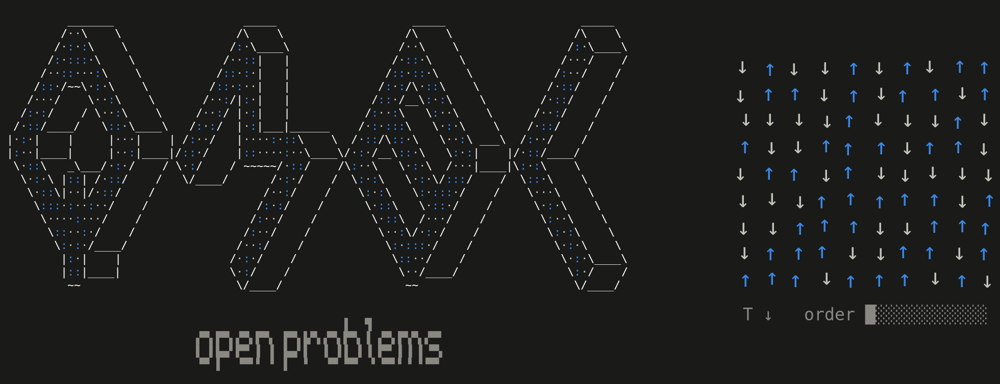

<!-- Header and footer animations are text-mode GIFs from QMBL's scripts/ascii.mjs; the header is
     its version with another tagline (node scripts/ascii.mjs --tagline "open problems" --out ...). -->

<!-- All badges via shields.io, as in QMBL's README: Zenodo's own badge endpoint returns 403 and
     renders as a broken image. The DOI is this repository's concept DOI (CITATION.cff). -->
<!-- BEGIN BADGES (generated by scripts/readme.mjs - do not edit) -->

<!-- END BADGES -->

**QMBL: Open Problems is a record book of the state of the art in quantum many-body simulation for problems with no exact ground-state energy.**

Scientists and AI systems should use the shared results to build on each other's work more efficiently and advance frontier science.

## Leaderboard

<!-- BEGIN LEADERBOARD (generated by scripts/readme.mjs - do not edit) -->

### All 418 open problems (click to unravel)

The verifier can measure 173 of them today.

<b>Heisenberg</b>: 26 instances, energies as <code>E/N (S.S)</code>

| instance | energy to beat | method | record (estimate) | verifier |
|---|---|---|---|---|
| chain, 200 sites, open | **-0.4422078** | DMRG [Wu et al. (2024)](https://doi.org/10.1126/science.adg9774) |  | not yet (chain lattice) |
| chain, 200 sites | **-0.4431678** | DMRG [Wu et al. (2024)](https://doi.org/10.1126/science.adg9774) |  | not yet (chain lattice) |
| kagome 6x6 (108 sites) | none yet | the first verified state sets it | -0.4383(3) extrapolated, [Depenbrock et al. (2012)](https://doi.org/10.48550/arxiv.1205.4858) | not yet (kagome-6x6 lattice) |
| kagome 8x8 (192 sites) | **-0.42987(1)** | VMC (Gutzwiller) [Wu et al. (2024)](https://doi.org/10.1126/science.adg9774) |  | not yet (kagome-8x8 lattice) |
| pyrochlore 2x2x2 (128 sites) | **-0.49229(7)** | VMC (PP + RBM) [Pohle et al. (2023)](https://doi.org/10.48550/arxiv.2311.11561) | -0.49434(5) extrapolated, [Pohle et al. (2023)](https://doi.org/10.48550/arxiv.2311.11561) | not yet (pyrochlore-2x2x2 lattice) |
| pyrochlore 2x2x3 (48 sites) | **-0.5028(2)** | VMC (PP) [Astrakhantsev et al. (2021)](https://doi.org/10.1103/physrevx.11.041021) |  | not yet (pyrochlore-2x2x3 lattice) |
| pyrochlore 2x2x4 (64 sites) | **-0.4924(2)** | VMC (PP) [Astrakhantsev et al. (2021)](https://doi.org/10.1103/physrevx.11.041021) |  | not yet (pyrochlore-2x2x4 lattice) |
| pyrochlore 2x2x6 (96 sites) | **-0.4917(4)** | VMC (PP) [Astrakhantsev et al. (2021)](https://doi.org/10.1103/physrevx.11.041021) |  | not yet (pyrochlore-2x2x6 lattice) |
| pyrochlore 2x4x6 (192 sites) | **-0.4915(2)** | VMC (PP) [Astrakhantsev et al. (2021)](https://doi.org/10.1103/physrevx.11.041021) |  | not yet (pyrochlore-2x4x6 lattice) |
| pyrochlore 3x3x3 (108 sites) | **-0.4871(1)** | VMC (PP) [Astrakhantsev et al. (2021)](https://doi.org/10.1103/physrevx.11.041021) |  | not yet (pyrochlore-3x3x3 lattice) |
| pyrochlore 3x3x3 (432 sites) | **-0.48851(3)** | VMC (PP) [Pohle et al. (2023)](https://doi.org/10.48550/arxiv.2311.11561) | -0.4924(2) extrapolated, [Pohle et al. (2023)](https://doi.org/10.48550/arxiv.2311.11561) | not yet (pyrochlore-3x3x3 lattice) |
| pyrochlore 4x4x4 (256 sites) | **-0.485584(3)** | VMC (RVB) [Cheng & Li (2026)](https://doi.org/10.1103/dsr3-sjt6) |  | not yet (pyrochlore-4x4x4 lattice) |
| pyrochlore 4x4x4 (1024 sites) | **-0.48800(1)** | VMC (PP) [Pohle et al. (2023)](https://doi.org/10.48550/arxiv.2311.11561) | -0.4921(2) extrapolated, [Pohle et al. (2023)](https://doi.org/10.48550/arxiv.2311.11561) | not yet (pyrochlore-4x4x4 lattice) |
| shuriken, 96 sites | **-0.43826(1)** | VMC (PP) [Wu et al. (2024)](https://doi.org/10.1126/science.adg9774) |  | not yet (shuriken lattice) |
| shuriken, 216 sites | **-0.4376(1)** | VMC (PP) [Wu et al. (2024)](https://doi.org/10.1126/science.adg9774) |  | not yet (shuriken lattice) |
| shuriken, 384 sites | **-0.4371(1)** | VMC (PP) [Wu et al. (2024)](https://doi.org/10.1126/science.adg9774) |  | not yet (shuriken lattice) |
| triangular 10x10, open | **-0.5147668** | DMRG [Wu et al. (2024)](https://doi.org/10.1126/science.adg9774) |  | not yet (triangular lattice) |
| triangular, 108 sites | **-0.55315(3)** | VMC (GCNN) [Roth et al. (2022)](https://doi.org/10.48550/arxiv.2211.07749) |  | not yet (triangular lattice) |
| triangular 12x12, open | **-0.5150648** | DMRG [Wu et al. (2024)](https://doi.org/10.1126/science.adg9774) |  | not yet (triangular lattice) |
| triangular 12x12 | **-0.5493(1)** | VMC (2D RNN) [Moss et al. (2025)](https://doi.org/10.48550/arxiv.2505.20406) |  | not yet (triangular lattice) |
| triangular 14x14, open | **-0.5138(1)** | VMC (2D RNN) [Wu et al. (2024)](https://doi.org/10.1126/science.adg9774) |  | not yet (triangular lattice) |
| triangular 16x16, open | **-0.51668(9)** | VMC (2D RNN) [Wu et al. (2024)](https://doi.org/10.1126/science.adg9774) |  | not yet (triangular lattice) |
| triangular 18x18 | **-0.551703(1)** | VMC (ViT) [Viteritti et al. (2026)](https://doi.org/10.48550/arxiv.2602.02665) | -0.55200(1) extrapolated, [Viteritti et al. (2026)](https://doi.org/10.48550/arxiv.2602.02665) | not yet (triangular lattice) |
| triangular 24x24 | **-0.551602(1)** | VMC (ViT) [Viteritti et al. (2026)](https://doi.org/10.48550/arxiv.2602.02665) | -0.55189(1) extrapolated, [Viteritti et al. (2026)](https://doi.org/10.48550/arxiv.2602.02665) | not yet (triangular lattice) |
| triangular 30x30 | **-0.551528(1)** | VMC (ViT) [Viteritti et al. (2026)](https://doi.org/10.48550/arxiv.2602.02665) | -0.55180(1) extrapolated, [Viteritti et al. (2026)](https://doi.org/10.48550/arxiv.2602.02665) | not yet (triangular lattice) |
| triangular 42x42 | **-0.551429(1)** | VMC (ViT) [Viteritti et al. (2026)](https://doi.org/10.48550/arxiv.2602.02665) | -0.55171(1) extrapolated, [Viteritti et al. (2026)](https://doi.org/10.48550/arxiv.2602.02665) | not yet (triangular lattice) |

<b>J1-J2</b>: 66 instances, energies as <code>E/N (S.S)</code>

| instance | energy to beat | method | record (estimate) | verifier |
|---|---|---|---|---|
| square 8x8, J2 = 0.1 | **-0.633093** &#9675; | VMC (ViT) [Golubev et al. (2026)](https://doi.org/10.48550/arxiv.2606.04558) |  | yes |
| square 8x8, J2 = 0.2 | **-0.594508** &#9675; | VMC (ViT) [Golubev et al. (2026)](https://doi.org/10.48550/arxiv.2606.04558) |  | yes |
| square 8x8, J2 = 0.3 | **-0.558295** &#9675; | VMC (ViT) [Golubev et al. (2026)](https://doi.org/10.48550/arxiv.2606.04558) |  | yes |
| square 8x8, J2 = 0.4 | **-0.525653(1)** | VMC (RBM + PP) [Nomura & Imada (2021)](https://doi.org/10.1103/physrevx.11.031034) | -0.5262(1) extrapolated, [Gong et al. (2013)](https://doi.org/10.48550/arxiv.1311.5962) | yes |
| square 8x8, J2 = 0.45 | **-0.511331(1)** | VMC (RBM + PP) [Nomura & Imada (2021)](https://doi.org/10.1103/physrevx.11.031034) | -0.5116(1) extrapolated, [Gong et al. (2013)](https://doi.org/10.48550/arxiv.1311.5962) | yes |
| square 8x8, J2 = 0.48 | none yet | the first verified state sets it | -0.5034(4) extrapolated, [Wang et al. (2011)](https://doi.org/10.48550/arxiv.1112.3331) | yes |
| square 8x8, J2 = 0.5 | **-0.498963(2)** | VMC (RBM + PP) [Wu et al. (2024)](https://doi.org/10.1126/science.adg9774) | -0.4992(1) extrapolated, [Gong et al. (2013)](https://doi.org/10.48550/arxiv.1311.5962) | yes |
| square 8x8, J2 = 0.52 | none yet | the first verified state sets it | -0.4941(1) extrapolated, [Wang et al. (2011)](https://doi.org/10.48550/arxiv.1112.3331) | yes |
| square 8x8, J2 = 0.55 | **-0.488820(2)** | VMC (RBM + PP) [Nomura & Imada (2021)](https://doi.org/10.1103/physrevx.11.031034) | -0.4891(1) extrapolated, [Gong et al. (2013)](https://doi.org/10.48550/arxiv.1311.5962) | yes |
| square 8x8, J2 = 0.6 | **-0.481606** &#9675; | VMC (ViT) [Golubev et al. (2026)](https://doi.org/10.48550/arxiv.2606.04558) |  | yes |
| square 8x8, J2 = 0.65 | **-0.498312** &#9675; | VMC (ViT) [Golubev et al. (2026)](https://doi.org/10.48550/arxiv.2606.04558) |  | yes |
| square 8x8, J2 = 0.7 | **-0.522091** &#9675; | VMC (ViT) [Golubev et al. (2026)](https://doi.org/10.48550/arxiv.2606.04558) |  | yes |
| square 8x8, J2 = 0.8 | **-0.57731** &#9675; | VMC (ViT) [Golubev et al. (2026)](https://doi.org/10.48550/arxiv.2606.04558) |  | yes |
| square 8x8, J2 = 0.9 | **-0.637518** &#9675; | VMC (ViT) [Golubev et al. (2026)](https://doi.org/10.48550/arxiv.2606.04558) |  | yes |
| square 8x8, J2 = 1 | **-0.700508** &#9675; | VMC (ViT) [Golubev et al. (2026)](https://doi.org/10.48550/arxiv.2606.04558) |  | yes |
| square 10x10, J2 = 0.1 | **-0.631365** &dagger; | VMC (ViT) [Golubev et al. (2026)](https://doi.org/10.48550/arxiv.2606.04558) |  | yes |
| square 10x10, J2 = 0.2 | **-0.592982** &dagger; | VMC (ViT) [Golubev et al. (2026)](https://doi.org/10.48550/arxiv.2606.04558) |  | yes |
| square 10x10, J2 = 0.3 | **-0.556912** &dagger; | VMC (ViT) [Golubev et al. (2026)](https://doi.org/10.48550/arxiv.2606.04558) |  | yes |
| square 10x10, J2 = 0.4 | **-0.524361** &dagger; | VMC (ViT) [Golubev et al. (2026)](https://doi.org/10.48550/arxiv.2606.04558) | -0.5253 &#9675; extrapolated, [Gong et al. (2013)](https://doi.org/10.48550/arxiv.1311.5962) | yes |
| square 10x10, J2 = 0.44 | **-0.51273** &#9675; | VMC (CNN) [10.1109/TPDS.2022.3145163,](https://doi.org/10.1109/TPDS.2022.3145163,) |  | yes |
| square 10x10, J2 = 0.45 | **-0.51001(1)** | VMC (Gutzwiller) [Hu et al. (2013)](https://doi.org/10.48550/arxiv.1304.2630) | -0.511 &#9675; extrapolated, [Gong et al. (2013)](https://doi.org/10.48550/arxiv.1311.5962) | yes |
| square 10x10, J2 = 0.46 | **-0.50744** &#9675; | VMC (CNN) [Liang et al. (2023)](https://doi.org/10.1088/2632-2153/acc56a) |  | yes |
| square 10x10, J2 = 0.48 | **-0.50231** &#9675; | VMC (CNN) [Liang et al. (2023)](https://doi.org/10.1088/2632-2153/acc56a) |  | yes |
| square 10x10, J2 = 0.5 | **-0.4976939(2)** | VMC (CNN-MPS) [Fan et al. (2026)](https://doi.org/10.48550/arxiv.2603.14425) | -0.4988 &#9675; extrapolated, [Gong et al. (2013)](https://doi.org/10.48550/arxiv.1311.5962) | yes |
| square 10x10, J2 = 0.55 | **-0.48693(3)** | VMC (Gutzwiller) [Hu et al. (2013)](https://doi.org/10.48550/arxiv.1304.2630) | -0.488 &#9675; extrapolated, [Gong et al. (2013)](https://doi.org/10.48550/arxiv.1311.5962) | yes |
| square 10x10, J2 = 0.6 | **-0.47839** &#9675; | VMC (CNN) [Liang et al. (2023)](https://doi.org/10.1088/2632-2153/acc56a) |  | yes |
| square 10x10, J2 = 0.65 | **-0.494672** &dagger; | VMC (ViT) [Golubev et al. (2026)](https://doi.org/10.48550/arxiv.2606.04558) |  | yes |
| square 10x10, J2 = 0.7 | **-0.519035** &dagger; | VMC (ViT) [Golubev et al. (2026)](https://doi.org/10.48550/arxiv.2606.04558) |  | yes |
| square 10x10, J2 = 0.8 | **-0.57413** &dagger; | VMC (ViT) [Golubev et al. (2026)](https://doi.org/10.48550/arxiv.2606.04558) |  | yes |
| square 10x10, J2 = 0.9 | **-0.63417** &dagger; | VMC (ViT) [Golubev et al. (2026)](https://doi.org/10.48550/arxiv.2606.04558) |  | yes |
| square 10x10, J2 = 1 | **-0.69670(2)** | VMC (RBM) [Chen et al. (2022)](https://doi.org/10.48550/arxiv.2206.14307) |  | yes |
| square 12x12, J2 = 0.44 | **-0.51225** &#9675; | VMC (CNN) [10.1109/TPDS.2022.3145163,](https://doi.org/10.1109/TPDS.2022.3145163,) |  | yes |
| square 12x12, J2 = 0.45 | none yet | the first verified state sets it | -0.5088(1) extrapolated, [Wang et al. (2011)](https://doi.org/10.48550/arxiv.1112.3331) | yes |
| square 12x12, J2 = 0.46 | **-0.50697** &#9675; | VMC (CNN) [Liang et al. (2023)](https://doi.org/10.1088/2632-2153/acc56a) |  | yes |
| square 12x12, J2 = 0.48 | **-0.50183** &#9675; | VMC (CNN) [Liang et al. (2023)](https://doi.org/10.1088/2632-2153/acc56a) |  | yes |
| square 12x12, J2 = 0.5 | **-0.496989** &#9675; | VMC (CNN) [Liang et al. (2023)](https://doi.org/10.1088/2632-2153/acc56a) |  | yes |
| square 12x12, J2 = 0.52 | none yet | the first verified state sets it | -0.4920(1) extrapolated, [Wang et al. (2011)](https://doi.org/10.48550/arxiv.1112.3331) | yes |
| square 12x12, J2 = 0.55 | **-0.48607(1)** | VMC (GCNN) [Roth et al. (2022)](https://doi.org/10.48550/arxiv.2211.07749) | -0.4862(2) extrapolated, [Wang et al. (2011)](https://doi.org/10.48550/arxiv.1112.3331) | yes |
| square 12x12, J2 = 0.6 | **-0.47715** &#9675; | VMC (CNN) [Liang et al. (2023)](https://doi.org/10.1088/2632-2153/acc56a) | -0.4784(3) extrapolated, [Wang et al. (2011)](https://doi.org/10.48550/arxiv.1112.3331) | yes |
| square 14x14, J2 = 0.4 | **-0.52287(1)** | VMC (Gutzwiller) [Hu et al. (2013)](https://doi.org/10.48550/arxiv.1304.2630) | -0.52351(2) extrapolated, [Hu et al. (2013)](https://doi.org/10.48550/arxiv.1304.2630) | yes |
| square 14x14, J2 = 0.44 | **-0.512** &#9675; | VMC (CNN) [10.1109/TPDS.2022.3145163,](https://doi.org/10.1109/TPDS.2022.3145163,) |  | yes |
| square 14x14, J2 = 0.45 | **-0.50899(1)** | VMC (Gutzwiller) [Hu et al. (2013)](https://doi.org/10.48550/arxiv.1304.2630) | -0.50953(1) extrapolated, [Hu et al. (2013)](https://doi.org/10.48550/arxiv.1304.2630) | yes |
| square 14x14, J2 = 0.46 | **-0.50675** &#9675; | VMC (CNN) [Liang et al. (2023)](https://doi.org/10.1088/2632-2153/acc56a) |  | yes |
| square 14x14, J2 = 0.48 | **-0.50159** &#9675; | VMC (CNN) [Liang et al. (2023)](https://doi.org/10.1088/2632-2153/acc56a) |  | yes |
| square 14x14, J2 = 0.5 | **-0.49674** &#9675; | VMC (CNN) [Liang et al. (2023)](https://doi.org/10.1088/2632-2153/acc56a) | -0.49722(2) extrapolated, [Hu et al. (2013)](https://doi.org/10.48550/arxiv.1304.2630) | yes |
| square 14x14, J2 = 0.55 | **-0.48581** &#9675; | VMC (CNN) [Liang et al. (2023)](https://doi.org/10.1088/2632-2153/acc56a) | -0.48696(5) extrapolated, [Hu et al. (2013)](https://doi.org/10.48550/arxiv.1304.2630) | yes |
| square 14x14, J2 = 0.6 | **-0.47678** &#9675; | VMC (CNN) [Liang et al. (2023)](https://doi.org/10.1088/2632-2153/acc56a) |  | yes |
| square 16x16, J2 = 0.44 | **-0.51188** &#9675; | VMC (CNN) [10.1109/TPDS.2022.3145163,](https://doi.org/10.1109/TPDS.2022.3145163,) |  | yes |
| square 16x16, J2 = 0.45 | none yet | the first verified state sets it | -0.5087(1) extrapolated, [Wang et al. (2011)](https://doi.org/10.48550/arxiv.1112.3331) | yes |
| square 16x16, J2 = 0.46 | **-0.50662** &#9675; | VMC (CNN) [Liang et al. (2023)](https://doi.org/10.1088/2632-2153/acc56a) |  | yes |
| square 16x16, J2 = 0.48 | **-0.50147** &#9675; | VMC (CNN) [Liang et al. (2023)](https://doi.org/10.1088/2632-2153/acc56a) |  | yes |
| square 16x16, J2 = 0.5 | **-0.4969140(5)** | VMC (CNN-MPS) [Fan et al. (2026)](https://doi.org/10.48550/arxiv.2603.14425) |  | yes |
| square 16x16, J2 = 0.52 | none yet | the first verified state sets it | -0.4920(1) extrapolated, [Wang et al. (2011)](https://doi.org/10.48550/arxiv.1112.3331) | yes |
| square 16x16, J2 = 0.55 | **-0.48565** &#9675; | VMC (CNN) [Liang et al. (2023)](https://doi.org/10.1088/2632-2153/acc56a) | -0.4859(4) extrapolated, [Wang et al. (2011)](https://doi.org/10.48550/arxiv.1112.3331) | yes |
| square 16x16, J2 = 0.6 | **-0.47656** &#9675; | VMC (CNN) [Liang et al. (2023)](https://doi.org/10.1088/2632-2153/acc56a) | -0.4777(3) extrapolated, [Wang et al. (2011)](https://doi.org/10.48550/arxiv.1112.3331) | yes |
| square 18x18, J2 = 0.4 | **-0.52259(1)** | VMC (Gutzwiller) [Hu et al. (2013)](https://doi.org/10.48550/arxiv.1304.2630) | -0.52333(1) extrapolated, [Hu et al. (2013)](https://doi.org/10.48550/arxiv.1304.2630) | yes |
| square 18x18, J2 = 0.44 | **-0.51179** &#9675; | VMC (CNN) [10.1109/TPDS.2022.3145163,](https://doi.org/10.1109/TPDS.2022.3145163,) |  | yes |
| square 18x18, J2 = 0.45 | **-0.50874(1)** | VMC (Gutzwiller) [Hu et al. (2013)](https://doi.org/10.48550/arxiv.1304.2630) | -0.50940(1) extrapolated, [Hu et al. (2013)](https://doi.org/10.48550/arxiv.1304.2630) | yes |
| square 18x18, J2 = 0.46 | **-0.50651** &#9675; | VMC (CNN) [Liang et al. (2023)](https://doi.org/10.1088/2632-2153/acc56a) |  | yes |
| square 18x18, J2 = 0.48 | **-0.50139** &#9675; | VMC (CNN) [Liang et al. (2023)](https://doi.org/10.1088/2632-2153/acc56a) |  | yes |
| square 18x18, J2 = 0.5 | **-0.496513** &#9675; | VMC (CNN) [Liang et al. (2023)](https://doi.org/10.1088/2632-2153/acc56a) | -0.49717(2) extrapolated, [Hu et al. (2013)](https://doi.org/10.48550/arxiv.1304.2630) | yes |
| square 18x18, J2 = 0.55 | **-0.48557** &#9675; | VMC (CNN) [Liang et al. (2023)](https://doi.org/10.1088/2632-2153/acc56a) | -0.48698(5) extrapolated, [Hu et al. (2013)](https://doi.org/10.48550/arxiv.1304.2630) | yes |
| square 18x18, J2 = 0.6 | **-0.47652** &#9675; | VMC (CNN) [Liang et al. (2023)](https://doi.org/10.1088/2632-2153/acc56a) |  | yes |
| square 20x20, J2 = 0.5 | **-0.4967987(6)** | VMC (CNN-MPS) [Fan et al. (2026)](https://doi.org/10.48550/arxiv.2603.14425) | -0.49684(1) extrapolated, [Viteritti et al. (2026)](https://doi.org/10.48550/arxiv.2602.02665) | yes |
| triangular, 108 sites, J2 = 0.125 | **-0.51268(9)** | VMC (GCNN) [Roth et al. (2022)](https://doi.org/10.48550/arxiv.2211.07749) |  | not yet (triangular lattice) |
| triangular 12x12, J2 = 0.125 | **-0.51218(9)** | VMC (GCNN) [Roth et al. (2022)](https://doi.org/10.48550/arxiv.2211.07749) |  | not yet (triangular lattice) |

<b>Hubbard</b>: 109 instances, energies as <code>E/site</code>

| instance | energy to beat | method | record (estimate) | verifier |
|---|---|---|---|---|
| rectangular 10x16, U = 8, n = 0.875, t12 (t2 = -0.2) | **-0.7434** &#9675; | VMC (transformer BF) [Gu et al. (2026)](https://doi.org/10.1038/s41467-026-74028-6) |  | yes |
| rectangular 12x16, U = 8, n = 0.875 | **-0.7562** &#9675; | VMC (transformer BF) [Gu et al. (2026)](https://doi.org/10.1038/s41467-026-74028-6) |  | yes |
| rectangular 12x16, U = 8, n = 0.875, t12 (t2 = -0.2) | **-0.744** &#9675; | VMC (transformer BF) [Gu et al. (2026)](https://doi.org/10.1038/s41467-026-74028-6) |  | yes |
| rectangular 14x16, U = 8, n = 0.875 | **-0.75830(4)** | VAFQMC [Wu et al. (2024)](https://doi.org/10.1126/science.adg9774) |  | yes |
| rectangular 16x32, U = 8, n = 0.875 | **-0.7507** &#9675; | VMC (SCALE) [Gu et al. (2026)](https://doi.org/10.1103/2kq2-5g5q) | -0.7547 &#9675; projected, [Gu et al. (2026)](https://doi.org/10.1103/2kq2-5g5q) | yes |
| rectangular 16x32, U = 8, n = 0.875, t12 (t2 = -0.2) | **-0.7371** &#9675; | VMC (SCALE) [Gu et al. (2026)](https://doi.org/10.1103/2kq2-5g5q) | -0.7406 &#9675; projected, [Gu et al. (2026)](https://doi.org/10.1103/2kq2-5g5q) | yes |
| rectangular 4x12, U = 8, n = 0.875 | **-0.76608(1)** | VMC (HFPS) [Chen et al. (2026)](https://doi.org/10.1073/pnas.2535288123) |  | yes |
| rectangular 4x16, U = 8, n = 0.875 | **-0.76623(1)** | VMC (ACE) [Gu et al. (2026)](https://doi.org/10.1103/2kq2-5g5q) | -0.76748 &#9675; extrapolated, [Loehr & Clark (2025)](https://doi.org/10.48550/arxiv.2510.26906) | yes |
| rectangular 4x16, periodic/open, U = 2, n = 0.8125 | **-1.2852656** | DMRG [Wu et al. (2024)](https://doi.org/10.1126/science.adg9774) |  | yes |
| rectangular 4x16, periodic/open, U = 8, n = 0.8125 | **-0.853** | DMRG [Wu et al. (2024)](https://doi.org/10.1126/science.adg9774) |  | yes |
| rectangular 4x16, periodic/open, U = 2, n = 0.875 | **-1.2611875** | DMRG [Wu et al. (2024)](https://doi.org/10.1126/science.adg9774) |  | yes |
| rectangular 4x16, periodic/open, U = 8, n = 0.875 | **-0.7508328** | DMRG [Wu et al. (2024)](https://doi.org/10.1126/science.adg9774) | -0.75114(6) extrapolated, [Wu et al. (2024)](https://doi.org/10.1126/science.adg9774) | yes |
| rectangular 4x16, periodic/open, U = 2, n = 0.9375 | **-1.2199062** | DMRG [Wu et al. (2024)](https://doi.org/10.1126/science.adg9774) |  | yes |
| rectangular 4x16, periodic/open, U = 8, n = 0.9375 | **-0.637875** | DMRG [Wu et al. (2024)](https://doi.org/10.1126/science.adg9774) |  | yes |
| rectangular 4x16, periodic/open, U = 2, n = 1 | **-1.1710781** | DMRG [Wu et al. (2024)](https://doi.org/10.1126/science.adg9774) |  | yes |
| rectangular 4x16, periodic/open, U = 8, n = 1 | **-0.5144219** | DMRG [Wu et al. (2024)](https://doi.org/10.1126/science.adg9774) |  | yes |
| rectangular 4x24, U = 4, n &asymp; 0.8333 | **-1.07872(3)** | VMC (HFPS) [Roth et al. (2025)](https://doi.org/10.48550/arxiv.2511.07566) |  | yes |
| rectangular 4x8, U = 8, n = 0.875 | **-0.768337(2)** | VMC (NNBF) [Loehr & Clark (2025)](https://doi.org/10.48550/arxiv.2510.26906) | -0.768416 &#9675; extrapolated, [Loehr & Clark (2025)](https://doi.org/10.48550/arxiv.2510.26906) | yes |
| rectangular 4x8, periodic/open, U = 8, n = 0.875 | **-0.7363906** | DMRG [Wu et al. (2024)](https://doi.org/10.1126/science.adg9774) | -0.736431(9) extrapolated, [Wu et al. (2024)](https://doi.org/10.1126/science.adg9774) | yes |
| rectangular 6x16, U = 8, n = 0.875 | **-0.7486** &#9675; | VMC (Jastrow + BF) [Marino et al. (2022)](https://doi.org/10.21468/scipostphys.12.6.180) |  | yes |
| rectangular 6x32, U = 8, n = 0.875 | **-0.7483** &#9675; | VMC (Jastrow + BF) [Marino et al. (2022)](https://doi.org/10.21468/scipostphys.12.6.180) |  | yes |
| rectangular 6x40, U = 12, n = 0.875, t12 (t2 = -0.1) | **-0.6206** &#9675; | VMC (Jastrow + BF) [Marino et al. (2022)](https://doi.org/10.21468/scipostphys.12.6.180) |  | yes |
| rectangular 6x40, U = 12, n = 0.875, t12 (t2 = -0.2) | **-0.6187** &#9675; | VMC (Jastrow + BF) [Marino et al. (2022)](https://doi.org/10.21468/scipostphys.12.6.180) |  | yes |
| rectangular 6x40, U = 12, n = 0.875, t12 (t2 = -0.3) | **-0.619** &#9675; | VMC (Jastrow + BF) [Marino et al. (2022)](https://doi.org/10.21468/scipostphys.12.6.180) |  | yes |
| rectangular 6x40, U = 12, n = 0.875, t12 (t2 = -0.35) | **-0.6202** &#9675; | VMC (Jastrow + BF) [Marino et al. (2022)](https://doi.org/10.21468/scipostphys.12.6.180) |  | yes |
| rectangular 6x40, U = 12, n = 0.875, t12 (t2 = -0.4) | **-0.622** &#9675; | VMC (Jastrow + BF) [Marino et al. (2022)](https://doi.org/10.21468/scipostphys.12.6.180) |  | yes |
| rectangular 6x40, U = 12, n = 0.875, t12 (t2 = -0.45) | **-0.624** &#9675; | VMC (Jastrow + BF) [Marino et al. (2022)](https://doi.org/10.21468/scipostphys.12.6.180) |  | yes |
| rectangular 6x40, U = 12, n = 0.875, t12 (t2 = -0.5) | **-0.626** &#9675; | VMC (Jastrow + BF) [Marino et al. (2022)](https://doi.org/10.21468/scipostphys.12.6.180) |  | yes |
| rectangular 6x48, U = 8, n &asymp; 0.8333 | **-0.82075(3)** | VMC (Jastrow + BF) [Wu et al. (2024)](https://doi.org/10.1126/science.adg9774) | -0.82575(2) projected, [Wu et al. (2024)](https://doi.org/10.1126/science.adg9774) | yes |
| rectangular 6x48, U = 8, n = 0.875 | **-0.74834(3)** | VMC (Jastrow + BF) [Wu et al. (2024)](https://doi.org/10.1126/science.adg9774) | -0.75398(2) projected, [Wu et al. (2024)](https://doi.org/10.1126/science.adg9774) | yes |
| rectangular 6x48, U = 12, n = 0.875 | **-0.62556(3)** | VMC (Jastrow + BF) [Wu et al. (2024)](https://doi.org/10.1126/science.adg9774) | -0.63217(2) projected, [Wu et al. (2024)](https://doi.org/10.1126/science.adg9774) | yes |
| rectangular 6x48, U = 12, n = 0.875, t12 (t2 = -0.1) | **-0.6147** &#9675; | VMC (Jastrow + BF) [Marino et al. (2022)](https://doi.org/10.21468/scipostphys.12.6.180) |  | yes |
| rectangular 6x48, U = 12, n = 0.875, t12 (t2 = -0.2) | **-0.6113** &#9675; | VMC (Jastrow + BF) [Marino et al. (2022)](https://doi.org/10.21468/scipostphys.12.6.180) |  | yes |
| rectangular 6x48, U = 12, n = 0.875, t12 (t2 = -0.3) | **-0.6118** &#9675; | VMC (Jastrow + BF) [Marino et al. (2022)](https://doi.org/10.21468/scipostphys.12.6.180) |  | yes |
| rectangular 6x48, U = 12, n = 0.875, t12 (t2 = -0.35) | **-0.6135** &#9675; | VMC (Jastrow + BF) [Marino et al. (2022)](https://doi.org/10.21468/scipostphys.12.6.180) |  | yes |
| rectangular 6x48, U = 12, n = 0.875, t12 (t2 = -0.4) | **-0.6162** &#9675; | VMC (Jastrow + BF) [Marino et al. (2022)](https://doi.org/10.21468/scipostphys.12.6.180) |  | yes |
| rectangular 6x48, U = 12, n = 0.875, t12 (t2 = -0.45) | **-0.6202** &#9675; | VMC (Jastrow + BF) [Marino et al. (2022)](https://doi.org/10.21468/scipostphys.12.6.180) |  | yes |
| rectangular 6x48, U = 12, n = 0.875, t12 (t2 = -0.5) | **-0.6261** &#9675; | VMC (Jastrow + BF) [Marino et al. (2022)](https://doi.org/10.21468/scipostphys.12.6.180) |  | yes |
| rectangular 6x48, U = 12, n = 0.875, t12 (t2 = 0.1) | **-0.6375** &#9675; | VMC (Jastrow + BF) [Marino et al. (2022)](https://doi.org/10.21468/scipostphys.12.6.180) |  | yes |
| rectangular 6x48, U = 12, n = 0.875, t12 (t2 = 0.15) | **-0.6464** &#9675; | VMC (Jastrow + BF) [Marino et al. (2022)](https://doi.org/10.21468/scipostphys.12.6.180) |  | yes |
| rectangular 6x48, U = 12, n = 0.875, t12 (t2 = 0.2) | **-0.6562** &#9675; | VMC (Jastrow + BF) [Marino et al. (2022)](https://doi.org/10.21468/scipostphys.12.6.180) |  | yes |
| rectangular 6x48, U = 12, n = 0.875, t12 (t2 = 0.25) | **-0.6669** &#9675; | VMC (Jastrow + BF) [Marino et al. (2022)](https://doi.org/10.21468/scipostphys.12.6.180) |  | yes |
| rectangular 6x48, U = 8, n &asymp; 0.9167 | **-0.67269(3)** | VMC (Jastrow + BF) [Wu et al. (2024)](https://doi.org/10.1126/science.adg9774) | -0.6862(2) projected, [Xu et al. (2022)](https://doi.org/10.1103/physrevresearch.4.013239) | yes |
| rectangular 6x64, U = 8, n = 0.875 | **-0.7482** &#9675; | VMC (Jastrow + BF) [Marino et al. (2022)](https://doi.org/10.21468/scipostphys.12.6.180) |  | yes |
| rectangular 8x10, U = 8, n = 0.875, t12 (t2 = -0.2) | **-0.7427** &#9675; | VMC (transformer BF) [Gu et al. (2026)](https://doi.org/10.1038/s41467-026-74028-6) |  | yes |
| rectangular 8x12, U = 8, n = 0.875, t12 (t2 = -0.2) | **-0.7456** &#9675; | VMC (transformer BF) [Gu et al. (2026)](https://doi.org/10.1038/s41467-026-74028-6) |  | yes |
| rectangular 8x16, U = 8, n = 0.875 | **-0.7568** &#9675; | VMC (tensor BF) [Liang (2025)](https://doi.org/10.48550/arXiv.2507.01856) |  | yes |
| rectangular 8x16, U = 8, n = 0.875, t12 (t2 = -0.2) | **-0.7419** &#9675; | VMC (transformer BF) [Gu et al. (2026)](https://doi.org/10.1038/s41467-026-74028-6) |  | yes |
| rectangular 8x18, U = 8, n = 0.875, t12 (t2 = -0.2) | **-0.7421** &#9675; | VMC (transformer BF) [Gu et al. (2026)](https://doi.org/10.1038/s41467-026-74028-6) |  | yes |
| rectangular 8x20, U = 8, n = 0.875, t12 (t2 = -0.2) | **-0.7433** &#9675; | VMC (transformer BF) [Gu et al. (2026)](https://doi.org/10.1038/s41467-026-74028-6) |  | yes |
| rectangular 8x24, U = 8, n = 0.875 | **-0.7546** &#9675; | VMC (tensor BF) [Liang (2025)](https://doi.org/10.48550/arXiv.2507.01856) |  | yes |
| rectangular 8x24, U = 8, n = 0.875, t12 (t2 = -0.2) | **-0.7423** &#9675; | VMC (transformer BF) [Gu et al. (2026)](https://doi.org/10.1038/s41467-026-74028-6) |  | yes |
| rectangular 8x32, U = 8, n = 0.875 | **-0.7547** &#9675; | VMC (tensor BF) [Liang (2025)](https://doi.org/10.48550/arXiv.2507.01856) |  | yes |
| rectangular 8x32, U = 8, n = 0.875, t12 (t2 = -0.2) | **-0.742** &#9675; | VMC (transformer BF) [Gu et al. (2026)](https://doi.org/10.1038/s41467-026-74028-6) | -0.7491 &#9675; extrapolated, [Gu et al. (2026)](https://doi.org/10.1038/s41467-026-74028-6) | yes |
| rectangular 8x48, U = 8, n &asymp; 0.9167 | none yet | the first verified state sets it | -0.6854(2) projected, [Xu et al. (2022)](https://doi.org/10.1103/physrevresearch.4.013239) | yes |
| square 4x4, U = 8, n = 0.875 | **-0.74177(5)** | VMC (HFPS) [Chen et al. (2026)](https://doi.org/10.1073/pnas.2535288123) |  | yes |
| square 6x6, U = 4, n &asymp; 0.6667 | **-1.1834(1)** | VAFQMC [Levy et al. (2023)](https://doi.org/10.48550/arxiv.2308.08594) | -1.18525(4) projected, [Shi & Zhang (2013)](https://doi.org/10.1103/physrevb.88.125132) | yes |
| square 6x6, U = 4, n &asymp; 1.3333 | none yet | the first verified state sets it | 0.14809(4) projected, [Shi & Zhang (2013)](https://doi.org/10.1103/physrevb.88.125132) | yes |
| square, 50 sites, U = 8, n = 0.84 | **-0.82328(3)** | VAFQMC [Wu et al. (2024)](https://doi.org/10.1126/science.adg9774) |  | yes |
| square 8x8, U = 4, n = 0.4375 | none yet | the first verified state sets it | -1.07180(2) projected, [Shi & Zhang (2013)](https://doi.org/10.1103/physrevb.88.125132) | yes |
| square 8x8, U = 4, n = 0.6875 | **-1.1846** &#9675; | VMC (tensor BF) [Liang (2025)](https://doi.org/10.48550/arXiv.2507.01856) | -1.1858(2) projected, [Shi & Zhang (2013)](https://doi.org/10.1103/physrevb.88.125132) | yes |
| square 8x8, U = 4, n &asymp; 0.7813 | **-1.13048(8)** | VAFQMC [Levy et al. (2023)](https://doi.org/10.48550/arxiv.2308.08594) | -1.13253(3) projected, [Levy et al. (2023)](https://doi.org/10.48550/arxiv.2308.08594) | yes |
| square 8x8, U = 8, n &asymp; 0.7813 | **-0.91483(2)** | VMC (PP + RBM) [Wu et al. (2024)](https://doi.org/10.1126/science.adg9774) | -0.9252(1) projected, [Levy et al. (2023)](https://doi.org/10.48550/arxiv.2308.08594) | yes |
| square 8x8, U = -2, n = 0.875 | **-2.0338** &#9675; | VMC (ACE) [Gu et al. (2026)](https://doi.org/10.1103/2kq2-5g5q) | -2.0339 &#9675; projected, [Gu et al. (2026)](https://doi.org/10.1103/2kq2-5g5q) | yes |
| square 8x8, U = 4, n = 0.875 | **-1.01391(8)** | VAFQMC [Levy et al. (2023)](https://doi.org/10.48550/arxiv.2308.08594) | -1.01923(6) projected, [Levy et al. (2023)](https://doi.org/10.48550/arxiv.2308.08594) | yes |
| square 8x8, U = 8, n = 0.875 | **-0.7532** &#9675; | VMC (transformer BF) [Gu et al. (2026)](https://doi.org/10.1038/s41467-026-74028-6) | -0.7616(1) projected, [Levy et al. (2023)](https://doi.org/10.48550/arxiv.2308.08594) | yes |
| square 8x8, U = 8, n = 0.875, t12 (t2 = -0.2) | **-0.75058(1)** | VMC (transformer BF) [Viteritti et al. (2026)](https://doi.org/10.48550/arxiv.2604.21978) | -0.7540(4) extrapolated, [Viteritti et al. (2026)](https://doi.org/10.48550/arxiv.2604.21978) | yes |
| square 10x10, U = 4, n = 0.8 | **-1.11097(6)** | VAFQMC [Levy et al. (2023)](https://doi.org/10.48550/arxiv.2308.08594) | -1.1135(2) projected, [Shi & Zhang (2013)](https://doi.org/10.1103/physrevb.88.125132) | yes |
| square 12x12, U = 4, n &asymp; 0.8056 | **-1.1061** &#9675; | VMC (tensor BF) [Liang (2025)](https://doi.org/10.48550/arXiv.2507.01856) | -1.1089(2) projected, [Shi & Zhang (2013)](https://doi.org/10.1103/physrevb.88.125132) | yes |
| square 12x12, U = 2, n &asymp; 0.8333 | **-1.29500(3)** | VMC (HFPS) [Roth et al. (2025)](https://doi.org/10.48550/arxiv.2511.07566) |  | yes |
| square 12x12, U = 4, n &asymp; 0.8333 | **-1.0751(1)** | VMC (HFPS) [Roth et al. (2025)](https://doi.org/10.48550/arxiv.2511.07566) |  | yes |
| square 12x12, U = 6, n &asymp; 0.8333 | **-0.92516(5)** | VMC (HFPS) [Roth et al. (2025)](https://doi.org/10.48550/arxiv.2511.07566) |  | yes |
| square 12x12, U = 10, n &asymp; 0.8333 | **-0.76179(5)** | VMC (HFPS) [Roth et al. (2025)](https://doi.org/10.48550/arxiv.2511.07566) |  | yes |
| square 12x12, U = 15, n &asymp; 0.8333 | **-0.66690(5)** | VMC (HFPS) [Roth et al. (2025)](https://doi.org/10.48550/arxiv.2511.07566) |  | yes |
| square 12x12, U = -8, n = 0.875 | **-4.0159** &#9675; | VMC (ACE) [Gu et al. (2026)](https://doi.org/10.1103/2kq2-5g5q) | -4.0161 &#9675; projected, [Gu et al. (2026)](https://doi.org/10.1103/2kq2-5g5q) | yes |
| square 12x12, U = -2, n = 0.875 | **-2.0405** &#9675; | VMC (ACE) [Gu et al. (2026)](https://doi.org/10.1103/2kq2-5g5q) | -2.0407 &#9675; projected, [Gu et al. (2026)](https://doi.org/10.1103/2kq2-5g5q) | yes |
| square 12x12, U = 8, n = 0.875 | **-0.7567** &#9675; | VMC (transformer BF) [Gu et al. (2026)](https://doi.org/10.1038/s41467-026-74028-6) |  | yes |
| square 12x12, U = 8, n = 0.875, t12 (t2 = -0.2) | **-0.74425(1)** | VMC (SBP) [Rende et al. (2026)](https://doi.org/10.48550/arxiv.2608.12465) |  | yes |
| square 16x16, open, U = 8, n = 0.875 | **-0.728** &#9675; | VMC (ACE) [Gu et al. (2026)](https://doi.org/10.1103/2kq2-5g5q) | -0.7288 &#9675; projected, [Gu et al. (2026)](https://doi.org/10.1103/2kq2-5g5q) | yes |
| square 16x16, open, U = 8, n = 0.875, t12 (t2 = -0.2) | **-0.7097(1)** | VMC (tensor BF) [Liang (2026)](https://doi.org/10.48550/arxiv.2609.22618) |  | yes |
| square 16x16, U = 8, n &asymp; 0.8281 | **-0.83788(6)** | VAFQMC [Wu et al. (2024)](https://doi.org/10.1126/science.adg9774) |  | yes |
| square 16x16, U = 8, n &asymp; 0.8438 | **-0.81198(6)** | VAFQMC [Wu et al. (2024)](https://doi.org/10.1126/science.adg9774) |  | yes |
| square 16x16, U = 8, n &asymp; 0.8516 | **-0.79896(5)** | VAFQMC [Wu et al. (2024)](https://doi.org/10.1126/science.adg9774) |  | yes |
| square 16x16, U = 8, n &asymp; 0.8594 | **-0.78530(6)** | VAFQMC [Wu et al. (2024)](https://doi.org/10.1126/science.adg9774) |  | yes |
| square 16x16, U = 8, n &asymp; 0.8672 | **-0.77196(6)** | VAFQMC [Wu et al. (2024)](https://doi.org/10.1126/science.adg9774) |  | yes |
| square 16x16, U = 4, n = 0.875 | **-1.02916(2)** | VAFQMC [Wu et al. (2024)](https://doi.org/10.1126/science.adg9774) |  | yes |
| square 16x16, U = 6, n = 0.875 | **-0.86592(2)** | VAFQMC [Wu et al. (2024)](https://doi.org/10.1126/science.adg9774) |  | yes |
| square 16x16, U = 8, n = 0.875 | **-0.75865(3)** | VAFQMC [Wu et al. (2024)](https://doi.org/10.1126/science.adg9774) |  | yes |
| square 16x16, U = 8, n = 0.875, t12 (t2 = -0.1) | **-0.7370(1)** | VMC (HFPS) [Roth et al. (2025)](https://doi.org/10.48550/arxiv.2511.07566) |  | yes |
| square 16x16, U = 8, n = 0.875, t12 (t2 = -0.2) | **-0.74411(1)** | VMC (SBP) [Rende et al. (2026)](https://doi.org/10.48550/arxiv.2608.12465) |  | yes |
| square 16x16, U = 8, n = 0.875, t12 (t2 = -0.3) | **-0.7375(1)** | VMC (HFPS) [Roth et al. (2025)](https://doi.org/10.48550/arxiv.2511.07566) |  | yes |
| square 16x16, U = 8, n &asymp; 0.8828 | **-0.74455(3)** | VAFQMC [Wu et al. (2024)](https://doi.org/10.1126/science.adg9774) |  | yes |
| square 16x16, U = 4, n &asymp; 0.8906 | **-1.00849(2)** | VAFQMC [Wu et al. (2024)](https://doi.org/10.1126/science.adg9774) |  | yes |
| square 16x16, U = 6, n &asymp; 0.8906 | **-0.84058(2)** | VAFQMC [Wu et al. (2024)](https://doi.org/10.1126/science.adg9774) |  | yes |
| square 16x16, U = 8, n &asymp; 0.8906 | **-0.73038(5)** | VAFQMC [Wu et al. (2024)](https://doi.org/10.1126/science.adg9774) |  | yes |
| square 16x16, U = 8, n &asymp; 0.8984 | **-0.71584(5)** | VAFQMC [Wu et al. (2024)](https://doi.org/10.1126/science.adg9774) |  | yes |
| square 16x16, U = 8, n &asymp; 0.9063 | **-0.70135(3)** | VAFQMC [Wu et al. (2024)](https://doi.org/10.1126/science.adg9774) |  | yes |
| square 16x16, U = 8, n &asymp; 0.9141 | **-0.68678(5)** | VAFQMC [Wu et al. (2024)](https://doi.org/10.1126/science.adg9774) |  | yes |
| square 16x16, U = 8, n &asymp; 0.9219 | **-0.67215(5)** | VAFQMC [Wu et al. (2024)](https://doi.org/10.1126/science.adg9774) |  | yes |
| square 16x16, U = 8, n = 0.9375 | **-0.64053(5)** | VAFQMC [Wu et al. (2024)](https://doi.org/10.1126/science.adg9774) |  | yes |
| square 16x16, periodic/antiperiodic, U = 8, n &asymp; 0.8359 | **-0.82333(3)** | VAFQMC [Wu et al. (2024)](https://doi.org/10.1126/science.adg9774) |  | yes |
| square 16x16, periodic/antiperiodic, U = 8, n &asymp; 0.8359, t12 (t2 = -0.25) | **-0.79937(4)** | VMC (PP + RBM) [Wu et al. (2024)](https://doi.org/10.1126/science.adg9774) |  | yes |
| square 16x16, periodic/antiperiodic, U = 8, n &asymp; 0.8359, t12 (t2 = -0.25), UV1V2 | **1.25918(3)** | VMC (PP + RBM) [Wu et al. (2024)](https://doi.org/10.1126/science.adg9774) |  | yes |
| square, 288 sites, U = 2, n &asymp; 0.8333 | **-1.29563(3)** | VMC (HFPS) [Roth et al. (2025)](https://doi.org/10.48550/arxiv.2511.07566) |  | yes |
| square, 288 sites, U = 4, n &asymp; 0.8333 | **-1.07256(5)** | VMC (HFPS) [Roth et al. (2025)](https://doi.org/10.48550/arxiv.2511.07566) |  | yes |
| square, 288 sites, U = 6, n &asymp; 0.8333 | **-0.91859(6)** | VMC (HFPS) [Roth et al. (2025)](https://doi.org/10.48550/arxiv.2511.07566) |  | yes |
| square 20x20, U = 8, n = 0.875, t12 (t2 = -0.2) | **-0.74382(1)** | VMC (SBP) [Rende et al. (2026)](https://doi.org/10.48550/arxiv.2608.12465) |  | yes |
| square 24x24, U = 8, n = 0.875, t12 (t2 = -0.2) | **-0.74397(1)** | VMC (SBP) [Rende et al. (2026)](https://doi.org/10.48550/arxiv.2608.12465) |  | yes |
| square 32x32, U = 8, n = 0.875 | **-0.7501** &#9675; | VMC (SCALE) [Gu et al. (2026)](https://doi.org/10.1103/2kq2-5g5q) | -0.7548 &#9675; projected, [Gu et al. (2026)](https://doi.org/10.1103/2kq2-5g5q) | yes |

<b>Transverse-field Ising</b>: 6 instances, energies as <code>E/N (Pauli)</code>

| instance | energy to beat | method | record (estimate) | verifier |
|---|---|---|---|---|
| square 8x8, open, h = 3 | **-3.1641828** &#9675; | DMRG [Dao (2026)](https://doi.org/10.48550/arxiv.2606.25600) |  | not yet (TFIsing model) |
| square 10x10, open, h = 3 | **-3.16977** &#9675; | DMRG [Dao (2026)](https://doi.org/10.48550/arxiv.2606.25600) |  | not yet (TFIsing model) |
| square 12x12, open, h = 2 | **-2.4096026** &#9675; | DMRG [Hibat-Allah et al. (2020)](https://doi.org/10.1103/physrevresearch.2.023358) |  | not yet (TFIsing model) |
| square 12x12, open, h = 3 | **-3.1739018(2)** | VMC (2D RNN) [Hibat-Allah et al. (2020)](https://doi.org/10.1103/physrevresearch.2.023358) |  | not yet (TFIsing model) |
| square 12x12, open, h = 4 | **-4.1217979** &#9675; | DMRG [Hibat-Allah et al. (2020)](https://doi.org/10.1103/physrevresearch.2.023358) |  | not yet (TFIsing model) |
| square 20x20, open, h = 3 | **-3.18197** &#9675; | DMRG [Ganahl et al. (2023)](https://doi.org/10.1103/prxquantum.4.010317) |  | not yet (TFIsing model) |

<b>Impurity</b>: 8 instances, energies as <code>E (total)</code>

| instance | energy to beat | method | record (estimate) | verifier |
|---|---|---|---|---|
| TB-DMFT, size 9 | **-112.9042852** | DMRG [Wu et al. (2024)](https://doi.org/10.1126/science.adg9774) |  | not yet (Impurity model) |
| TB-DMFT, size 19 | **-224.3360713** | DMRG [Wu et al. (2024)](https://doi.org/10.1126/science.adg9774) |  | not yet (Impurity model) |
| TB-DMFT, size 119 | **-1307.5645417** | DMRG [Wu et al. (2024)](https://doi.org/10.1126/science.adg9774) |  | not yet (Impurity model) |
| TB-DMFT, size 309 | **-3378.6762368** | DMRG [Wu et al. (2024)](https://doi.org/10.1126/science.adg9774) |  | not yet (Impurity model) |
| TB-DMFT-SOC, size 9 | **-112.8717703** | DMRG [Wu et al. (2024)](https://doi.org/10.1126/science.adg9774) |  | not yet (Impurity model) |
| TB-DMFT-SOC, size 19 | **-219.766911** | DMRG [Wu et al. (2024)](https://doi.org/10.1126/science.adg9774) |  | not yet (Impurity model) |
| TB-DMFT-SOC, size 119 | **-1305.3902308** | DMRG [Wu et al. (2024)](https://doi.org/10.1126/science.adg9774) |  | not yet (Impurity model) |
| TB-DMFT-SOC, size 309 | **-3351.7573592** | DMRG [Wu et al. (2024)](https://doi.org/10.1126/science.adg9774) |  | not yet (Impurity model) |

<b>Electron gas, 3D</b>: 138 instances, energies as <code>E/N (Ha)</code>

| instance | energy to beat | method | record (estimate) | verifier |
|---|---|---|---|---|
| bcc cell, N = 27, rs = 0.2, polarized | **44.18067(2)** | VMC (FermiNet) [10.1103/PhysRevLett.130.036401](https://doi.org/10.1103/PhysRevLett.130.036401) |  | not yet (HEG3D model) |
| bcc cell, N = 27, rs = 0.5, polarized | **6.318704(2)** | VMC (FermiNet) [10.1103/PhysRevLett.130.036401](https://doi.org/10.1103/PhysRevLett.130.036401) |  | not yet (HEG3D model) |
| bcc cell, N = 27, rs = 1, polarized | **1.261547(1)** | VMC (FermiNet) [10.1103/PhysRevLett.130.036401](https://doi.org/10.1103/PhysRevLett.130.036401) |  | not yet (HEG3D model) |
| bcc cell, N = 27, rs = 10, polarized | **-0.050320(5)** | VMC (FermiNet) [10.1103/PhysRevLett.130.036401](https://doi.org/10.1103/PhysRevLett.130.036401) | -0.0503349(8) projected, [10.1103/PhysRevLett.130.036401](https://doi.org/10.1103/PhysRevLett.130.036401) | not yet (HEG3D model) |
| bcc cell, N = 27, rs = 2, polarized | **0.152086(1)** | VMC (FermiNet) [10.1103/PhysRevLett.130.036401](https://doi.org/10.1103/PhysRevLett.130.036401) | 0.152077(4) projected, [10.1103/PhysRevLett.130.036401](https://doi.org/10.1103/PhysRevLett.130.036401) | not yet (HEG3D model) |
| bcc cell, N = 27, rs = 3, polarized | **-0.006961(2)** | VMC (FermiNet) [10.1103/PhysRevLett.130.036401](https://doi.org/10.1103/PhysRevLett.130.036401) | -0.006966(2) projected, [10.1103/PhysRevLett.130.036401](https://doi.org/10.1103/PhysRevLett.130.036401) | not yet (HEG3D model) |
| bcc cell, N = 27, rs = 30, polarized | **-0.022541(5)** | VMC (FermiNet) [10.1103/PhysRevLett.130.036401](https://doi.org/10.1103/PhysRevLett.130.036401) | -0.0225620(2) projected, [10.1103/PhysRevLett.130.036401](https://doi.org/10.1103/PhysRevLett.130.036401) | not yet (HEG3D model) |
| bcc cell, N = 27, rs = 5, polarized | **-0.057691(4)** | VMC (FermiNet) [10.1103/PhysRevLett.130.036401](https://doi.org/10.1103/PhysRevLett.130.036401) | -0.057702(1) projected, [10.1103/PhysRevLett.130.036401](https://doi.org/10.1103/PhysRevLett.130.036401) | not yet (HEG3D model) |
| bcc cell, N = 27, rs = 50, polarized | **-0.014478(4)** | VMC (FermiNet) [10.1103/PhysRevLett.130.036401](https://doi.org/10.1103/PhysRevLett.130.036401) | -0.0144918(1) projected, [10.1103/PhysRevLett.130.036401](https://doi.org/10.1103/PhysRevLett.130.036401) | not yet (HEG3D model) |
| bcc cell, N = 27, rs = 70, polarized | **-0.010693(3)** | VMC (FermiNet) [10.1103/PhysRevLett.130.036401](https://doi.org/10.1103/PhysRevLett.130.036401) | -0.0107118(1) projected, [10.1103/PhysRevLett.130.036401](https://doi.org/10.1103/PhysRevLett.130.036401) | not yet (HEG3D model) |
| bcc cell, N = 27, rs = 90, polarized | **-0.008496(1)** | VMC (FermiNet) [10.1103/PhysRevLett.130.036401](https://doi.org/10.1103/PhysRevLett.130.036401) | -0.0085137(2) projected, [10.1103/PhysRevLett.130.036401](https://doi.org/10.1103/PhysRevLett.130.036401) | not yet (HEG3D model) |
| bcc cell, N = 64, rs = 100, unpolarized | **-0.00767129(8)** | VMC (SJ) [10.1103/PhysRevB.105.245135](https://doi.org/10.1103/PhysRevB.105.245135) | -0.0076974(1) projected, [10.1103/PhysRevB.105.245135](https://doi.org/10.1103/PhysRevB.105.245135) | not yet (HEG3D model) |
| bcc cell, N = 64, rs = 125, unpolarized | **-0.0062378(1)** | VMC (SJ) [10.1103/PhysRevB.105.245135](https://doi.org/10.1103/PhysRevB.105.245135) | -0.0062597(1) projected, [10.1103/PhysRevB.105.245135](https://doi.org/10.1103/PhysRevB.105.245135) | not yet (HEG3D model) |
| bcc cell, N = 64, rs = 80, unpolarized | **-0.0093993(3)** | VMC (SJ) [10.1103/PhysRevB.105.245135](https://doi.org/10.1103/PhysRevB.105.245135) | -0.0094484(2) projected, [10.1103/PhysRevB.105.245135](https://doi.org/10.1103/PhysRevB.105.245135) | not yet (HEG3D model) |
| bcc cell, N = 64, rs = 90, unpolarized | **-0.00844873(6)** | VMC (SJ) [10.1103/PhysRevB.105.245135](https://doi.org/10.1103/PhysRevB.105.245135) | -0.0084813(1) projected, [10.1103/PhysRevB.105.245135](https://doi.org/10.1103/PhysRevB.105.245135) | not yet (HEG3D model) |
| bcc cell, N = 64, rs = 100, polarized | **-0.0076803(2)** | VMC (SJB) [10.1103/PhysRevB.105.245135](https://doi.org/10.1103/PhysRevB.105.245135) | -0.00769619(9) projected, [10.1103/PhysRevB.105.245135](https://doi.org/10.1103/PhysRevB.105.245135) | not yet (HEG3D model) |
| bcc cell, N = 64, rs = 125, polarized | **-0.00624309(3)** | VMC (SJ) [10.1103/PhysRevB.105.245135](https://doi.org/10.1103/PhysRevB.105.245135) | -0.0062592(1) projected, [10.1103/PhysRevB.105.245135](https://doi.org/10.1103/PhysRevB.105.245135) | not yet (HEG3D model) |
| bcc cell, N = 64, rs = 80, polarized | **-0.0094086(1)** | VMC (SJ) [10.1103/PhysRevB.105.245135](https://doi.org/10.1103/PhysRevB.105.245135) | -0.00944340(6) projected, [10.1103/PhysRevB.105.245135](https://doi.org/10.1103/PhysRevB.105.245135) | not yet (HEG3D model) |
| bcc cell, N = 64, rs = 90, polarized | **-0.00845026(5)** | VMC (SJ) [10.1103/PhysRevB.105.245135](https://doi.org/10.1103/PhysRevB.105.245135) | -0.00847899(9) projected, [10.1103/PhysRevB.105.245135](https://doi.org/10.1103/PhysRevB.105.245135) | not yet (HEG3D model) |
| bcc cell, N = 216, rs = 100, unpolarized | **-0.00765917(9)** | VMC (SJ) [10.1103/PhysRevB.105.245135](https://doi.org/10.1103/PhysRevB.105.245135) | -0.0076828(1) projected, [10.1103/PhysRevB.105.245135](https://doi.org/10.1103/PhysRevB.105.245135) | not yet (HEG3D model) |
| bcc cell, N = 216, rs = 125, unpolarized | **-0.00623503(4)** | VMC (SJ) [10.1103/PhysRevB.105.245135](https://doi.org/10.1103/PhysRevB.105.245135) | -0.00624956(9) projected, [10.1103/PhysRevB.105.245135](https://doi.org/10.1103/PhysRevB.105.245135) | not yet (HEG3D model) |
| bcc cell, N = 216, rs = 80, unpolarized | **-0.0093763(1)** | VMC (SJ) [10.1103/PhysRevB.105.245135](https://doi.org/10.1103/PhysRevB.105.245135) | -0.0094299(3) projected, [10.1103/PhysRevB.105.245135](https://doi.org/10.1103/PhysRevB.105.245135) | not yet (HEG3D model) |
| bcc cell, N = 216, rs = 90, unpolarized | **-0.00843572(7)** | VMC (SJ) [10.1103/PhysRevB.105.245135](https://doi.org/10.1103/PhysRevB.105.245135) | -0.0084658(1) projected, [10.1103/PhysRevB.105.245135](https://doi.org/10.1103/PhysRevB.105.245135) | not yet (HEG3D model) |
| bcc cell, N = 216, rs = 100, polarized | **-0.0076584(2)** | VMC (SJ) [10.1103/PhysRevB.105.245135](https://doi.org/10.1103/PhysRevB.105.245135) | -0.0076816(4) projected, [10.1103/PhysRevB.105.245135](https://doi.org/10.1103/PhysRevB.105.245135) | not yet (HEG3D model) |
| bcc cell, N = 216, rs = 125, polarized | **-0.00623504(4)** | VMC (SJ) [10.1103/PhysRevB.105.245135](https://doi.org/10.1103/PhysRevB.105.245135) | -0.00624968(7) projected, [10.1103/PhysRevB.105.245135](https://doi.org/10.1103/PhysRevB.105.245135) | not yet (HEG3D model) |
| bcc cell, N = 216, rs = 80, polarized | **-0.00939055(8)** | VMC (SJ) [10.1103/PhysRevB.105.245135](https://doi.org/10.1103/PhysRevB.105.245135) | -0.0094277(1) projected, [10.1103/PhysRevB.105.245135](https://doi.org/10.1103/PhysRevB.105.245135) | not yet (HEG3D model) |
| bcc cell, N = 216, rs = 90, polarized | **-0.00843484(6)** | VMC (SJ) [10.1103/PhysRevB.105.245135](https://doi.org/10.1103/PhysRevB.105.245135) | -0.0084646(1) projected, [10.1103/PhysRevB.105.245135](https://doi.org/10.1103/PhysRevB.105.245135) | not yet (HEG3D model) |
| bcc cell, N = 512, rs = 100, unpolarized | **-0.00765566(9)** | VMC (SJ) [10.1103/PhysRevB.105.245135](https://doi.org/10.1103/PhysRevB.105.245135) | -0.0076790(1) projected, [10.1103/PhysRevB.105.245135](https://doi.org/10.1103/PhysRevB.105.245135) | not yet (HEG3D model) |
| bcc cell, N = 512, rs = 125, unpolarized | **-0.00623185(4)** | VMC (SJ) [10.1103/PhysRevB.105.245135](https://doi.org/10.1103/PhysRevB.105.245135) | -0.00624652(5) projected, [10.1103/PhysRevB.105.245135](https://doi.org/10.1103/PhysRevB.105.245135) | not yet (HEG3D model) |
| bcc cell, N = 512, rs = 80, unpolarized | **-0.0093843(1)** | VMC (SJ) [10.1103/PhysRevB.105.245135](https://doi.org/10.1103/PhysRevB.105.245135) | -0.0094232(2) projected, [10.1103/PhysRevB.105.245135](https://doi.org/10.1103/PhysRevB.105.245135) | not yet (HEG3D model) |
| bcc cell, N = 512, rs = 90, unpolarized | **-0.00843112(8)** | VMC (SJ) [10.1103/PhysRevB.105.245135](https://doi.org/10.1103/PhysRevB.105.245135) | -0.0084611(1) projected, [10.1103/PhysRevB.105.245135](https://doi.org/10.1103/PhysRevB.105.245135) | not yet (HEG3D model) |
| bcc cell, N = 512, rs = 100, polarized | **-0.0076578(4)** | VMC (SJ) [10.1103/PhysRevB.105.245135](https://doi.org/10.1103/PhysRevB.105.245135) | -0.0076795(1) projected, [10.1103/PhysRevB.105.245135](https://doi.org/10.1103/PhysRevB.105.245135) | not yet (HEG3D model) |
| bcc cell, N = 512, rs = 125, polarized | **-0.00623263(4)** | VMC (SJ) [10.1103/PhysRevB.105.245135](https://doi.org/10.1103/PhysRevB.105.245135) | -0.00624666(6) projected, [10.1103/PhysRevB.105.245135](https://doi.org/10.1103/PhysRevB.105.245135) | not yet (HEG3D model) |
| bcc cell, N = 512, rs = 80, polarized | **-0.00938865(8)** | VMC (SJ) [10.1103/PhysRevB.105.245135](https://doi.org/10.1103/PhysRevB.105.245135) | -0.00942260(9) projected, [10.1103/PhysRevB.105.245135](https://doi.org/10.1103/PhysRevB.105.245135) | not yet (HEG3D model) |
| bcc cell, N = 512, rs = 90, polarized | **-0.00843318(7)** | VMC (SJ) [10.1103/PhysRevB.105.245135](https://doi.org/10.1103/PhysRevB.105.245135) | -0.0084605(1) projected, [10.1103/PhysRevB.105.245135](https://doi.org/10.1103/PhysRevB.105.245135) | not yet (HEG3D model) |
| fcc cell, N = 54, rs = 2, unpolarized | none yet | the first verified state sets it | 0.00426(2) projected, [10.1088/0953-8984/22/6/065501](https://doi.org/10.1088/0953-8984/22/6/065501) | not yet (HEG3D model) |
| fcc cell, N = 102, rs = 2, unpolarized | none yet | the first verified state sets it | 0.00081(2) projected, [10.1088/0953-8984/22/6/065501](https://doi.org/10.1088/0953-8984/22/6/065501) | not yet (HEG3D model) |
| fcc cell, N = 178, rs = 2, unpolarized | none yet | the first verified state sets it | 0.00892(2) projected, [10.1088/0953-8984/22/6/065501](https://doi.org/10.1088/0953-8984/22/6/065501) | not yet (HEG3D model) |
| fcc cell, N = 226, rs = 2, unpolarized | none yet | the first verified state sets it | 0.00202(2) projected, [10.1088/0953-8984/22/6/065501](https://doi.org/10.1088/0953-8984/22/6/065501) | not yet (HEG3D model) |
| rect-3x3x2 cell, N = 36, rs = 10, unpolarized | **-0.0537396(1)** | VMC (MP-NQS) [arXiv:2604.15888](https://arxiv.org/abs/2604.15888) |  | not yet (HEG3D model) |
| rect-3x3x2 cell, N = 36, rs = 100, unpolarized | **-0.00769287(1)** | VMC (MP-NQS) [arXiv:2604.15888](https://arxiv.org/abs/2604.15888) |  | not yet (HEG3D model) |
| rect-3x3x2 cell, N = 36, rs = 30, unpolarized | **-0.02272554(2)** | VMC (MP-NQS) [arXiv:2604.15888](https://arxiv.org/abs/2604.15888) |  | not yet (HEG3D model) |
| rect-3x3x2 cell, N = 36, rs = 5, unpolarized | **-0.0756267(6)** | VMC (MP-NQS) [arXiv:2604.15888](https://arxiv.org/abs/2604.15888) |  | not yet (HEG3D model) |
| rect-3x3x2 cell, N = 36, rs = 50, unpolarized | **-0.01449795(2)** | VMC (MP-NQS) [arXiv:2604.15888](https://arxiv.org/abs/2604.15888) |  | not yet (HEG3D model) |
| rect-3x3x2 cell, N = 36, rs = 80, unpolarized | **-0.00945620(2)** | VMC (MP-NQS) [arXiv:2604.15888](https://arxiv.org/abs/2604.15888) |  | not yet (HEG3D model) |
| rect-3x3x2 cell, N = 36, rs = 86.6, unpolarized | **-0.00879026(2)** | VMC (MP-NQS) [arXiv:2604.15888](https://arxiv.org/abs/2604.15888) |  | not yet (HEG3D model) |
| rect-3x3x2 cell, N = 36, rs = 86.7, unpolarized | **-0.00878092(1)** | VMC (MP-NQS) [arXiv:2604.15888](https://arxiv.org/abs/2604.15888) |  | not yet (HEG3D model) |
| rect-3x3x2 cell, N = 36, rs = 86.8, unpolarized | **-0.00877159(1)** | VMC (MP-NQS) [arXiv:2604.15888](https://arxiv.org/abs/2604.15888) |  | not yet (HEG3D model) |
| rect-3x3x2 cell, N = 36, rs = 86.9, unpolarized | **-0.00876228(1)** | VMC (MP-NQS) [arXiv:2604.15888](https://arxiv.org/abs/2604.15888) |  | not yet (HEG3D model) |
| rect-3x3x2 cell, N = 36, rs = 87, unpolarized | **-0.008753017(8)** | VMC (MP-NQS) [arXiv:2604.15888](https://arxiv.org/abs/2604.15888) |  | not yet (HEG3D model) |
| rect-3x3x2 cell, N = 36, rs = 87.1, unpolarized | **-0.008743822(8)** | VMC (MP-NQS) [arXiv:2604.15888](https://arxiv.org/abs/2604.15888) |  | not yet (HEG3D model) |
| sc cell, N = 7, rs = 1, polarized | **1.120358(3)** | VMC (WAP-net) [10.1103/PhysRevB.107.235139](https://doi.org/10.1103/PhysRevB.107.235139) |  | not yet (HEG3D model) |
| sc cell, N = 7, rs = 10, polarized | **-0.0531436(2)** | VMC (WAP-net) [10.1103/PhysRevB.107.235139](https://doi.org/10.1103/PhysRevB.107.235139) |  | not yet (HEG3D model) |
| sc cell, N = 7, rs = 100, polarized | **-0.00774654(1)** | VMC (WAP-net) [10.1103/PhysRevB.107.235139](https://doi.org/10.1103/PhysRevB.107.235139) |  | not yet (HEG3D model) |
| sc cell, N = 7, rs = 2, polarized | **0.110850(1)** | VMC (WAP-net) [10.1103/PhysRevB.107.235139](https://doi.org/10.1103/PhysRevB.107.235139) |  | not yet (HEG3D model) |
| sc cell, N = 7, rs = 20, polarized | **-0.0322689(1)** | VMC (WAP-net) [10.1103/PhysRevB.107.235139](https://doi.org/10.1103/PhysRevB.107.235139) |  | not yet (HEG3D model) |
| sc cell, N = 7, rs = 5, polarized | **-0.0664225(5)** | VMC (WAP-net) [10.1103/PhysRevB.107.235139](https://doi.org/10.1103/PhysRevB.107.235139) |  | not yet (HEG3D model) |
| sc cell, N = 7, rs = 50, polarized | **-0.01466089(1)** | VMC (WAP-net) [10.1103/PhysRevB.107.235139](https://doi.org/10.1103/PhysRevB.107.235139) |  | not yet (HEG3D model) |
| sc cell, N = 14, rs = 0.1, unpolarized | none yet | the first verified state sets it | 106.89994(1) extrapolated, [10.1063/1.4942173](https://doi.org/10.1063/1.4942173) | not yet (HEG3D model) |
| sc cell, N = 14, rs = 0.2, unpolarized | none yet | the first verified state sets it | 25.4050004 &#9675; extrapolated, [10.1063/1.4867783](https://doi.org/10.1063/1.4867783) | not yet (HEG3D model) |
| sc cell, N = 14, rs = 0.3, unpolarized | none yet | the first verified state sets it | 10.6954209 &#9675; extrapolated, [10.1063/1.4867783](https://doi.org/10.1063/1.4867783) | not yet (HEG3D model) |
| sc cell, N = 14, rs = 0.4, unpolarized | none yet | the first verified state sets it | 5.6765448 &#9675; extrapolated, [10.1063/1.4867783](https://doi.org/10.1063/1.4867783) | not yet (HEG3D model) |
| sc cell, N = 14, rs = 0.5, unpolarized | **3.412684(4)** | VMC (FermiNet) [10.1103/PhysRevLett.130.036401](https://doi.org/10.1103/PhysRevLett.130.036401) | 3.41226(2) extrapolated, [10.1063/1.4720076](https://doi.org/10.1063/1.4720076) | not yet (HEG3D model) |
| sc cell, N = 14, rs = 0.6, unpolarized | none yet | the first verified state sets it | 2.2154921 &#9675; extrapolated, [10.1063/1.4867783](https://doi.org/10.1063/1.4867783) | not yet (HEG3D model) |
| sc cell, N = 14, rs = 0.7, unpolarized | none yet | the first verified state sets it | 1.5130365 &#9675; extrapolated, [10.1063/1.4867783](https://doi.org/10.1063/1.4867783) | not yet (HEG3D model) |
| sc cell, N = 14, rs = 0.8, unpolarized | none yet | the first verified state sets it | 1.0698103 &#9675; extrapolated, [10.1063/1.4867783](https://doi.org/10.1063/1.4867783) | not yet (HEG3D model) |
| sc cell, N = 14, rs = 0.9, unpolarized | none yet | the first verified state sets it | 0.7746685 &#9675; extrapolated, [10.1063/1.4867783](https://doi.org/10.1063/1.4867783) | not yet (HEG3D model) |
| sc cell, N = 14, rs = 1, unpolarized | **0.568851(1)** | VMC (FermiNet) [arXiv:2604.15888](https://arxiv.org/abs/2604.15888) | 0.56850(3) extrapolated, [10.1063/1.4720076](https://doi.org/10.1063/1.4720076) | not yet (HEG3D model) |
| sc cell, N = 14, rs = 10, unpolarized | **-0.0552126(6)** | VMC (MP-NQS) [10.1103/PhysRevB.110.035108](https://doi.org/10.1103/PhysRevB.110.035108) | -0.0552180(5) projected, [10.1103/PhysRevB.107.235139](https://doi.org/10.1103/PhysRevB.107.235139) | not yet (HEG3D model) |
| sc cell, N = 14, rs = 100, unpolarized | **-0.00773024(1)** | VMC (WAP-net) [10.1103/PhysRevB.107.235139](https://doi.org/10.1103/PhysRevB.107.235139) | -0.00773430(2) projected, [10.1103/PhysRevB.107.235139](https://doi.org/10.1103/PhysRevB.107.235139) | not yet (HEG3D model) |
| sc cell, N = 14, rs = 15, unpolarized | **-0.0408619(1)** | VMC (FermiNet) [arXiv:2604.15888](https://arxiv.org/abs/2604.15888) |  | not yet (HEG3D model) |
| sc cell, N = 14, rs = 2, unpolarized | **-0.0084275(7)** | VMC (FermiNet) [10.1103/PhysRevLett.130.036401](https://doi.org/10.1103/PhysRevLett.130.036401) | -0.00873(3) extrapolated, [10.1063/1.4720076](https://doi.org/10.1063/1.4720076) | not yet (HEG3D model) |
| sc cell, N = 14, rs = 20, unpolarized | **-0.0324553(2)** | VMC (MP-NQS) [10.1103/PhysRevB.110.035108](https://doi.org/10.1103/PhysRevB.110.035108) | -0.0324578(2) projected, [10.1103/PhysRevB.107.235139](https://doi.org/10.1103/PhysRevB.107.235139) | not yet (HEG3D model) |
| sc cell, N = 14, rs = 3, unpolarized | none yet | the first verified state sets it | -0.07432(2) extrapolated, [10.1063/1.5003794](https://doi.org/10.1063/1.5003794) | not yet (HEG3D model) |
| sc cell, N = 14, rs = 30, unpolarized | none yet | the first verified state sets it | -0.0203291 &#9675; extrapolated, [10.1063/1.4867783](https://doi.org/10.1063/1.4867783) | not yet (HEG3D model) |
| sc cell, N = 14, rs = 4, unpolarized | none yet | the first verified state sets it | -0.0792519 &#9675; extrapolated, [10.1063/1.4867783](https://doi.org/10.1063/1.4867783) | not yet (HEG3D model) |
| sc cell, N = 14, rs = 40, unpolarized | none yet | the first verified state sets it | -0.0155875 &#9675; extrapolated, [10.1063/1.4867783](https://doi.org/10.1063/1.4867783) | not yet (HEG3D model) |
| sc cell, N = 14, rs = 5, unpolarized | **-0.0798630(2)** | VMC (FermiNet) [arXiv:2604.15888](https://arxiv.org/abs/2604.15888) | -0.07997(7) extrapolated, [10.1063/1.4720076](https://doi.org/10.1063/1.4720076) | not yet (HEG3D model) |
| sc cell, N = 14, rs = 50, unpolarized | **-0.01462631(6)** | VMC (MP-NQS) [10.1103/PhysRevB.110.035108](https://doi.org/10.1103/PhysRevB.110.035108) | -0.0146287(1) projected, [10.1103/PhysRevB.107.235139](https://doi.org/10.1103/PhysRevB.107.235139) | not yet (HEG3D model) |
| sc cell, N = 14, rs = 6, unpolarized | none yet | the first verified state sets it | -0.0706647 &#9675; extrapolated, [10.1063/1.4867783](https://doi.org/10.1063/1.4867783) | not yet (HEG3D model) |
| sc cell, N = 14, rs = 60, unpolarized | none yet | the first verified state sets it | -0.0106188 &#9675; extrapolated, [10.1063/1.4867783](https://doi.org/10.1063/1.4867783) | not yet (HEG3D model) |
| sc cell, N = 14, rs = 7, unpolarized | none yet | the first verified state sets it | -0.0651069 &#9675; extrapolated, [10.1063/1.4867783](https://doi.org/10.1063/1.4867783) | not yet (HEG3D model) |
| sc cell, N = 14, rs = 70, unpolarized | none yet | the first verified state sets it | -0.0091195 &#9675; extrapolated, [10.1063/1.4867783](https://doi.org/10.1063/1.4867783) | not yet (HEG3D model) |
| sc cell, N = 14, rs = 8, unpolarized | none yet | the first verified state sets it | -0.0599259 &#9675; extrapolated, [10.1063/1.4867783](https://doi.org/10.1063/1.4867783) | not yet (HEG3D model) |
| sc cell, N = 14, rs = 80, unpolarized | none yet | the first verified state sets it | -0.0080403 &#9675; extrapolated, [10.1063/1.4867783](https://doi.org/10.1063/1.4867783) | not yet (HEG3D model) |
| sc cell, N = 14, rs = 9, unpolarized | none yet | the first verified state sets it | -0.0553862 &#9675; extrapolated, [10.1063/1.4867783](https://doi.org/10.1063/1.4867783) | not yet (HEG3D model) |
| sc cell, N = 14, rs = 90, unpolarized | none yet | the first verified state sets it | -0.0071484 &#9675; extrapolated, [10.1063/1.4867783](https://doi.org/10.1063/1.4867783) | not yet (HEG3D model) |
| sc cell, N = 19, rs = 1, polarized | **1.046242(3)** | VMC (WAP-net) [10.1103/PhysRevB.107.235139](https://doi.org/10.1103/PhysRevB.107.235139) | 1.0462250(5) projected, [10.1103/PhysRevB.107.235139](https://doi.org/10.1103/PhysRevB.107.235139) | not yet (HEG3D model) |
| sc cell, N = 19, rs = 10, polarized | **-0.0528624(2)** | VMC (MP-NQS) [10.1103/PhysRevB.110.035108](https://doi.org/10.1103/PhysRevB.110.035108) | -0.0528652(3) projected, [10.1103/PhysRevB.107.235139](https://doi.org/10.1103/PhysRevB.107.235139) | not yet (HEG3D model) |
| sc cell, N = 19, rs = 100, polarized | **-0.00771899(1)** | VMC (iterative BF) [10.1103/PhysRevB.107.235139](https://doi.org/10.1103/PhysRevB.107.235139) | -0.00772142(1) projected, [10.1103/PhysRevB.107.235139](https://doi.org/10.1103/PhysRevB.107.235139) | not yet (HEG3D model) |
| sc cell, N = 19, rs = 2, polarized | **0.096303(1)** | VMC (WAP-net) [10.1103/PhysRevB.107.235139](https://doi.org/10.1103/PhysRevB.107.235139) | 0.096302(2) projected, [10.1103/PhysRevB.107.235139](https://doi.org/10.1103/PhysRevB.107.235139) | not yet (HEG3D model) |
| sc cell, N = 19, rs = 20, polarized | **-0.03201095(5)** | VMC (WAP-net) [10.1103/PhysRevB.107.235139](https://doi.org/10.1103/PhysRevB.107.235139) | -0.0320167(1) projected, [10.1103/PhysRevB.107.235139](https://doi.org/10.1103/PhysRevB.107.235139) | not yet (HEG3D model) |
| sc cell, N = 19, rs = 5, polarized | **-0.0672510(2)** | VMC (WAP-net) [10.1103/PhysRevB.107.235139](https://doi.org/10.1103/PhysRevB.107.235139) | -0.0672540(5) projected, [10.1103/PhysRevB.107.235139](https://doi.org/10.1103/PhysRevB.107.235139) | not yet (HEG3D model) |
| sc cell, N = 19, rs = 50, polarized | **-0.01456685(3)** | VMC (MP-NQS) [10.1103/PhysRevB.110.035108](https://doi.org/10.1103/PhysRevB.110.035108) | -0.01456920(4) projected, [10.1103/PhysRevB.107.235139](https://doi.org/10.1103/PhysRevB.107.235139) | not yet (HEG3D model) |
| sc cell, N = 27, rs = 1, polarized | **1.051771(4)** | VMC (MP-NQS) [10.1103/PhysRevB.110.035108](https://doi.org/10.1103/PhysRevB.110.035108) |  | not yet (HEG3D model) |
| sc cell, N = 27, rs = 10, polarized | **-0.0526015(2)** | VMC (MP-NQS) [10.1103/PhysRevB.110.035108](https://doi.org/10.1103/PhysRevB.110.035108) |  | not yet (HEG3D model) |
| sc cell, N = 27, rs = 2, polarized | **0.098460(2)** | VMC (MP-NQS) [10.1103/PhysRevB.110.035108](https://doi.org/10.1103/PhysRevB.110.035108) |  | not yet (HEG3D model) |
| sc cell, N = 27, rs = 30, polarized | **-0.0228184(1)** | VMC (MP-NQS) [10.1103/PhysRevB.110.035108](https://doi.org/10.1103/PhysRevB.110.035108) |  | not yet (HEG3D model) |
| sc cell, N = 27, rs = 5, polarized | **-0.0665523(6)** | VMC (MP-NQS) [10.1103/PhysRevB.110.035108](https://doi.org/10.1103/PhysRevB.110.035108) |  | not yet (HEG3D model) |
| sc cell, N = 27, rs = 50, polarized | **-0.01457976(5)** | VMC (MP-NQS) [10.1103/PhysRevB.110.035108](https://doi.org/10.1103/PhysRevB.110.035108) |  | not yet (HEG3D model) |
| sc cell, N = 27, rs = 70, polarized | **-0.01074986(3)** | VMC (MP-NQS) [10.1103/PhysRevB.110.035108](https://doi.org/10.1103/PhysRevB.110.035108) |  | not yet (HEG3D model) |
| sc cell, N = 27, rs = 90, polarized | **-0.00853156(2)** | VMC (MP-NQS) [10.1103/PhysRevB.110.035108](https://doi.org/10.1103/PhysRevB.110.035108) |  | not yet (HEG3D model) |
| sc cell, N = 38, rs = 0.5, unpolarized | none yet | the first verified state sets it | 3.20691(3) extrapolated, [10.1063/1.4720076](https://doi.org/10.1063/1.4720076) | not yet (HEG3D model) |
| sc cell, N = 38, rs = 1, unpolarized | none yet | the first verified state sets it | 0.52478(3) extrapolated, [10.1063/1.4720076](https://doi.org/10.1063/1.4720076) | not yet (HEG3D model) |
| sc cell, N = 38, rs = 2, unpolarized | none yet | the first verified state sets it | -0.01422(5) extrapolated, [10.1063/1.4720076](https://doi.org/10.1063/1.4720076) | not yet (HEG3D model) |
| sc cell, N = 54, rs = 0.5, unpolarized | **3.221226(2)** | VMC (DeepSolid) [10.1038/s41467-022-35627-1](https://doi.org/10.1038/s41467-022-35627-1) | 3.2202(2) extrapolated, [10.1103/PhysRevB.85.081103](https://doi.org/10.1103/PhysRevB.85.081103) | not yet (HEG3D model) |
| sc cell, N = 54, rs = 1, unpolarized | **0.52973(1)** | VMC (MP-NQS) [10.1103/PhysRevB.110.035108](https://doi.org/10.1103/PhysRevB.110.035108) | 0.52967(2) projected, [10.1063/1.5109572](https://doi.org/10.1063/1.5109572) | not yet (HEG3D model) |
| sc cell, N = 54, rs = 10, unpolarized | **-0.054448(1)** | VMC (MP-NQS) [10.1103/PhysRevB.110.035108](https://doi.org/10.1103/PhysRevB.110.035108) |  | not yet (HEG3D model) |
| sc cell, N = 54, rs = 100, unpolarized | **-0.00769203(5)** | VMC (MP-NQS) [10.1103/PhysRevB.110.035108](https://doi.org/10.1103/PhysRevB.110.035108) |  | not yet (HEG3D model) |
| sc cell, N = 54, rs = 15, unpolarized | none yet | the first verified state sets it | -0.0363669 &#9675; extrapolated, [10.1063/1.4867783](https://doi.org/10.1063/1.4867783) | not yet (HEG3D model) |
| sc cell, N = 54, rs = 2, unpolarized | **-0.014046(8)** | VMC (MP-NQS) [10.1103/PhysRevB.110.035108](https://doi.org/10.1103/PhysRevB.110.035108) | -0.01429(3) projected, [10.1063/1.5109572](https://doi.org/10.1063/1.5109572) | not yet (HEG3D model) |
| sc cell, N = 54, rs = 20, unpolarized | **-0.0320524(5)** | VMC (MP-NQS) [10.1103/PhysRevB.110.035108](https://doi.org/10.1103/PhysRevB.110.035108) |  | not yet (HEG3D model) |
| sc cell, N = 54, rs = 3, unpolarized | none yet | the first verified state sets it | -0.0706229 &#9675; approximate, [10.1063/1.4867783](https://doi.org/10.1063/1.4867783) | not yet (HEG3D model) |
| sc cell, N = 54, rs = 4, unpolarized | none yet | the first verified state sets it | -0.0774134 &#9675; approximate, [10.1063/1.4867783](https://doi.org/10.1063/1.4867783) | not yet (HEG3D model) |
| sc cell, N = 54, rs = 5, unpolarized | **-0.079090(2)** | VMC (MP-NQS) [10.1103/PhysRevB.110.035108](https://doi.org/10.1103/PhysRevB.110.035108) |  | not yet (HEG3D model) |
| sc cell, N = 54, rs = 50, unpolarized | **-0.0145015(1)** | VMC (MP-NQS) [10.1103/PhysRevB.110.035108](https://doi.org/10.1103/PhysRevB.110.035108) |  | not yet (HEG3D model) |
| sc cell, N = 54, rs = 7.5, unpolarized | none yet | the first verified state sets it | -0.0602626 &#9675; approximate, [10.1063/1.4867783](https://doi.org/10.1063/1.4867783) | not yet (HEG3D model) |
| sc cell, N = 66, rs = 1, unpolarized | **0.5748(3)** | VMC (SJ) [10.1103/PhysRevB.58.6800](https://doi.org/10.1103/PhysRevB.58.6800) | 0.57290(3) projected, [10.1140/epjb/e2013-40204-3](https://doi.org/10.1140/epjb/e2013-40204-3) | not yet (HEG3D model) |
| sc cell, N = 66, rs = 10, unpolarized | **-0.05318(1)** | VMC (SJ) [10.1103/PhysRevB.58.6800](https://doi.org/10.1103/PhysRevB.58.6800) | -0.053728(3) projected, [10.1140/epjb/e2013-40204-3](https://doi.org/10.1140/epjb/e2013-40204-3) | not yet (HEG3D model) |
| sc cell, N = 66, rs = 2, unpolarized | none yet | the first verified state sets it | -0.00208(4) projected, [10.1140/epjb/e2013-40204-3](https://doi.org/10.1140/epjb/e2013-40204-3) | not yet (HEG3D model) |
| sc cell, N = 66, rs = 20, unpolarized | **-0.031515(5)** | VMC (SJ) [10.1103/PhysRevB.58.6800](https://doi.org/10.1103/PhysRevB.58.6800) |  | not yet (HEG3D model) |
| sc cell, N = 66, rs = 5, unpolarized | **-0.07583(2)** | VMC (SJ) [10.1103/PhysRevB.58.6800](https://doi.org/10.1103/PhysRevB.58.6800) | -0.076676(2) projected, [10.1140/epjb/e2013-40204-3](https://doi.org/10.1140/epjb/e2013-40204-3) | not yet (HEG3D model) |
| sc cell, N = 114, rs = 0.5, unpolarized | none yet | the first verified state sets it | 3.48453(8) projected, [10.1063/1.5109572](https://doi.org/10.1063/1.5109572) | not yet (HEG3D model) |
| sc cell, N = 114, rs = 1, unpolarized | **0.6039(3)** | VMC (SJ) [10.1103/PhysRevB.58.6800](https://doi.org/10.1103/PhysRevB.58.6800) | 0.59877(6) projected, [10.1063/1.5109572](https://doi.org/10.1063/1.5109572) | not yet (HEG3D model) |
| sc cell, N = 114, rs = 10, unpolarized | **-0.05276(1)** | VMC (SJ) [10.1103/PhysRevB.58.6800](https://doi.org/10.1103/PhysRevB.58.6800) |  | not yet (HEG3D model) |
| sc cell, N = 114, rs = 2, unpolarized | none yet | the first verified state sets it | 0.00487(6) projected, [10.1063/1.5109572](https://doi.org/10.1063/1.5109572) | not yet (HEG3D model) |
| sc cell, N = 114, rs = 20, unpolarized | **-0.031390(5)** | VMC (SJ) [10.1103/PhysRevB.58.6800](https://doi.org/10.1103/PhysRevB.58.6800) |  | not yet (HEG3D model) |
| sc cell, N = 114, rs = 5, unpolarized | **-0.07433(1)** | VMC (SJ) [10.1103/PhysRevB.58.6800](https://doi.org/10.1103/PhysRevB.58.6800) |  | not yet (HEG3D model) |
| sc cell, N = 128, rs = 110, unpolarized | **-0.0071121(2)** | VMC (MP-NQS) [10.1103/PhysRevB.110.035108](https://doi.org/10.1103/PhysRevB.110.035108) |  | not yet (HEG3D model) |
| sc cell, N = 128, rs = 200, unpolarized | **-0.0040615(1)** | VMC (MP-NQS) [10.1103/PhysRevB.110.035108](https://doi.org/10.1103/PhysRevB.110.035108) |  | not yet (HEG3D model) |
| sc cell, N = 162, rs = 1, unpolarized | **0.5581(2)** | VMC (SJ) [10.1103/PhysRevB.58.6800](https://doi.org/10.1103/PhysRevB.58.6800) |  | not yet (HEG3D model) |
| sc cell, N = 162, rs = 10, unpolarized | **-0.053210(5)** | VMC (SJ) [10.1103/PhysRevB.58.6800](https://doi.org/10.1103/PhysRevB.58.6800) |  | not yet (HEG3D model) |
| sc cell, N = 162, rs = 20, unpolarized | **-0.031350(5)** | VMC (SJ) [10.1103/PhysRevB.58.6800](https://doi.org/10.1103/PhysRevB.58.6800) |  | not yet (HEG3D model) |
| sc cell, N = 162, rs = 5, unpolarized | **-0.07619(1)** | VMC (SJ) [10.1103/PhysRevB.58.6800](https://doi.org/10.1103/PhysRevB.58.6800) |  | not yet (HEG3D model) |
| sc cell, N = 246, rs = 1, unpolarized | **0.5969(2)** | VMC (SJ) [10.1103/PhysRevB.58.6800](https://doi.org/10.1103/PhysRevB.58.6800) |  | not yet (HEG3D model) |
| sc cell, N = 246, rs = 10, unpolarized | **-0.052740(5)** | VMC (SJ) [10.1103/PhysRevB.58.6800](https://doi.org/10.1103/PhysRevB.58.6800) |  | not yet (HEG3D model) |
| sc cell, N = 246, rs = 20, unpolarized | **-0.031375(5)** | VMC (SJ) [10.1103/PhysRevB.58.6800](https://doi.org/10.1103/PhysRevB.58.6800) |  | not yet (HEG3D model) |
| sc cell, N = 246, rs = 5, unpolarized | **-0.07443(2)** | VMC (SJ) [10.1103/PhysRevB.58.6800](https://doi.org/10.1103/PhysRevB.58.6800) |  | not yet (HEG3D model) |

<b>Electron gas, 2D</b>: 65 instances, energies as <code>E/N (Ha)</code>

| instance | energy to beat | method | record (estimate) | verifier |
|---|---|---|---|---|
| square cell, N = 21, rs = 10, polarized | **-0.08492(4)** | VMC (SJ) [10.1103/PhysRevB.39.5005](https://doi.org/10.1103/PhysRevB.39.5005) |  | not yet (HEG2D model) |
| square cell, N = 21, rs = 20, polarized | **-0.04634(2)** | VMC (SJ) [10.1103/PhysRevB.39.5005](https://doi.org/10.1103/PhysRevB.39.5005) |  | not yet (HEG2D model) |
| square cell, N = 21, rs = 30, polarized | **-0.031965(5)** | VMC (SJ) [10.1103/PhysRevB.39.5005](https://doi.org/10.1103/PhysRevB.39.5005) |  | not yet (HEG2D model) |
| square cell, N = 21, rs = 40, polarized | **-0.024434(5)** | VMC (SJ) [10.1103/PhysRevB.39.5005](https://doi.org/10.1103/PhysRevB.39.5005) |  | not yet (HEG2D model) |
| square cell, N = 21, rs = 5, polarized | **-0.1451(1)** | VMC (SJ) [10.1103/PhysRevB.39.5005](https://doi.org/10.1103/PhysRevB.39.5005) |  | not yet (HEG2D model) |
| square cell, N = 21, rs = 75, polarized | **-0.013457(1)** | VMC (SJ) [10.1103/PhysRevB.39.5005](https://doi.org/10.1103/PhysRevB.39.5005) |  | not yet (HEG2D model) |
| square cell, N = 26, rs = 1, unpolarized | **-0.1850(5)** | VMC (SJ) [10.1103/PhysRevB.39.5005](https://doi.org/10.1103/PhysRevB.39.5005) |  | not yet (HEG2D model) |
| square cell, N = 26, rs = 10, unpolarized | **-0.08433(2)** | VMC (SJ) [10.1103/PhysRevB.39.5005](https://doi.org/10.1103/PhysRevB.39.5005) |  | not yet (HEG2D model) |
| square cell, N = 26, rs = 20, unpolarized | **-0.04587(1)** | VMC (SJ) [10.1103/PhysRevB.39.5005](https://doi.org/10.1103/PhysRevB.39.5005) |  | not yet (HEG2D model) |
| square cell, N = 26, rs = 30, unpolarized | **-0.03166(1)** | VMC (SJ) [10.1103/PhysRevB.39.5005](https://doi.org/10.1103/PhysRevB.39.5005) |  | not yet (HEG2D model) |
| square cell, N = 26, rs = 5, unpolarized | **-0.14685(5)** | VMC (SJ) [10.1103/PhysRevB.39.5005](https://doi.org/10.1103/PhysRevB.39.5005) |  | not yet (HEG2D model) |
| square cell, N = 26, rs = 50, unpolarized | **-0.019659(4)** | VMC (SJ) [10.1103/PhysRevB.39.5005](https://doi.org/10.1103/PhysRevB.39.5005) |  | not yet (HEG2D model) |
| square cell, N = 37, rs = 10, polarized | **-0.08440(4)** | VMC (SJ) [10.1103/PhysRevB.39.5005](https://doi.org/10.1103/PhysRevB.39.5005) |  | not yet (HEG2D model) |
| square cell, N = 37, rs = 20, polarized | **-0.04614(1)** | VMC (SJ) [10.1103/PhysRevB.39.5005](https://doi.org/10.1103/PhysRevB.39.5005) |  | not yet (HEG2D model) |
| square cell, N = 37, rs = 30, polarized | **-0.0318870(5)** | VMC (SJ) [10.1103/PhysRevB.39.5005](https://doi.org/10.1103/PhysRevB.39.5005) |  | not yet (HEG2D model) |
| square cell, N = 37, rs = 40, polarized | **-0.024379(4)** | VMC (SJ) [10.1103/PhysRevB.39.5005](https://doi.org/10.1103/PhysRevB.39.5005) |  | not yet (HEG2D model) |
| square cell, N = 37, rs = 5, polarized | **-0.14373(4)** | VMC (NCT) [10.21468/SciPostPhys.14.6.154](https://doi.org/10.21468/SciPostPhys.14.6.154) |  | not yet (HEG2D model) |
| square cell, N = 37, rs = 75, polarized | **-0.0134380(5)** | VMC (SJ) [10.1103/PhysRevB.39.5005](https://doi.org/10.1103/PhysRevB.39.5005) |  | not yet (HEG2D model) |
| square cell, N = 42, rs = 1, unpolarized | **-0.2225(3)** | VMC (SJ) [10.1103/PhysRevB.39.5005](https://doi.org/10.1103/PhysRevB.39.5005) |  | not yet (HEG2D model) |
| square cell, N = 42, rs = 10, unpolarized | **-0.08450(2)** | VMC (SJ) [10.1103/PhysRevB.39.5005](https://doi.org/10.1103/PhysRevB.39.5005) |  | not yet (HEG2D model) |
| square cell, N = 42, rs = 20, unpolarized | **-0.04588(1)** | VMC (SJ) [10.1103/PhysRevB.39.5005](https://doi.org/10.1103/PhysRevB.39.5005) |  | not yet (HEG2D model) |
| square cell, N = 42, rs = 30, unpolarized | **-0.031675(5)** | VMC (SJ) [10.1103/PhysRevB.39.5005](https://doi.org/10.1103/PhysRevB.39.5005) |  | not yet (HEG2D model) |
| square cell, N = 42, rs = 5, unpolarized | **-0.14800(5)** | VMC (SJ) [10.1103/PhysRevB.39.5005](https://doi.org/10.1103/PhysRevB.39.5005) |  | not yet (HEG2D model) |
| square cell, N = 42, rs = 50, unpolarized | **-0.019654(3)** | VMC (SJ) [10.1103/PhysRevB.39.5005](https://doi.org/10.1103/PhysRevB.39.5005) |  | not yet (HEG2D model) |
| square cell, N = 57, rs = 10, polarized | **-0.08390(5)** | VMC (SJ) [10.1103/PhysRevB.39.5005](https://doi.org/10.1103/PhysRevB.39.5005) | -0.08427(3) projected, [10.1103/PhysRevB.39.5005](https://doi.org/10.1103/PhysRevB.39.5005) | not yet (HEG2D model) |
| square cell, N = 57, rs = 20, polarized | **-0.04607(3)** | VMC (SJ) [10.1103/PhysRevB.39.5005](https://doi.org/10.1103/PhysRevB.39.5005) | -0.04618(1) projected, [10.1103/PhysRevB.39.5005](https://doi.org/10.1103/PhysRevB.39.5005) | not yet (HEG2D model) |
| square cell, N = 57, rs = 30, polarized | **-0.031825(5)** | VMC (SJ) [10.1103/PhysRevB.39.5005](https://doi.org/10.1103/PhysRevB.39.5005) | -0.031913(4) projected, [10.1103/PhysRevB.39.5005](https://doi.org/10.1103/PhysRevB.39.5005) | not yet (HEG2D model) |
| square cell, N = 57, rs = 40, polarized | **-0.024360(5)** | VMC (SJ) [10.1103/PhysRevB.39.5005](https://doi.org/10.1103/PhysRevB.39.5005) | -0.024420(1) projected, [10.1103/PhysRevB.39.5005](https://doi.org/10.1103/PhysRevB.39.5005) | not yet (HEG2D model) |
| square cell, N = 57, rs = 5, polarized | **-0.14225(5)** | VMC (SJ) [10.1103/PhysRevB.39.5005](https://doi.org/10.1103/PhysRevB.39.5005) | -0.14291(5) projected, [10.1103/PhysRevB.39.5005](https://doi.org/10.1103/PhysRevB.39.5005) | not yet (HEG2D model) |
| square cell, N = 57, rs = 75, polarized | **-0.0134275(5)** | VMC (SJ) [10.1103/PhysRevB.39.5005](https://doi.org/10.1103/PhysRevB.39.5005) | -0.013473(2) projected, [10.1103/PhysRevB.39.5005](https://doi.org/10.1103/PhysRevB.39.5005) | not yet (HEG2D model) |
| square cell, N = 58, rs = 1, unpolarized | **-0.1953(1)** | VMC (SJ) [10.1103/PhysRevB.39.5005](https://doi.org/10.1103/PhysRevB.39.5005) | -0.2046(3) projected, [10.1103/PhysRevB.39.5005](https://doi.org/10.1103/PhysRevB.39.5005) | not yet (HEG2D model) |
| square cell, N = 58, rs = 10, unpolarized | **-0.08426(2)** | VMC (SJ) [10.1103/PhysRevB.39.5005](https://doi.org/10.1103/PhysRevB.39.5005) | -0.08552(4) projected, [10.1103/PhysRevB.39.5005](https://doi.org/10.1103/PhysRevB.39.5005) | not yet (HEG2D model) |
| square cell, N = 58, rs = 20, unpolarized | **-0.04582(2)** | VMC (SJ) [10.1103/PhysRevB.39.5005](https://doi.org/10.1103/PhysRevB.39.5005) | -0.04636(1) projected, [10.1103/PhysRevB.39.5005](https://doi.org/10.1103/PhysRevB.39.5005) | not yet (HEG2D model) |
| square cell, N = 58, rs = 30, unpolarized | **-0.031655(3)** | VMC (SJ) [10.1103/PhysRevB.39.5005](https://doi.org/10.1103/PhysRevB.39.5005) | -0.031967(3) projected, [10.1103/PhysRevB.39.5005](https://doi.org/10.1103/PhysRevB.39.5005) | not yet (HEG2D model) |
| square cell, N = 58, rs = 5, unpolarized | **-0.1470(1)** | VMC (SJ) [10.1103/PhysRevB.39.5005](https://doi.org/10.1103/PhysRevB.39.5005) | -0.14990(5) projected, [10.1103/PhysRevB.39.5005](https://doi.org/10.1103/PhysRevB.39.5005) | not yet (HEG2D model) |
| square cell, N = 58, rs = 50, unpolarized | **-0.019651(3)** | VMC (SJ) [10.1103/PhysRevB.39.5005](https://doi.org/10.1103/PhysRevB.39.5005) | -0.019763(3) projected, [10.1103/PhysRevB.39.5005](https://doi.org/10.1103/PhysRevB.39.5005) | not yet (HEG2D model) |
| square cell, N = 69, rs = 10, polarized | **-0.08412(3)** | VMC (SJ) [10.1103/PhysRevB.39.5005](https://doi.org/10.1103/PhysRevB.39.5005) |  | not yet (HEG2D model) |
| square cell, N = 69, rs = 20, polarized | **-0.046085(5)** | VMC (SJ) [10.1103/PhysRevB.39.5005](https://doi.org/10.1103/PhysRevB.39.5005) |  | not yet (HEG2D model) |
| square cell, N = 69, rs = 30, polarized | **-0.031852(4)** | VMC (SJ) [10.1103/PhysRevB.39.5005](https://doi.org/10.1103/PhysRevB.39.5005) |  | not yet (HEG2D model) |
| square cell, N = 69, rs = 40, polarized | **-0.024375(2)** | VMC (SJ) [10.1103/PhysRevB.39.5005](https://doi.org/10.1103/PhysRevB.39.5005) |  | not yet (HEG2D model) |
| square cell, N = 69, rs = 5, polarized | **-0.14310(5)** | VMC (SJ) [10.1103/PhysRevB.39.5005](https://doi.org/10.1103/PhysRevB.39.5005) |  | not yet (HEG2D model) |
| square cell, N = 69, rs = 75, polarized | **-0.0134305(5)** | VMC (SJ) [10.1103/PhysRevB.39.5005](https://doi.org/10.1103/PhysRevB.39.5005) |  | not yet (HEG2D model) |
| square cell, N = 74, rs = 1, unpolarized | **-0.2078(4)** | VMC (SJ) [10.1103/PhysRevB.39.5005](https://doi.org/10.1103/PhysRevB.39.5005) |  | not yet (HEG2D model) |
| square cell, N = 74, rs = 10, unpolarized | **-0.08429(2)** | VMC (SJ) [10.1103/PhysRevB.39.5005](https://doi.org/10.1103/PhysRevB.39.5005) |  | not yet (HEG2D model) |
| square cell, N = 74, rs = 20, unpolarized | **-0.045845(5)** | VMC (SJ) [10.1103/PhysRevB.39.5005](https://doi.org/10.1103/PhysRevB.39.5005) |  | not yet (HEG2D model) |
| square cell, N = 74, rs = 30, unpolarized | **-0.031662(4)** | VMC (SJ) [10.1103/PhysRevB.39.5005](https://doi.org/10.1103/PhysRevB.39.5005) |  | not yet (HEG2D model) |
| square cell, N = 74, rs = 5, unpolarized | **-0.14735(5)** | VMC (SJ) [10.1103/PhysRevB.39.5005](https://doi.org/10.1103/PhysRevB.39.5005) |  | not yet (HEG2D model) |
| square cell, N = 74, rs = 50, unpolarized | **-0.019651(2)** | VMC (SJ) [10.1103/PhysRevB.39.5005](https://doi.org/10.1103/PhysRevB.39.5005) |  | not yet (HEG2D model) |
| square cell, N = 90, rs = 30, unpolarized | **-0.0317373(2)** | VMC (SJ) [10.1103/PhysRevB.110.245145](https://doi.org/10.1103/PhysRevB.110.245145) | -0.031919(1) projected, [10.1103/PhysRevB.110.245145](https://doi.org/10.1103/PhysRevB.110.245145) | not yet (HEG2D model) |
| square cell, N = 113, rs = 10, polarized | **-0.08396(2)** | VMC (SJ) [10.1103/PhysRevB.39.5005](https://doi.org/10.1103/PhysRevB.39.5005) |  | not yet (HEG2D model) |
| square cell, N = 113, rs = 20, polarized | **-0.046030(5)** | VMC (SJ) [10.1103/PhysRevB.39.5005](https://doi.org/10.1103/PhysRevB.39.5005) |  | not yet (HEG2D model) |
| square cell, N = 113, rs = 30, polarized | **-0.031821(3)** | VMC (SJ) [10.1103/PhysRevB.39.5005](https://doi.org/10.1103/PhysRevB.39.5005) |  | not yet (HEG2D model) |
| square cell, N = 113, rs = 40, polarized | **-0.024356(2)** | VMC (SJ) [10.1103/PhysRevB.39.5005](https://doi.org/10.1103/PhysRevB.39.5005) |  | not yet (HEG2D model) |
| square cell, N = 113, rs = 5, polarized | **-0.14215(5)** | VMC (SJ) [10.1103/PhysRevB.39.5005](https://doi.org/10.1103/PhysRevB.39.5005) |  | not yet (HEG2D model) |
| square cell, N = 113, rs = 75, polarized | **-0.0134245(5)** | VMC (SJ) [10.1103/PhysRevB.39.5005](https://doi.org/10.1103/PhysRevB.39.5005) |  | not yet (HEG2D model) |
| square cell, N = 114, rs = 1, unpolarized | **-0.1983(4)** | VMC (SJ) [10.1103/PhysRevB.39.5005](https://doi.org/10.1103/PhysRevB.39.5005) |  | not yet (HEG2D model) |
| square cell, N = 114, rs = 10, unpolarized | **-0.08423(1)** | VMC (SJ) [10.1103/PhysRevB.39.5005](https://doi.org/10.1103/PhysRevB.39.5005) |  | not yet (HEG2D model) |
| square cell, N = 114, rs = 20, unpolarized | **-0.045825(5)** | VMC (SJ) [10.1103/PhysRevB.39.5005](https://doi.org/10.1103/PhysRevB.39.5005) |  | not yet (HEG2D model) |
| square cell, N = 114, rs = 30, unpolarized | **-0.031647(4)** | VMC (SJ) [10.1103/PhysRevB.39.5005](https://doi.org/10.1103/PhysRevB.39.5005) |  | not yet (HEG2D model) |
| square cell, N = 114, rs = 5, unpolarized | **-0.14685(5)** | VMC (SJ) [10.1103/PhysRevB.39.5005](https://doi.org/10.1103/PhysRevB.39.5005) |  | not yet (HEG2D model) |
| square cell, N = 114, rs = 50, unpolarized | **-0.019648(2)** | VMC (SJ) [10.1103/PhysRevB.39.5005](https://doi.org/10.1103/PhysRevB.39.5005) |  | not yet (HEG2D model) |
| triangular cell, N = 16, rs = 30, polarized | **-0.031990687(3)** | VMC (Fermi Sets) [arXiv:2607.25872](https://arxiv.org/abs/2607.25872) | -0.03199636(7) projected, [arXiv:2607.25872](https://arxiv.org/abs/2607.25872) | not yet (HEG2D model) |
| triangular cell, N = 91, rs = 30, polarized | **-0.03193763(3)** | VMC (self-attention) [arXiv:2607.08616](https://arxiv.org/abs/2607.08616) |  | not yet (HEG2D model) |
| triangular cell, N = 91, rs = 40, polarized | **-0.02443814(2)** | VMC (self-attention) [arXiv:2607.08616](https://arxiv.org/abs/2607.08616) |  | not yet (HEG2D model) |
| triangular cell, N = 169, rs = 30, polarized | **-0.03192077(3)** | VMC (self-attention) [arXiv:2607.08616](https://arxiv.org/abs/2607.08616) |  | not yet (HEG2D model) |

<!-- END LEADERBOARD -->

The same tables, with search and figures, are on [qmbl.org/open-problems](https://qmbl.org/open-problems/).

## Details

**The problems.** Every instance in QMBL's current data with no exact energy is an open problem
(`scripts/targets.mjs`), so the list follows QMBL: an instance added to QMBL without an exact
energy is a problem from the day it is added, and an instance that gets an exact energy is solved
and takes no new entries (its entries stay listed). The 153 targets of QMBL v0.4.0 (Hubbard 54,
J1-J2 67, Heisenberg 22, impurity 8, transverse-field Ising 2) are kept in `targets/v1.json`.

**The energy to beat** (bold) is QMBL's best variational energy: the lowest unflagged variational
energy published for the instance. By the variational principle no state goes below the ground
state, so a lower energy of an explicit state is a better result, and it can be checked: QMBL
re-measures every submitted state with one protocol before listing it. Extrapolations and
projected energies are not upper bounds. Where one holds QMBL's record it is shown under
*record (estimate)*, but it is not the bar. The bar is read from QMBL's live data when an entry is
measured, so a newly published result counts. Where an instance has no variational energy yet,
the first verified state sets one.

**Markers**, as in [QMBL](https://github.com/quantum-many-body-leaderboard/quantum-many-body-leaderboard#details):
&#9675; marks an energy whose source gives no error metric (neither an error bar nor an energy
variance); &dagger; marks a sampled energy with a variance but no error bar.

**What is checked.** The verifier builds the Hamiltonian itself, runs its own Markov chains from
random configurations and computes its own statistics ([verifier](https://github.com/quantum-many-body-leaderboard/verifier), `DESIGN.md`). An entry verifies
when both measurements pass every gate and agree within 2.5 sigma; one that does not is still
listed, with a flag that names the reason. An energy below an exact one is a bug. An energy
below an extrapolated or projected one is allowed, but it gets a second measurement with a
different sampler before it is called a result, and the papers citing the instance are checked
for newer energies before a record is announced. The *verifier* column says whether the verifier
can build the instance yet: today it builds the Hubbard, Heisenberg and J1-J2 models on square and
rectangular lattices. The other instances take entries once it covers them.

## Scoring

- Every entry is listed, wherever its energy lands. Scientists and AI systems enter the same
  list. An entry whose re-measurement fails a check carries a flag with the reason; it takes no
  record mark and does not count in its system's score.
- An entry's score is its relative gap to the energy to beat, (E - E_target) / |E_target|. Below
  zero is below the target.
- An entry more than 2 sigma combined below the target is marked as a new record (QMBL's rule for
  ties, [`RULES.md` section 6](https://github.com/quantum-many-body-leaderboard/quantum-many-body-leaderboard/blob/main/RULES.md#6-records-and-ties)).
- A system's score is the median gap over the instances it entered, shown with how many it
  entered and how many records it set.
- One live entry per system and instance; a new entry of the same system replaces the old one.
- Each entry states its compute (hardware, GPU or CPU hours) and how much AI was involved:
  `ai` (an AI system did the work end to end), `human+ai`, or `human`.
- QMBL measures each entry twice, each measurement capped at 4 GPU-hours. QMBL's longest test
  measurement took 1.9 h on one H100 (Hubbard 6x48).

## How to enter

1. Train a state for one target, in any framework. The [verifier](https://github.com/quantum-many-body-leaderboard/verifier) takes a function that
   returns log psi of a configuration (flax, PyTorch, JAX, Julia, C/C++ or numpy) with its
   parameter file, or a matrix product state as an HDF5 file (written from ITensor, TeNPy or
   numpy), which it contracts exactly. Its README has the formats and the conventions; check with
   `op_verify.py logpsi-check` that it reproduces your own log psi.
2. Measure it yourself: the energy per site as qmbl.org prints it (S.S per site for spin models,
   total / N for fermions), with its error bar if you have one.
3. Publish the code at a fixed commit and the checkpoint (the parameter file or the MPS file), for
   example on GitHub and Zenodo. Please use an open licence (for example Apache-2.0 or MIT for the
   code, CC BY 4.0 for the checkpoint) so that others may build on them, and if your state starts
   from another entry's checkpoint, name that entry in your `README.md`. Neither is required.
4. Copy `template/` to `submissions/<model>/<instance>/<YYYY-MM-DD>_<team>_<method>/`, fill in
   `metadata.yaml` and `README.md`, add your measurement log and the output of `logpsi-check`,
   and open a pull request. CI checks the format.
5. QMBL measures the state twice with independent seeds (`op_verify.py`), adds the
   result to `results/` and merges. The entry then appears in the leaderboard above and on
   [qmbl.org/open-problems](https://qmbl.org/open-problems/).

Test a pipeline on a solved instance first: every QMBL instance with an exact energy is one, and
`op_verify.py ed-gate` scores a state on a small lattice against exact diagonalisation.

## In this repository

| folder | what |
|---|---|
| `targets/` | the target list of QMBL v0.4.0, `v1.json` (`scripts/freeze_targets.mjs` makes such a snapshot from a QMBL release); the live list is `scripts/targets.mjs` |
| `template/` | `metadata.yaml` and `README.md` to copy for an entry |
| `schema/` | the fields of `metadata.yaml` |
| `submissions/` | the entries |
| `results/` | QMBL's re-measurement of each entry, read by qmbl.org and by this README |
| `scripts/` | the format check CI runs, the live target list, and `readme.mjs`, which writes this README's badges, leaderboard and citation every day |
| `maintainer/` | how QMBL turns a pull request into a listed entry |
| `figures/` | the header and footer animations |

## Citing

<!-- BEGIN CITATION (generated by scripts/readme.mjs - do not edit) -->

Cite QMBL: Open Problems by its concept DOI, which always resolves to the latest release:

> T. Zerweck and J. Carrasquilla, *QMBL: Open Problems*, Zenodo (2026).
> [10.5281/zenodo.23439787](https://doi.org/10.5281/zenodo.23439787)

Individual energies should cite the primary paper named on the row, not this repository.

<!-- END CITATION -->

## Licence

Apache-2.0.

